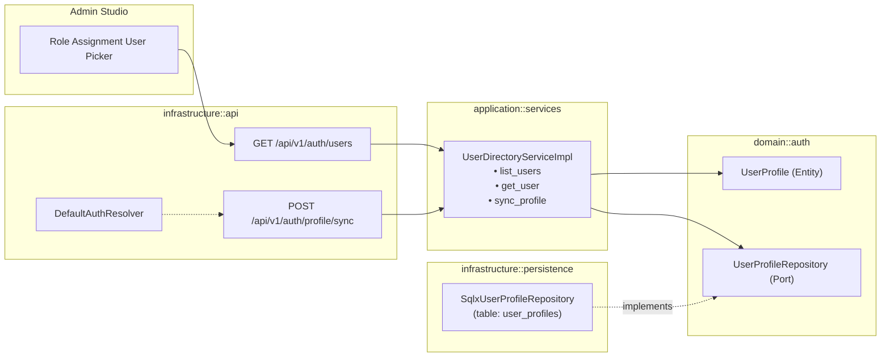

# ADR-006: User Profile and Directory Architecture for External Identity Management

- **Status**: Accepted
- **Date**: 2026-10-28 (proposed) · 2026-10-28 (accepted)
- **Deciders**: Dmitri Astafiev
- **Governing decisions**: [`ADR-002`](./ADR-002-hexagonal-architecture.md), [`ADR-003`](./ADR-003-aws-dsql-database.md)
- **Related docs**: [`docs/architecture.md`](../architecture.md), [`docs/api.md`](../api.md)

---

## Context

Luminair delegates user authentication and credential storage to external OpenID Connect (OIDC) Identity Providers (IdPs), such as Keycloak, AWS Cognito, Dex, or Okta.

Per OIDC Core 1.0 §2, Identity Providers issue a **Subject Identifier (`sub`)** representing the end-user. The `sub` value is an immutable, locally unique, never-reassigned identifier (typically a UUID in Keycloak and AWS Cognito, or an internal account number in Google OIDC). Alongside `sub`, IdPs transmit mutable user claims, including `email`, `name` (display name), and `preferred_username`.

### The Problem

1. **Missing Domain Entity & User Directory**:
   In `domain::auth`, the model currently defines [`UserId`](../../domain/src/auth/user.rs), [`UserRoleAssignment`](../../domain/src/auth/role.rs), and [`AccessRequest`](../../domain/src/auth/access_request.rs), but **no user entity or profile concept**. When an administrator manages users in the Admin Studio (e.g. assigning roles or reviewing access requests), they cannot be expected to recognize or type raw OIDC `sub` UUIDs (`f47ac10b-58cc-4372-a567-0e02b2c3d479`). The UI requires a **Role-Assignment User Picker** and searchable **User Directory** displaying human-friendly names and emails.
2. **Layer Boundary Violation (Issue 2)**:
   The early prototype introduced an internal infrastructure trait `ShadowUserRecorder` and a table `shadow_users`. Because it was treated as an infrastructure seam rather than a domain port, it returned `domain::errors::DomainError`, violating Hexagonal boundaries and the Anti-Corruption Layer (ACL).
3. **Hot-Path Write Amplification on Aurora DSQL**:
   The initial implementation called `record_user_seen` on **every incoming HTTP request**, executing `INSERT ... ON CONFLICT (user_id) DO UPDATE SET last_seen = ...`. In AWS Aurora DSQL (ADR-003), running concurrent row mutations for the same user across parallel read requests (`GET /api/v1/content/...`) causes severe write amplification and Optimistic Concurrency Control (OCC `40001` serialization failure) lock contention.
4. **IdP Attribute Mutation (Email / Name Drift)**:
   While `sub` is permanently immutable, human attributes (`email`, `name`) can and do change in external IdPs (e.g., employee legal name changes, company domain rebranding from `@old.com` to `@new.com`, or typo corrections). The system must keep local display metadata synchronized without breaking existing role assignments or historical document audit trails.

---

## Considered Alternatives

### Alternative 1: Pure Infrastructure "Shadow User" Cache (Status Quo with Error Fix)

Keep `ShadowUserRecorder` and `shadow_users` confined strictly to the `infrastructure::auth` module, changing its return type from `DomainError` to `PersistenceError`.

- ❌ **No Domain Model for User Management**: Leaves the User Directory and role-assignment picker completely unmodeled in the domain and application layers.
- ❌ **No Search / Read API**: The table remains an unread write-only sink.
- ❌ **Persistent Hot-Path Contention**: Continues executing database writes on every read request.

### Alternative 2: Synchronous Real-Time Querying of External IdP Admin APIs

Do not store local user profiles. Whenever the Admin Studio picker needs to search users, query the external IdP directly via its administration API (e.g. Keycloak Admin REST API or AWS Cognito `ListUsers` SDK).

- ❌ **Breaks IdP Portability**: Every IdP exposes a radically different administration API; Dex (our lightweight local development IdP) has no user search API at all.
- ❌ **Tight Coupling & Latency**: Every user search in Admin Studio triggers external HTTP requests to the IdP, introducing network latency, failure points, and rate-limiting risks.
- ❌ **Security Overhead**: Requires granting the Luminair server high-privilege administrative service credentials in the external IdP.

### Alternative 3: Domain `UserProfile` Entity, Repository Port, and `UserDirectoryService` (Selected)

Promote local user identity information into a first-class domain concept named **`UserProfile`**, managed by an application service **`UserDirectoryService`**, backed by a dedicated port **`UserProfileRepository`**, and exposed via an authenticated REST endpoint for the Admin Studio picker.

- ✅ **Ubiquitous Language**: Aligns with DDD; `UserProfile` represents the local identity projection of an authenticated human user.
- ✅ **First-Class User Directory & Role-Assignment Picker**: Provides fast, indexed, paginated search by name and email for Admin Studio workflows.
- ✅ **Clean Hexagonal Architecture**: `UserProfileRepository` lives in `domain::auth::ports` and legitimately returns `DomainError`.
- ✅ **Immutable Identity Anchoring**: All role assignments, access requests, and document audit records (`created_by`, `published_by`) anchor permanently to `user_id` (`sub`). If a user's email or name changes in the IdP, only `UserProfile` updates—no foreign keys or audit logs are broken.
- ✅ **Decoupled Write Path**: Separates user profile synchronization from high-frequency read requests, eliminating Aurora DSQL OCC write contention.

---

## Decision

We adopt **Alternative 3**. We introduce the `UserProfile` domain entity, `UserProfileRepository` port trait, `UserDirectoryService` application service, and a transition from `shadow_users` to `user_profiles`.

### 1. Domain Model (`domain::auth::profile`)

```rust
// domain/src/auth/profile.rs

use chrono::{DateTime, Utc};
use crate::auth::user::UserId;
use crate::common::{DisplayName, Email};

/// Local identity profile representing an authenticated external user.
#[derive(Debug, Clone, PartialEq, Eq)]
pub struct UserProfile {
    /// Immutable Subject Identifier (`sub`) issued by the external IdP.
    pub user_id: UserId,
    /// Current verified email address.
    pub email: Option<Email>,
    /// Current display name.
    pub name: Option<DisplayName>,
    /// Timestamp when this identity was first encountered.
    pub first_seen_at: DateTime<Utc>,
    /// Timestamp of the most recent recorded authentication or activity.
    pub last_seen_at: DateTime<Utc>,
}

impl UserProfile {
    /// Constructs a new user profile upon first login.
    #[must_use]
    pub fn new(
        user_id: UserId,
        email: Option<Email>,
        name: Option<DisplayName>,
        now: DateTime<Utc>,
    ) -> Self {
        Self {
            user_id,
            email,
            name,
            first_seen_at: now,
            last_seen_at: now,
        }
    }

    /// Reconstitutes an existing user profile from persistent storage.
    #[must_use]
    pub fn reconstitute(
        user_id: UserId,
        email: Option<Email>,
        name: Option<DisplayName>,
        first_seen_at: DateTime<Utc>,
        last_seen_at: DateTime<Utc>,
    ) -> Self {
        Self {
            user_id,
            email,
            name,
            first_seen_at,
            last_seen_at,
        }
    }

    /// Updates profile metadata from incoming IdP claims, returning `true` if attributes changed.
    pub fn sync_claims(
        &mut self,
        email: Option<Email>,
        name: Option<DisplayName>,
        now: DateTime<Utc>,
    ) -> bool {
        let changed = self.email != email || self.name != name;
        if changed {
            self.email = email;
            self.name = name;
        }
        self.last_seen_at = now;
        changed
    }
}
```

### 2. Domain Repository Port (`domain::auth::ports`)

```rust
// In domain/src/auth/ports.rs

pub trait UserProfileRepository: Send + Sync {
    /// Fetches a profile by the immutable user identifier.
    fn find_by_id(
        &self,
        user_id: &UserId,
    ) -> impl Future<Output = Result<Option<UserProfile>, DomainError>> + Send;

    /// Batch-fetches profiles by user identifiers (for UI tables and audit lookups).
    fn find_by_ids(
        &self,
        user_ids: &[UserId],
    ) -> impl Future<Output = Result<Vec<UserProfile>, DomainError>> + Send;

    /// Searches and lists user profiles matching an optional text query (name or email prefix).
    fn list_users(
        &self,
        query: Option<&str>,
        pagination: Pagination,
    ) -> impl Future<Output = Result<Page<UserProfile>, DomainError>> + Send;

    /// Persists a new or updated user profile.
    fn save(
        &self,
        profile: &UserProfile,
    ) -> impl Future<Output = Result<(), DomainError>> + Send;
}
```

### 3. Application Service (`application::services::user_directory`)

```rust
// application/src/services/user_directory.rs

pub trait UserDirectoryService: Send + Sync + 'static {
    /// Lists user profiles for admin pickers, requiring `Permission::ManageUsers`.
    fn list_users(
        &self,
        caller: &CallerContext,
        query: Option<String>,
        pagination: Pagination,
    ) -> impl Future<Output = Result<Page<UserProfile>, ApplicationError>> + Send;

    /// Looks up a single user profile by identifier.
    fn get_user(
        &self,
        caller: &CallerContext,
        user_id: &UserId,
    ) -> impl Future<Output = Result<Option<UserProfile>, ApplicationError>> + Send;

    /// Synchronizes external IdP claims into local storage without requiring caller permissions.
    fn sync_profile(
        &self,
        user_id: UserId,
        email: Option<Email>,
        name: Option<DisplayName>,
    ) -> impl Future<Output = Result<UserProfile, ApplicationError>> + Send;
}
```

### 4. Write Lifecycle & Aurora DSQL OCC Mitigation

To eliminate write amplification on `GET /api/v1/content/...` endpoints:
1. **No Writes on Ordinary Read Requests**: Ordinary content queries (`GET /api/v1/content/{type}`) perform **zero writes** to `user_profiles`.
2. **Explicit Session Sync**: The Admin Studio SPA calls `POST /api/v1/auth/profile/sync` once upon SPA bootstrap / login after verifying its OIDC tokens.
3. **Onboarding Integration**: When a user submits an access request (`POST /api/v1/auth/access-requests`), their `UserProfile` is registered or synchronized atomically.
4. **Non-Fatal Tracing**: If profile synchronization fails in background or middleware paths, it logs structured warnings via `tracing::warn!` without aborting the user's HTTP request.

### 5. Persistence Schema & Migration

Replace the legacy `shadow_users` table with `user_profiles`:

```sql
CREATE TABLE IF NOT EXISTS user_profiles (
    user_id       VARCHAR(255) PRIMARY KEY,
    email         VARCHAR(320),
    name          VARCHAR(255),
    first_seen_at TIMESTAMPTZ NOT NULL,
    last_seen_at  TIMESTAMPTZ NOT NULL
);

-- Fast case-insensitive prefix search for role-assignment picker
CREATE INDEX IF NOT EXISTS idx_user_profiles_search
    ON user_profiles (email, name);
```

### 6. HTTP API Driving Adapter

Add endpoint conforming to [`docs/api.md`](../api.md):

* `GET /api/v1/auth/users?search=john&page=1&pageSize=25` (Requires `ManageUsers` permission; returns `PagedJson<UserProfileDto>`).
* `POST /api/v1/auth/profile/sync` (Authenticated endpoint for current user session sync).

---

## Architecture Diagram



---

## Consequences

### Positive
- **Human-Friendly Administration**: The Admin Studio role-assignment picker and access-request tables can search and display user names and emails cleanly.
- **Strict Hexagonal Purity**: `UserProfileRepository` is a domain port returning `DomainError`; internal infrastructure hacks returning domain errors are eliminated.
- **IdP Mutation Safety**: External email or name modifications in Keycloak/Cognito update local presentation fields without altering immutable `user_id` foreign keys or breaking document audit histories.
- **Database Scalability**: Eliminates the hot-path `INSERT ... ON CONFLICT` on every incoming API request, protecting Aurora DSQL from OCC transaction serialization failures.

### Negative / Trade-offs
- **Additional Service & Table**: Introduces one new domain entity, port, application service, and table (`user_profiles`).
- **Sync Coordination**: The frontend Admin Studio SPA should trigger session sync on initial load to ensure metadata remains fresh.
