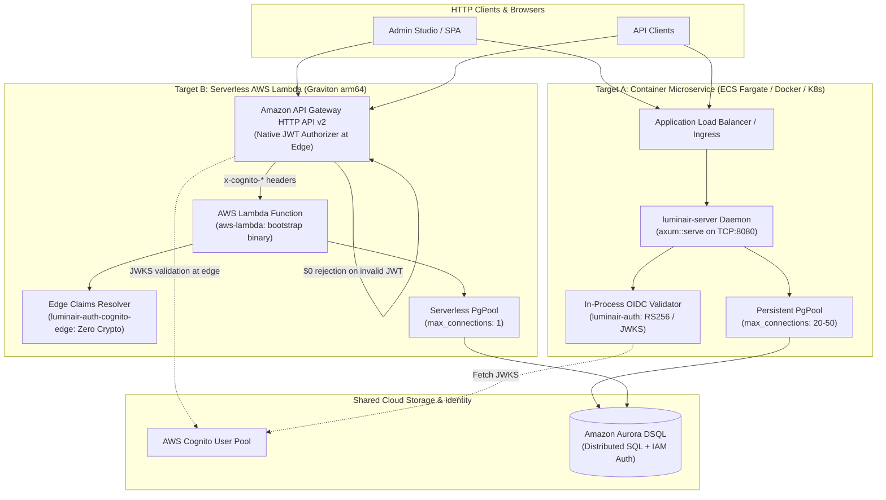

# Architecture

## Overview

Luminair backend follows **Hexagonal Architecture** (Ports & Adapters) combined with **Domain-Driven Design (DDD)**.
The codebase is structured as a modular Cargo workspace organized into core logic, granular adapter libraries, and dedicated execution entrypoints:

```text
luminair-system/
├── Cargo.toml                              # Workspace root manifest
├── domain/                                 # Pure business logic — no I/O, no frameworks
├── application/                            # Pure use-cases / orchestration
│
├── infrastructure/                         # Adapter layer (focused library crates)
│   ├── schema-loader/                      # Schema disk walker, validation & SystemContext assembly
│   ├── persistence/                        # Database adapters, SeaQuery, SQLx, DSQL connection factory
│   ├── auth/                               # In-process OIDC validator, JWKS client & Service Tokens
│   ├── auth-cognito-edge/                  # Edge-authenticated claims resolver (zero cryptography)
│   └── http/                               # Axum router, REST routes, handlers, DTO codecs, ProblemDetails
│
└── bootstrap/                              # Platform execution entrypoints (binaries)
    ├── aws-lambda/                         # AWS Lambda custom runtime (`bootstrap` binary)
    ├── luminair-server/                    # Long-running HTTP service daemon (`luminair-server` binary)
    └── luminair-cli/                       # Administrative & migration CLI (`luminair-cli` binary)
```

---

## Crate Responsibilities & Workspace Layout

### 1. Pure Core Crates

#### `domain`
- **Contains**: Entities, value objects, aggregates, domain events, repository *traits* (ports), domain errors, structured into 5 DDD subdomains:
  - `auth`: Identity & Access Management (`UserId`, `ActorId`, `UserProfile`, `UserRoleAssignment`, `AccessRequest`, `Role`, `Permission`).
  - `schema`: Schema Metadata & Type System (`DocumentType`, `FieldDefinition`, `RelationDefinition`, `DocumentKind::Singleton`, `DocumentKind::Collection`).
  - `content`: Content Lifecycle & Storage (`DocumentInstance`, `DocumentDraft`, `DocumentSnapshot`, `ContentValue`, `PublicationState`).
  - `system`: System Configuration & Localization (`SystemConfig`, `Locale`, `SystemContext`).
  - `common`: Ubiquitous Value Objects (`Slug`, `DisplayName`, `Email`, `Pagination`).
- **Must NOT depend on**: `application`, `infrastructure/*`, `bootstrap/*`, or any I/O framework (`tokio`, `sqlx`, `axum`).
- **Allowed dependencies**: `serde` (serialization traits only), `thiserror`, `uuid`, `chrono`, `nutype`, `email_address`, `url`, `indexmap`, `rust_decimal`.

#### `application`
- **Contains**: Use-case structs, application services, command/query handlers, application errors, and service ports:
  - `services`: `DocumentsServiceImpl`, `AccessRequestsServiceImpl`, `UserDirectoryServiceImpl`, `SchemaServiceImpl`, `SystemConfigServiceImpl`.
  - `context`: `CallerContext` holding validated caller identity, active role assignments, and permissions.
- **Depends on**: `domain` only.
- **Must NOT depend on**: Any adapter crate, `sqlx`, `axum`, `lambda_http`, or network I/O.

---

### 2. Granular Infrastructure Adapter Crates (`infrastructure/*`)

To ensure minimal compile times, zero extraneous dependencies, and strict attack surface reduction across diverse deployment targets, the infrastructure layer is decomposed into single-responsibility adapter crates:

#### `infrastructure/schema-loader` (`luminair-schema-loader`)
- **Responsibility**: Discovers, validates, and parses schema JSON definitions from disk (`system-config.json` and `document-types/*.json`).
- **Produces**: Borrowed zero-copy DTOs, cross-schema graph validation, and the immutable `&'static SystemContext`.
- **Dependencies**: `domain`, `serde`, `serde_json`, `indexmap`, `thiserror`. (Zero database, zero web framework, zero Lambda dependencies).

#### `infrastructure/persistence` (`luminair-persistence`)
- **Responsibility**: Database connectivity, query generation, schema synchronization, and repository implementations.
- **Components**:
  - `connection`: PostgreSQL and Amazon Aurora DSQL connection factory with dynamic IAM SigV4 token refresh (`DsqlTokenProvider`, `AwsSdkDsqlTokenProvider`), lifecycle tuning (`max_lifetime <= 10m`), and serverless pool sizing safeguards (`max_connections = 1..2`).
  - `naming`: Zero-allocation precomputed SQL identifier and junction table mapping (`SchemaNaming`).
  - `migration`: Static SQLx migrations (`-- no-transaction` for Aurora DSQL) and dynamic schema synchronizer (introspector, diff, topological planner, DDL generator).
  - `query`: Modular `sea-query` builders for wide tables, drafts, snapshots, junction links, and auth tables with automatic OCC retry loops on SQLSTATE `40001`.
  - `repositories`: `SqlxDocumentInstanceRepository`, `SqlxDocumentSnapshotRepository`, `SqlxRoleRepository`, `SqlxUserRoleAssignmentRepository`, `SqlxAccessRequestRepository`, `SqlxUserProfileRepository`.
- **Dependencies**: `domain`, `application`, `luminair-schema-loader`, `sqlx`, `sea-query`, `tokio`, `uuid`, `chrono`, `rust_decimal`, `tracing`.

#### `infrastructure/auth` (`luminair-auth`)
- **Responsibility**: In-process JWT validation, OIDC JWKS caching, and machine-to-machine service tokens.
- **Components**:
  - `oidc`: `OidcTokenValidator` performing in-process RS256/ES256 signature verification and claim extraction using public keys fetched from external OIDC Identity Providers (AWS Cognito, Keycloak, Dex).
  - `service_tokens`: `ServiceTokenRegistry` managing static machine-to-machine API tokens.
  - `resolver`: `SqlxAuthResolver` implementing `AuthContextResolver` by validating tokens in-process, caching caller roles, and managing user directory profile records.
- **Dependencies**: `domain`, `application`, `luminair-persistence`, `jsonwebtoken`, `reqwest`, `serde`, `thiserror`, `tracing`. (Used exclusively by long-running microservice daemons).

#### `infrastructure/auth-cognito-edge` (`luminair-auth-cognito-edge`)
- **Responsibility**: Edge-authenticated identity resolution with **zero cryptography and zero outbound network calls**.
- **Components**:
  - `CognitoEdgeAuthResolver`: Extracts verified identity claims (`sub`, `email`, `name`) forwarded in trusted HTTP headers by Amazon API Gateway HTTP API (v2) JWT Authorizers.
  - Adheres strictly to [`ADR-006`](./adr/ADR-006-user-profile-and-directory-architecture.md): strictly read-only role and onboarding resolution, eliminating OCC write contention on Aurora DSQL.
- **Dependencies**: `domain`, `application`, `luminair-persistence`, `thiserror`, `tracing`. (Pulls in zero RSA/cryptographic libraries and zero HTTP client dependencies).

#### `infrastructure/http` (`luminair-http`)
- **Responsibility**: Driving HTTP adapter providing REST routing, extractors, codecs, envelopes, and composition root wiring.
- **Components**:
  - `container`: Monomorphized composition root `AppContainer<Auth: AuthContextResolver>` assembling services and database repositories.
  - `state`: Generic `HttpState<D, A, S, C, H, Auth>` and segregated `Has*` state traits.
  - `auth`: Transport-agnostic `AuthCredentials<'a>` enum (`BearerToken(&str)` vs `EdgeCognito { user_id, email, name }`) and `AuthContextResolver` port trait utilizing modern Rust Return-Position Impl Trait in Trait (RPITIT).
  - `extractors`: Type-safe request extractors including `Caller`, `OnboardingUser`, `PaginationQuery`, and query parameter filters.
  - `routes` & `handlers`: REST API endpoints (25 route paths across 21 operations) with RFC 9457 `ProblemDetails` error formatting.
- **Dependencies**: `domain`, `application`, `luminair-schema-loader`, `luminair-persistence`, `axum`, `serde`, `serde_json`, `thiserror`, `tracing`.

---

### 3. Dedicated Platform Bootstrap Crates (`bootstrap/*`)

Execution entrypoints are strictly isolated into standalone binary crates:

#### `bootstrap/luminair-cli` (`luminair-cli`)
- **Target**: Standalone command-line executable for DevOps pipelines and pre-deployment automation.
- **Modes**:
  - `validate`: Deterministic offline schema and configuration validation.
  - `dry-run`: Live database introspection and schema diff inspection (emits planned DDL SQL without mutating the database).
  - `migrate`: Runs static system migrations and executes dynamic schema migrations safely against Aurora DSQL or PostgreSQL.
- **Zero Web Dependencies**: Contains zero references to `axum`, `reqwest`, `jsonwebtoken`, or `lambda_http`.

#### `bootstrap/luminair-server` (`luminair-server`)
- **Target**: High-throughput container microservice daemon running on Amazon ECS Fargate, EKS, Docker, or EC2.
- **Runtime**: Binds a persistent TCP socket via `tokio::net::TcpListener`, serves requests using `axum::serve`, and listens for POSIX signals (`SIGINT`, `SIGTERM`) for zero-downtime graceful shutdown.
- **Authentication**: Wires `SqlxAuthResolver` with in-process OIDC JWT verification and service token registry.
- **Database Pooling**: Standard persistent connection pool (`max_connections = 20..50`).

#### `bootstrap/aws-lambda` (`aws-lambda`)
- **Target**: Serverless event-driven execution on AWS Lambda (`provided.al2023`, `arm64` Graviton).
- **Runtime**: Runs the `bootstrap` binary using `lambda_http` behind Amazon API Gateway HTTP API (v2).
- **Authentication**: Wires `CognitoEdgeAuthResolver` to ingest edge-verified claims, saving 5–15ms of billable execution duration per request and eliminating in-process cryptographic overhead.
- **Database Pooling**: Serverless-tuned connection pool (`max_connections = 1`, max 2) with dynamic IAM token rotation.

---

## Dependency Rule & Architectural Boundaries

```text
       bootstrap/aws-lambda     bootstrap/luminair-server     bootstrap/luminair-cli
                 │                           │                         │
                 ▼                           ▼                         │
          luminair-http               luminair-http                    │
                 │   \                      /   │                      │
                 │    ▼                    ▼    │                      │
                 │  luminair-auth-cognito-edge  │                      │
                 │  luminair-auth               │                      │
                 ▼         /                  \ ▼                      │
           luminair-persistence ◄──────────────────────────────────────┤
                 │                                                     │
                 ▼                                                     ▼
           luminair-schema-loader ◄────────────────────────────────────┘
                 │
                 ▼
            application
                 │
                 ▼
               domain
```

### Architectural Guardrails
1. **Core Independence**: `domain` and `application` are strictly independent of I/O, database frameworks, web frameworks, and AWS SDKs.
2. **Adapter Segregation**: Driving adapters (`luminair-http`) depend only on ports and shared abstractions. Persistence adapters (`luminair-persistence`) implement domain repository traits.
3. **Binary Isolation**: Platform entrypoints (`bootstrap/*`) compose only the specific adapters required for their execution environment, keeping binary sizes minimal and attack surfaces tightly bounded.

---

## Dual Deployment Targets

Luminair natively supports two first-class cloud deployment targets from a single unified codebase:



### Target Comparison

| Architectural Dimension | Container Microservice (`luminair-server`) | Serverless AWS Lambda (`aws-lambda`) |
|---|---|---|
| **Binary Entry Point** | `bootstrap/luminair-server` | `bootstrap/aws-lambda` (`bootstrap`) |
| **Execution Model** | Long-running daemon (`tokio` + `axum::serve`) | Event-driven invocations (`lambda_http::run`) |
| **Infrastructure** | Amazon ECS Fargate, EKS, Docker, EC2 | AWS Lambda (`provided.al2023`, `arm64` Graviton) |
| **Gateway / Ingress** | Application Load Balancer, NGINX, Envoy | Amazon API Gateway HTTP API (v2) |
| **Authentication Adapter** | `luminair-auth` (`SqlxAuthResolver`) | `luminair-auth-cognito-edge` (`CognitoEdgeAuthResolver`) |
| **JWT Verification** | In-process RS256 cryptography & JWKS caching | AWS network edge via API Gateway v2 JWT Authorizer |
| **Unauthenticated Requests** | Processed by Axum runtime | Rejected at API Gateway edge (**$0 Lambda cost**) |
| **Connection Pool Sizing** | `max_connections = 20..50` | `max_connections = 1` (clamped to max 2) |
| **Schema Discovery** | Mounted disk path or container directory | Bundled artifact (`/var/task/schemas`) |
| **Migration Execution** | Auto-migrate opt-in or dedicated CLI task | **Hard-disabled**; run via `luminair-cli` in CI/CD |

---

## Decoupled Authentication Architecture

### 1. Transport-Agnostic Credentials (`AuthCredentials`)

To decouple HTTP transport mechanics from identity resolution, the driving HTTP adapter defines `AuthCredentials`:

```rust
pub enum AuthCredentials<'a> {
    /// In-process token validation (Bearer JWT or Service Token)
    BearerToken(&'a str),
    /// Verified edge claims injected by API Gateway
    EdgeCognito {
        user_id: &'a str,
        email: Option<&'a str>,
        name: Option<&'a str>,
    },
}
```

### 2. AWS Network Edge Authentication & Parameter Mappings

When deployed on AWS Lambda behind Amazon API Gateway HTTP API (v2):
1. **Edge Validation**: API Gateway intercepts incoming requests and verifies the `Authorization: Bearer <JWT>` header against the AWS Cognito User Pool issuer and audience.
2. **Zero-Cost Defense**: Malformed, expired, or invalid tokens are rejected immediately at the AWS network edge. Lambda is never invoked, completely eliminating compute and invocation costs.
3. **Spoof-Proof Parameter Mappings**: API Gateway overwrites client-supplied headers with verified claims:
   - `x-cognito-sub` $\leftarrow$ `$context.authorizer.jwt.claims.sub`
   - `x-cognito-email` $\leftarrow$ `$context.authorizer.jwt.claims.email`
   - `x-cognito-name` $\leftarrow$ `$context.authorizer.jwt.claims.name`
   Any malicious spoofing attempt by a caller sending fabricated `x-cognito-*` headers is overwritten at the edge.

### 3. Zero-Cryptography Edge Resolver (`CognitoEdgeAuthResolver`)

Inside the Lambda function, `CognitoEdgeAuthResolver` parses the injected headers directly into domain identifiers:
- **No RSA Computations**: Eliminates `jsonwebtoken` RSA mathematical checks, saving 5–15ms of CPU execution time per request.
- **No Outbound Network Calls**: Eliminates external JWKS endpoint queries and cache invalidation logic on cold starts.
- **ADR-006 Conformance**: The resolver performs strictly read-only queries against `user_role_assignments` and `access_requests`. It executes **zero writes** during authentication, preventing OCC (`40001`) serialization conflicts on Amazon Aurora DSQL.

---

## Monomorphized Composition Root with RPITIT

To achieve zero runtime dispatch overhead and avoid dynamic heap allocation (`Box<dyn ...>`), Luminair utilizes modern Rust Return-Position Impl Trait in Trait (RPITIT):

```rust
pub trait AuthContextResolver: Send + Sync + 'static {
    fn resolve_user_identity(
        &self,
        credentials: AuthCredentials<'_>,
    ) -> impl Future<Output = Result<AuthenticatedUser, AuthResolutionError>> + Send;

    fn resolve_caller(
        &self,
        credentials: AuthCredentials<'_>,
    ) -> impl Future<Output = Result<CallerContext, AuthResolutionError>> + Send;
}
```

The composition root `AppContainer<Auth>` and web state `HttpState` are generic over `Auth: AuthContextResolver`:

```rust
pub struct AppContainer<Auth> {
    pub context: &'static SystemContext,
    pub auth_resolver: Arc<Auth>,
    pub documents_service: Arc<DocumentsServiceImpl<...>>,
    pub access_requests_service: Arc<AccessRequestsServiceImpl<...>>,
    pub user_directory_service: Arc<UserDirectoryServiceImpl<...>>,
    pub schema_service: Arc<SchemaServiceImpl>,
    pub system_config_service: Arc<SystemConfigServiceImpl>,
    pub health_checker: Arc<SqlxHealthChecker>,
}
```

- In `luminair-server`, `AppContainer` monomorphizes with `SqlxAuthResolver`.
- In `aws-lambda`, `AppContainer` monomorphizes with `CognitoEdgeAuthResolver`.
- All use-case calls, future polls, and handler dispatches compile to direct static calls with zero heap-allocated vtables.

---

## Amazon Aurora DSQL Integration & Serverless Sizing

Amazon Aurora DSQL is a distributed, serverless, Active-Active relational database engine with specific architectural requirements:

### 1. Dynamic IAM Token Refresh
Aurora DSQL authentication tokens are short-lived IAM credentials valid for 15 minutes.
- The `DsqlTokenProvider` and `AwsSdkDsqlTokenProvider` automatically refresh IAM credentials asynchronously.
- The SQLx connection pool sets `max_lifetime = Duration::from_secs(600)` (10 minutes) and `idle_timeout = Duration::from_secs(300)` (5 minutes). This guarantees connections are recycled before IAM tokens expire.

### 2. Serverless Connection Pool Sizing
In serverless environments (AWS Lambda), hundreds or thousands of execution sandboxes can scale concurrently. If each sandbox allocates a traditional connection pool (e.g., 20 connections), the database connection capacity will be instantly saturated.
- When running in AWS Lambda (detected via `AWS_LAMBDA_FUNCTION_NAME` or explicit configuration), `create_connection_pool` enforces `max_connections = 1` (clamped to an absolute maximum of 2).
- Single-connection pools prevent connection pool starvation across horizontally scaled Lambda instances.

### 3. Client-Side UUIDv7 & OCC Retry Loop
- Primary keys are generated as UUIDv7 on the client before issuing `INSERT` statements to eliminate distributed lock contention.
- Relational updates and draft mutations run within `with_occ_retry` loops, handling SQLSTATE `40001` serialization failures with randomized exponential backoff and jitter.

---

## Project-Agnostic Schema Bundling Strategy

Luminair acts as a reusable, project-agnostic CMS engine. Custom content models are declared strictly via declarative JSON schemas:
- **Directory Structure**:
  - `system-config.json`: System localization and default locale settings.
  - `document-types/*.json`: Declarative models for singletons and collection types.
- **Zero Rust Code Changes**: To introduce new content types or modify attributes, developers update JSON schemas without recompiling or altering the core Rust codebase.
- **Deployment Artifact Bundling**:
  - **AWS Lambda**: Schemas are packaged directly into the function artifact under `/var/task/schemas` (configured via `LUMINAIR_SCHEMA_DIR=/var/task/schemas`).
  - **Container**: Schemas are copied into the container image at `/app/schemas` or mounted via volume.
- **Cold-Start Precomputation**: During cold-start initialization, `load_system_context_from_dir` inspects the disk, validates schema relationships, and leaks the resulting `SystemContext` to obtain an immutable, zero-allocation `&'static SystemContext` that lives for the lifetime of the process or sandbox.

---

## Pre-Deployment Migration Strategy (`luminair-cli`)

Dynamic database schema migrations must **never** be executed during AWS Lambda cold starts or high-concurrency container autoscaling:
- Running migrations on cold starts creates distributed write races across concurrent Lambda sandboxes, triggers OCC conflicts, and adds hundreds of milliseconds to cold-start latency.
- **Deterministic Pipeline**: Migrations are strictly separated into pre-deployment CI/CD stages:
  1. **Validation**: `luminair-cli --mode validate` verifies schema JSON validity offline.
  2. **Dry-Run Inspection**: `luminair-cli --mode dry-run` introspects the target database, computes schema diffs, and prints the planned DDL statements without applying changes.
  3. **Execution**: `luminair-cli --mode migrate` executes static system migrations followed by dynamic schema synchronization using non-transactional DDL (`-- no-transaction`).
  4. **Deployment**: Traffic is shifted to updated `aws-lambda` functions or `luminair-server` containers only after migrations complete successfully.

---

## Content Persistence Pattern (ADR-004)

Luminair employs an **Asymmetric Hybrid Persistence Pattern** to balance public read performance with draft flexibility under AWS Aurora DSQL:

- **Per-Type Wide Relational Table (`[type]`)**: Contains only live published instances (and single-lifecycle types where `draft_and_publish: false`). Features typed columns, B-tree indexes, foreign keys, and `has_pending_draft BOOLEAN NOT NULL DEFAULT FALSE` to eliminate distributed cross-shard joins. Public visitor queries target this table directly.
- **Unified Draft Store (`document_drafts`)**: A single static system table holding in-progress content and relations as JSONB across all content types. Tracks `schema_version`, `status` (`draft`, `modified`, `unpublished`), and materialized `display_values` (`IndexMap<AttributeId, String>`) for rapid Admin table rendering.
- **Global Snapshot Store (`document_snapshots`)**: A single static append-only table recording immutable JSONB snapshots of superseded published revisions with zero OCC write contention. Unique constraint `UNIQUE (document_type_id, document_id, revision)` guarantees an unambiguous, collision-free history.
- **Relational Junction Tables (`[type]_[attr]_links`)**: Maintained strictly for published associations with foreign keys (`ON DELETE CASCADE`).
- **Composite Identity**: Schemas declare `display_fields: Vec<AttributeId>`, materialized at write-time into self-describing key-value maps (`display_values JSONB`) and a joined text fallback (`display_title`).
- **Lifecycle semantics**: See [`docs/content-lifecycle.md`](./content-lifecycle.md).

---

## Error Handling Architecture & HTTP Machinery

In alignment with Hexagonal Architecture and DDD boundaries:

1. **`domain`**: Defines `DomainError` capturing business rule and aggregate invariant violations. Strictly free of I/O, framework dependencies, or transport concepts.
2. **`application`**: Defines `ApplicationError` and machine-readable enum codes (e.g. `ConflictCode`). Transport-agnostic; communicates *why* a use case failed along with contextual metadata (`details: Option<Value>`).
3. **`infrastructure/http` (Driving Adapter)**: The HTTP web layer in `luminair_http::error` is the sole owner of transport concerns. It maps `ApplicationError` and `DomainError` into [RFC 9457](https://www.rfc-editor.org/rfc/rfc9457.html) Problem Details (`application/problem+json`), assigns HTTP status codes (`StatusCode::CONFLICT`, `NOT_FOUND`, etc.), and implements `axum::response::IntoResponse`.

---

## UI Layer (Admin Studio)

The UI layer is an independent **Decoupled Single-Page Application (SPA)** adhering strictly to Hexagonal Architecture boundaries:
- **Location**: Isolated `/frontend` directory in the repository (independent package management, zero impact on Cargo workspace).
- **Technology Stack**: React 19.3, TypeScript 7, Mantine v9 design system (`@mantine/*`), Zustand for global client state, TanStack Router for type-safe routing, and TanStack Query v5 for server state.
- **Dynamic Schema Forms**: Queries `/api/schema/document-types` at runtime to generate forms for all 12 field types, multi-locale editing tabs (`LocalizedText`), and relational association pickers (`HasOne` and `HasMany`).
- **Authentication**: OIDC Authorization Code Flow with PKCE (`oidc-client-ts`). Uses Dex for local development (~15MB RAM via Docker Compose) and AWS Cognito in production.
- **Deployment**: Static assets hosted on AWS S3 behind an Amazon CloudFront CDN distribution with Origin Access Control (OAC). CloudFront routes `/*` to S3 and `/api/*` to the backend, eliminating CORS preflight overhead in production.
- **Specification & Implementation Plan**: See [`docs/ui-architecture.md`](./ui-architecture.md) and [`docs/plan-ui.md`](./plan-ui.md).
