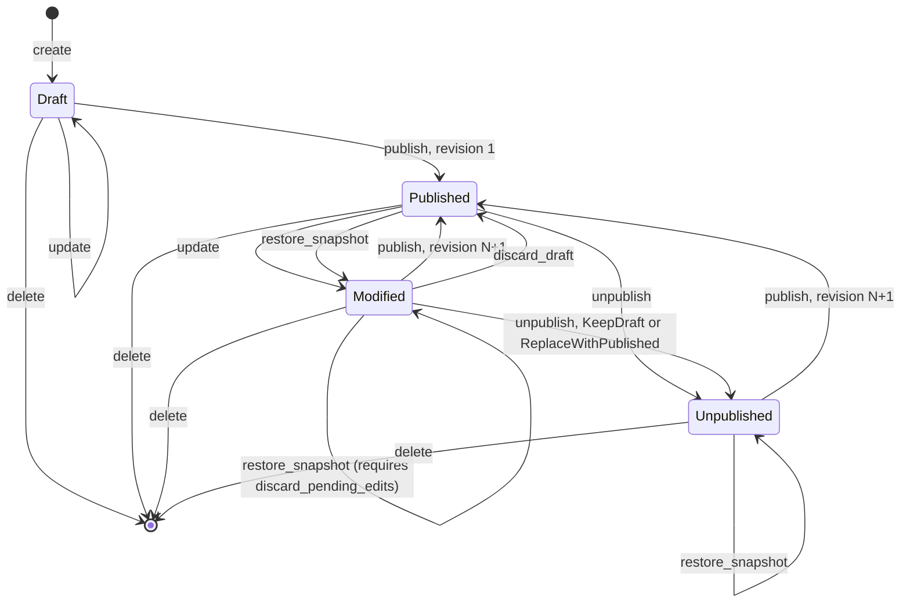
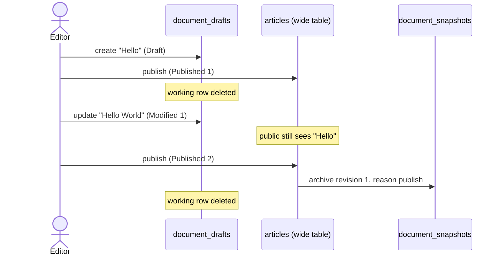
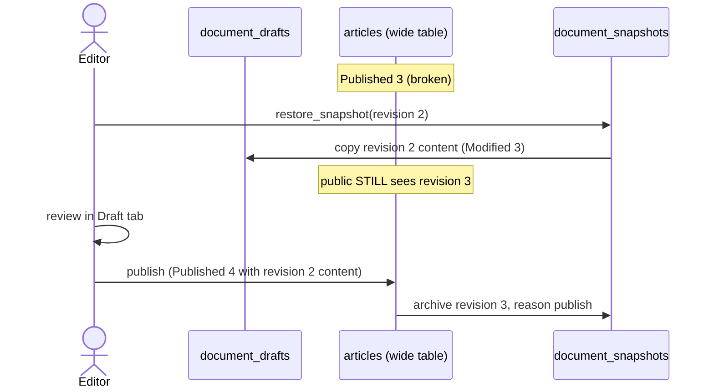
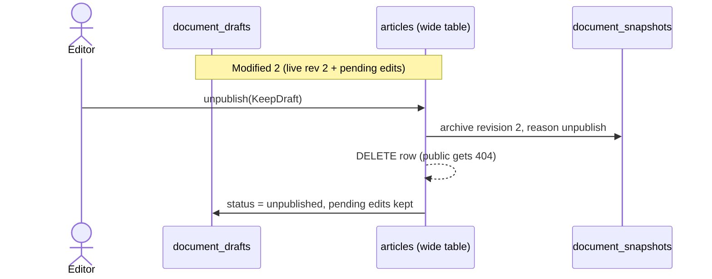
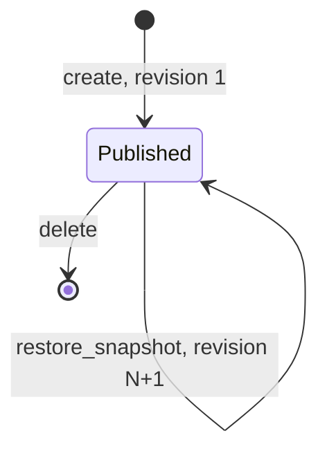

# Content Lifecycle: States, Actions & Snapshots

- **Audience**: New contributors, reviewers, and anyone who forgot how draft-and-publish works
- **Governing decisions**: [`ADR-004`](./adr/ADR-004-draft-and-publish-table-pattern.md), [`.ai/context/decisions.md`](../.ai/context/decisions.md) (2026-10-21, 2026-10-22)
- **Normative specs**: [`LC` — document-lifecycle](./specs/domain/document-lifecycle.md) (domain state machine), [`DS` — documents-service](./specs/application/documents-service.md) (use cases)
- **Code**: [`DocumentInstance`](../domain/src/content/instance.rs), [`PublicationState`](../domain/src/content/instance.rs), [`DocumentsServiceImpl`](../application/src/services/documents.rs)
- **Last reviewed**: 2026-10-22

> This document is explanatory. When it disagrees with a spec rule or the code, the **spec wins** (ADR-001). Report the mismatch and fix this document.

---

## 1. The Mental Model in One Minute

A document has **two independent "copies"** plus an **archive**:

| Where | What it holds | Who reads it |
|---|---|---|
| **Live copy**: wide table `[type]` (e.g. `articles`) | The version the public sees | Public API, Admin **Published** tab (`VersionView::Published`) |
| **Working copy**: `document_drafts` | The version editors are working on | Admin **Draft** tab (`VersionView::Working`); falls back to the live copy when no working copy exists |
| **Archive**: `document_snapshots` | Older versions that are **no longer** live (`reason IN ('publish', 'unpublish')`) | Admin **History** panel (`list_snapshots`, `restore_snapshot`) |

The four states only describe which of the two copies exist:

| State | Live copy? | Working copy? | In plain words |
|---|---|---|---|
| `Draft` | ❌ | ✅ (`status = 'draft'`) | Never published. Only editors see it. |
| `Published(N)` | ✅ revision `N` | ❌ | Live, no pending edits. Both tabs show the same content. |
| `Modified(N, V)` | ✅ revision `N` | ✅ (`status = 'modified'`) | Live, plus unpublished edits (draft version `V`). |
| `Unpublished(N)` | ❌ | ✅ (`status = 'unpublished'`) | Was live (last revision `N`), taken offline. Content kept for editors. |

The three main actions are **separate concerns**. Don't mix them up:

| Action | Question it answers | Changes public visibility? | Changes content? |
|---|---|---|---|
| `publish` | "Make my working copy live" | Yes (goes live or replaces live) | Live copy := working copy |
| `unpublish` | "Take it off the website" | Yes (goes offline, 404) | No (content kept, see `UnpublishDraftResolution`) |
| `restore_snapshot` | "Bring back an older version into my draft" | **No** | Working copy := historical snapshot |

> [!IMPORTANT]
> **`unpublish` is not a rollback.** To roll back the website to an older version: `restore_snapshot(R)` → review in the Draft tab → `publish`. The website stays online the whole time and keeps serving the current revision until you publish.

---

## 2. State Diagram (draft-and-publish types)

Applies to document types with `draft_and_publish: true` (the default).



**Transitions that do not exist** (they return an error):

| From | Action | Result | Rule |
|---|---|---|---|
| `Published` | `publish` | `ApplicationError::Conflict("... already published with no pending changes")`: nothing to publish | `DS-17` |
| `Draft` | `restore_snapshot` | `DomainError::InvalidStateTransition`: never published, has no snapshots | `LC-13` |
| `Modified` | `restore_snapshot` (without `discard_pending_edits: true`) | `ApplicationError::Conflict("restoring snapshot would overwrite pending working draft edits; confirm with discard_pending_edits: true")` | `DS-14` |
| `Draft`, `Unpublished` | `unpublish` | `DomainError::InvalidStateTransition`: not live | `LC-05`, `LC-06`, `DS-09` |
| `Draft`, `Published`, `Unpublished` | `discard_draft` | `DomainError::InvalidStateTransition`: only `Modified` has a working copy that can be discarded in favour of a live one | `LC-11` |

> [!NOTE]
> Why is `Published → publish` forbidden while the domain method `DocumentInstance::publish` still accepts `Published`? Single-lifecycle types (§5) use `DocumentInstance::publish` on every save to advance the live revision. The "nothing to publish" rule is a policy of the draft-and-publish **use case**, so it lives in `DocumentsServiceImpl::publish` (`DS-17`) and not in the aggregate (`LC-02` remains valid).

---

## 3. Full Transition Matrix (draft-and-publish types)

Legend: `N` = live revision, `V` = draft version (`audit.version` of the working copy), `R` = a historical revision being restored. "Public" = `VersionView::Published`, "Draft tab" = `VersionView::Working`.

| # | From | Action | To | Public sees | Draft tab sees | Snapshot written | `audit.version` |
|---|---|---|---|---|---|---|---|
| 1 | (none) | `create` | `Draft` | 404 | new content | none | `1` |
| 2 | `Draft` | `update` | `Draft` | 404 | edited content | none | `+1` |
| 3 | `Draft` | `publish` | `Published(1)` | revision 1 | revision 1 (fallback) | **none**: nothing was live before | `+1` |
| 4 | `Draft` | `unpublish` / `discard_draft` / `restore_snapshot` | error (`LC-05`, `LC-11`, `LC-13`) | n/a | n/a | none | unchanged |
| 5 | `Published(N)` | `update` | `Modified(N, V)` | revision `N` (unchanged) | edited content | none | `+1` |
| 6 | `Published(N)` | `restore_snapshot(R)` | `Modified(N, V)` | revision `N` (unchanged) | content of `R` | none (no pending edits to protect) | `+1` |
| 7 | `Published(N)` | `unpublish` | `Unpublished(N)` | 404 | revision `N` content | **`Unpublish`** (revision `N`) | `+1` |
| 8 | `Published(N)` | `publish` | **error** (`DS-17`) | revision `N` | revision `N` | none | unchanged |
| 9 | `Modified(N, V)` | `update` | `Modified(N, V+1)` | revision `N` | edited content | none | `+1` |
| 10 | `Modified(N, V)` | `publish` | `Published(N+1)` | new revision `N+1` | revision `N+1` (fallback) | **`Publish`** (old live revision `N`) | `+1` |
| 11 | `Modified(N, V)` | `discard_draft` | `Published(N)` | revision `N` | revision `N` (fallback) | none | back to the live copy's version |
| 12a | `Modified(N, V)` | `restore_snapshot(R)` without confirmation | **error** (`DS-14`) | revision `N` | edited content (unchanged) | none (requires `discard_pending_edits`) | unchanged |
| 12b | `Modified(N, V)` | `restore_snapshot(R)` with `discard_pending_edits` | `Modified(N, V+1)` | revision `N` | content of `R` | none (confirmed discard) | `+1` |
| 13 | `Modified(N, V)` | `unpublish` + `KeepDraft` (default) | `Unpublished(N)` | 404 | the pending edits | **`Unpublish`** (live revision `N`) | `+1` |
| 14 | `Modified(N, V)` | `unpublish` + `ReplaceWithPublished` | `Unpublished(N)` | 404 | revision `N` content (edits dropped) | **`Unpublish`** (live revision `N`) | `+1` |
| 15 | `Unpublished(N)` | `update` | `Unpublished(N)` | 404 | edited content | none | `+1` |
| 16 | `Unpublished(N)` | `restore_snapshot(R)` | `Unpublished(N)` | 404 | content of `R` | none | `+1` |
| 17 | `Unpublished(N)` | `publish` | `Published(N+1)` | revision `N+1` | revision `N+1` (fallback) | **none**: revision `N` was already archived at unpublish | `+1` |
| 18 | `Unpublished(N)` | `unpublish` / `discard_draft` | error | n/a | n/a | none | unchanged |
| 19 | any | `delete` | (gone) | 404 | 404 | none | n/a |

Rows `3`, `10`, `17` share one rule. **A snapshot is written only when a live revision leaves the wide table** (it is replaced by `publish` or removed by `unpublish`). The current live revision is never duplicated in `document_snapshots`, and checkpoints do not exist. `(document_type_id, document_id, revision)` is strictly unique across all snapshots.

---

## 4. Worked Scenarios

### 4.1 Normal editorial cycle



Result: the live copy holds revision 2 and the archive holds revision 1. Nothing is stored twice.

### 4.2 Rolling back the website to an older version (no downtime)

The question here is "revision 3 is broken, bring back revision 2".



Notes:
- Revisions only ever go **up**. A rollback creates a **new** revision (4) with old content. Nothing is rewritten, and history stays append-only.
- If the editor changes their mind after the restore, `discard_draft` returns to clean `Published(3)`.
- If the website has to go dark **immediately** while you investigate, that is a different need. Use `unpublish` (§4.3).

### 4.3 Taking a document offline

The need here is "legal asked us to remove this page now".



With `ReplaceWithPublished`, the working copy is overwritten with the live revision 2 content and the pending edits are dropped. Choose it when the pending edits were the problem. Re-publishing later creates revision 3.

### 4.4 Restoring while you have unsaved work (Conflict guard)

`restore_snapshot` on a `Modified` document guards against accidental data loss. If you have uncommitted draft edits in `document_drafts`, calling `restore_snapshot` without explicit confirmation returns:
```rust
ApplicationError::Conflict(
    "restoring snapshot would overwrite pending working draft edits; confirm with discard_pending_edits: true"
)
```
To proceed and overwrite the working draft, the caller must set `cmd.discard_pending_edits = true` via `RestoreSnapshotCommand::with_discard_pending_edits()`. No synthetic checkpoints are written to `document_snapshots`, ensuring `document_snapshots` remains an immutable, strictly unique archive of published revisions.

---

## 5. Single-Lifecycle Types (`draft_and_publish: false`)

Some types (settings, lookup tables) have no drafts. Every save goes live immediately, and `document_drafts` is never used.



| Action | Result | Snapshot written |
|---|---|---|
| `create` | `Published(1)` | none |
| `update` | `Published(N+1)` | **`Publish`** (previous revision `N`) |
| `restore_snapshot(R)` | `Published(N+1)` with content of `R` | **`Publish`** (previous revision `N`) |
| `publish` / `unpublish` | `ApplicationError::Conflict("does not support draft-and-publish")` | none (`DS-07`) |
| `discard_draft` | `DomainError::InvalidStateTransition` (no working copy) | none |

---

## 6. Snapshot Reasons Cheat Sheet

`document_snapshots` records only live revisions that leave the wide table. It has a strict database constraint `UNIQUE (document_type_id, document_id, revision)`.

| `reason` | Written by | Content captured | `revision` column means |
|---|---|---|---|
| `publish` | `publish` (rows 10), single-lifecycle `update` / `restore_snapshot` | The **old live** copy being replaced | The live revision that was replaced |
| `unpublish` | `unpublish` (rows 7, 13, 14) | The **live** copy being taken offline | The live revision that went offline |

---

## 7. Where Each Rule Lives

| Concern | Layer | Location |
|---|---|---|
| Allowed state transitions, revision numbering, audit touch | `domain` | [`DocumentInstance`](../domain/src/content/instance.rs): `publish`, `unpublish`, `edit_draft`, `discard_draft`, `restore_snapshot` (`LC-*`) |
| "Nothing to publish" guard (`DS-17`), draft-and-publish on/off, which snapshot to write, `UnpublishDraftResolution`, discard confirmation on restore (`DS-14`) | `application` | [`DocumentsServiceImpl`](../application/src/services/documents.rs) (`DS-*`) |
| Atomic multi-table writes (wide table + drafts + snapshots + links) | `infrastructure` | Repository adapters: see [`design-infrastructure-persistence.md`](./design-infrastructure-persistence.md) §4.3–4.5 |

---

## 8. Resolved Architecture Questions

1. **Q1 (Snapshot identity & checkpoints)**: **Resolved**. Checkpoints were eliminated. `document_snapshots` strictly archives live revisions leaving the wide table (`reason IN ('publish', 'unpublish')`). `(document_type_id, document_id, revision)` is an immutable unique key with zero collision risk.
2. **Q2 (Snapshots on `Draft`)**: **Resolved**. A document in `Draft` state has never been published and possesses no snapshots in `document_snapshots`. Calling `restore_snapshot` returns `DomainError::InvalidStateTransition` (`LC-13`). `PublicationState::Draft` is a unit variant.
3. **Q3 (Snapshot retention & deletion rollback)**: **Resolved in ADR-005**. Documents are deleted into a `document_tombstones` table (soft-delete with trash lifecycle). Revision snapshots in `document_snapshots` are preserved for audit and undelete rollback until an asynchronous vacuum retention purge cleans up expired tombstones. Hard erasure (GDPR) wipes wide table, drafts, tombstones, and snapshots in one atomic operation.
