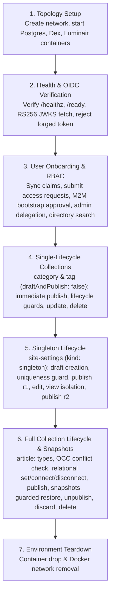

# End-to-End Component Testing with Testcontainers

Luminair includes a fully automated container-to-container end-to-end (E2E) component test suite ([`infrastructure/tests/e2e_service_test.rs`](../infrastructure/tests/e2e_service_test.rs)) powered by [`testcontainers`](https://docs.rs/testcontainers) (`0.28.0`), [`reqwest`](https://docs.rs/reqwest) (`0.13.5`), and [`assert-json-diff`](https://docs.rs/assert-json-diff) (`2.0.2`).

The suite tests the compiled production Docker image (`luminair-cli:local`) over real TCP sockets against a live PostgreSQL database and a real Dex OIDC identity provider.

---

## 1. Container Topology & Architecture

When a Docker daemon is available, `E2eEnvironment::start()` ([`infrastructure/tests/e2e_support/containers.rs`](../infrastructure/tests/e2e_support/containers.rs)) provisions an isolated Docker bridge network (`luminair-e2e-<uuid_v7>`) and orchestrates three containers:

```mermaid
flowchart LR
    subgraph Isolated Docker Network ["Isolated Docker Network: luminair-e2e-&lt;uuid&gt;"]
        direction TB
        PG["PostgreSQL 18<br/><code>postgres:18.6-alpine3.24</code><br/>port 5432"]
        DEX["Dex OIDC Provider<br/><code>ghcr.io/dexidp/dex:v2.43.0</code><br/>port 5556"]
        LUM["Luminair Service<br/><code>luminair-cli:local</code><br/><code>--mode serve --auto-migrate</code><br/>port 8080"]
        
        LUM -->|SQL Connections| PG
        LUM -->|Fetch RS256 JWKS Keys| DEX
    end

    TEST["Test Runner (Host)<br/><code>e2e_service_test.rs</code><br/><code>E2eClient</code>"]
    TEST -->|HTTP / API Requests| LUM
    TEST -->|Token Acquisition (Password Grant)| DEX
```

### Components

1. **PostgreSQL (`postgres:18.6-alpine3.24`)**:
   - Database service with dedicated user/database credentials.
   - Validated healthy via PostgreSQL port readiness check.
2. **Dex OIDC (`ghcr.io/dexidp/dex:v2.43.0`)**:
   - Live OpenID Connect provider mounted with [`config/dex.yaml`](../config/dex.yaml).
   - Provides pre-seeded users (`admin@luminair.dev`, `editor@luminair.dev`) and exposes RS256 JWKS public keys at `/dex/keys`.
   - Validated healthy via `GET /dex/healthz`.
3. **Luminair Service (`luminair-cli:local`)**:
   - Compiled container image running in `--mode serve --auto-migrate`.
   - Dynamic schema directory mounted from `config/`.
   - Configured with `LUMINAIR_OIDC_JWKS_URL=http://<dex_alias>:5556/dex/keys` for live cryptographic RS256 token verification.
   - Configured with bootstrap M2M token `LUMINAIR_SERVICE_TOKENS=local-dev-admin-token:ci-agent:admin`.
   - Validated healthy via `GET /ready`.

### Lifecycle & Cleanup

- **Dynamic Isolation**: Containers and network use unique UUID v7 identifiers to prevent port or name collisions during parallel or consecutive test runs.
- **Deterministic Teardown**: `E2eEnvironment` owns a trailing `DockerNetworkGuard`. Rust's struct drop order terminates and disconnects all containers before executing `docker network rm -f`.
- **Graceful Skip**: If Docker daemon is unavailable, tests log a notice and pass, ensuring offline `cargo test --workspace` runs succeed.

---

## 2. Test Execution Flow

The test suite executes sequentially against the running container topology, exercising complete domain and infrastructure workflows:



### Scenario Breakdown

| Stage | What It Tests | Key Assertions |
|---|---|---|
| **Health & OIDC** | Probes and cryptographic authentication | `GET /healthz` and `/ready` (`200 OK`); Dex token issue via password grant; forged JWT rejection (`401 unauthenticated`). |
| **User Onboarding** | Pre-onboarding guards, self-service onboarding, role assignment, directory search | Pre-onboarding call yields `403 access_not_requested`; profile sync (`/profile/sync`); access request yields `403 access_pending`; bootstrap approval via service token; delegated admin role assignment; `/api/v1/auth/users` query filtering. |
| **Single-Lifecycle Collections** | Non-draftable types (`draftAndPublish: false`) | Category & tag creation auto-publishes (`status: "published"`, `revision: 1`); `/publish` and `/unpublish` return `409 draft_and_publish_disabled`; update increments `audit.version`; deletion returns `204` then `404`. |
| **Singleton Lifecycle** | Singletons (`kind: "singleton"`, `draftAndPublish: true`) | Draft creation; duplicate creation yields `409 singleton_already_exists`; publish revision 1; dirty edit transitions to `modified`; `?view=published` vs `?view=working` isolation; publish revision 2. |
| **Full Collection Lifecycle & Relations** | Complex draftable types (`article`), schema types, relations, snapshots | All field types (`text`, `uid`, localized `en`/`uk`, `int32`, `decimal`, `json`); OCC guard (`409 version_mismatch`); relational mutations (`set`, `connect`, `disconnect`); `?populate=category,tags`; snapshot generation on publish; restore guarded against dirty edits (`409 draft_has_pending_edits`); forced restore (`discardPendingEdits: true`); `/discard-draft`; `/unpublish`; hard `DELETE`. |

---

## 3. Test Harness Architecture

The test harness is organized under [`infrastructure/tests/e2e_support/`](../infrastructure/tests/e2e_support/):

```
infrastructure/tests/
├── e2e_service_test.rs       # Main E2E test scenarios and assertions
└── e2e_support/
    ├── mod.rs                # Facade re-exporting harness components
    ├── containers.rs         # Docker network, image builds, and container lifecycle
    ├── client.rs             # E2eClient HTTP wrapper and Dex authentication
    └── assertions.rs         # RFC 9457 and JSON structural assertion helpers
```

- **`E2eEnvironment`** (`containers.rs`): Orchestrates container provisioning, health polling with backoff, container log dumping on failure, and automated network cleanup.
- **`E2eClient`** (`client.rs`): Handles HTTP communication via `reqwest`, automatic Dex password-grant token exchange, and bearer token injection.
- **Assertion Helpers** (`assertions.rs`): Provides `assert_problem_details` for RFC 9457 `application/problem+json` contract checks, `assert_json_include!` for structural JSON matching, and `extract_data_id`.

---

## 4. Running the Tests

### Prerequisites
- Docker daemon running locally.
- `luminair-cli:local` Docker image (built automatically on the first run).

### Execution Commands

**Bash / Zsh (Linux / macOS):**
```bash
# Run full E2E test suite (builds luminair-cli:local if missing or outdated):
cargo test -p infrastructure --test e2e_service_test -- --nocapture

# Fast iterative runs (skip image rebuild when only test code changed):
LUMINAIR_SKIP_DOCKER_BUILD=1 cargo test -p infrastructure --test e2e_service_test -- --nocapture
```

**PowerShell (Windows):**
```powershell
# Run full E2E test suite:
cargo test -p infrastructure --test e2e_service_test -- --nocapture

# Fast iterative runs:
$env:LUMINAIR_SKIP_DOCKER_BUILD="1"; cargo test -p infrastructure --test e2e_service_test -- --nocapture

# Reset build skip flag:
Remove-Item Env:LUMINAIR_SKIP_DOCKER_BUILD -ErrorAction SilentlyContinue
```
