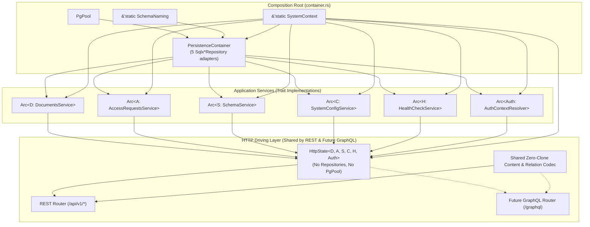

# Infrastructure API & Authentication Design

- **Target Modules**: `infrastructure::api`, `infrastructure::auth`, `infrastructure::health`, `infrastructure::container`
- **Canonical API Reference**: [`docs/api.md`](../api.md)
- **Governing RFCs**: [RFC 9457 (Problem Details for HTTP APIs)](https://www.rfc-editor.org/rfc/rfc9457.html)
- **Status**: Active Architecture Specification
- **Last Updated**: 2026-10-27

---

## 1. Driving Adapter Architecture & Generic `HttpState` Design

The `api` module is the HTTP driving adapter constructed with [Axum](https://github.com/tokio-rs/axum). It decodes incoming HTTP requests, passes control to the application layer via typed commands and `CallerContext`, and formats responses according to [`docs/api.md`](../api.md).

### 1.1 Separation Between Composition Root (`AppContainer`) and Driving State (`HttpState`)

To keep driving adapters (both REST `/api/v1/*` and future GraphQL `/graphql`) strictly decoupled from database infrastructure (`PgPool`, `SchemaNaming`, and `Sqlx*Repository` adapters), `container.rs` wires the concrete repositories into application services at startup and projects a repository-free, trait-generic **`HttpState`**:



### 1.2 Generic `HttpState` & Interface-Segregated `Has*` State Traits (`api::state`)

`HttpState` is parameterized over the application port traits (`DocumentsService`, `AccessRequestsService`, `SchemaService`, `SystemConfigService`, `HealthCheckService`, `AuthContextResolver`) with defaults pointing to the production SQLx-backed service implementations:

```rust
pub struct HttpState<
    D = ProductionDocumentsService,
    A = ProductionAccessRequestsService,
    S = SchemaServiceImpl,
    C = SystemConfigServiceImpl,
    H = SqlxHealthChecker,
    Auth = DefaultAuthResolver,
> {
    pub context: &'static SystemContext,
    pub auth: Arc<Auth>,
    pub documents_service: Arc<D>,
    pub access_requests_service: Arc<A>,
    pub schema_service: Arc<S>,
    pub system_config_service: Arc<C>,
    pub health_checker: Arc<H>,
}
```

- **Manual `Clone` via `Arc::clone`**: Implemented without requiring `D: Clone, A: Clone, ...` bounds on the service traits.
- **Interface-Segregated `Has*` Traits**: Each handler module constrains only the single service trait it calls (`HasDocumentsService`, `HasAccessRequestsService`, `HasSchemaService`, `HasSystemConfigService`, `HasHealthChecker`, `HasAuthResolver`), keeping handler signatures concise and reusable across REST and GraphQL.
- **Zero-Database Route Testing**: Because routers and handlers are generic over service traits, `infrastructure/tests/api_test.rs` can instantiate `HttpState` over `application::test_support` in-memory fakes for fast end-to-end HTTP verification via `axum-test`.

---

## 2. Zero-Clone & Zero-Allocation Codec Architecture (`api::codec`)

To eliminate unnecessary `.clone()` calls and intermediate `serde_json::Value` heap trees during both **request decoding** and **response encoding**, `api::codec` (and `persistence::repositories::codec`) uses three ownership patterns:

1. **Consuming Move-on-Decode (`serde_json::Value` $\rightarrow$ Domain Values)**:
   - Consumes the incoming `serde_json::Map<String, Value>` by value (`into_iter()`).
   - Destructures `Value::String(s)` and `Value::Object(map)` by value to move `String` buffers directly into `PrimitiveValue::Text(s)`, `PrimitiveValue::Uid(s)`, `Email::try_new(s)`, `Url::try_new(s)`, `ContentValue::LocalizedText`, and `DomainValue::Json` with **0 string clones**.
   - Parses `Uuid`, `NaiveDate`, `DateTime<Utc>`, and `Decimal` directly from borrowed `val.as_str()` without allocating temporary `String`s.
   - Accumulates all field validation errors into `Vec<InvalidParam>` (never truncating at the first error).
2. **Consuming Move-on-Encode (`From<DomainEntity>` by Value) & Borrowed Static DTOs**:
   - Consumes owned domain entities returned by application services (`DocumentInstance`, `DocumentHeader`, `DocumentSnapshot`, `SnapshotHeader`, `AccessRequest`, `DocumentType`) by value (`self`), moving all `HashMap`s, `IndexMap`s, `Vec`s, and `String`s into response DTOs with **0 `.clone()` calls**.
   - Uses borrowed `SystemConfigDto<'a>` for `&'static SystemConfig` (`SystemConfigService::get_config`), borrowing `&'a LocaleId` and `&'a [LocaleId]` directly.
3. **Streaming `serde::Serialize` Newtype Wrappers (`SerFieldsMap`, `SerContentValue<'a>`)**:
   - Wraps moved `HashMap<AttributeId, ContentValue>` in `SerFieldsMap` and implements `serde::Serialize` directly via `serializer.collect_map(...)` and `serializer.serialize_str(s)`, streaming borrowed `&str` slices straight into the HTTP response buffer without constructing an intermediate `serde_json::Value` tree.

---

## 3. Canonical Error Translation (`api::error`)

Luminair conforms to RFC 9457 Problem Details for all non-2xx responses. `ApiError` wraps `ApplicationError`, attaches the request URI path (`instance`) when available, and serializes `ProblemDetails` with `Content-Type: application/problem+json`:

```rust
use axum::http::{StatusCode, header};
use axum::response::{IntoResponse, Response};
use axum::Json;
use application::errors::ApplicationError;

pub struct ApiError {
    pub error: ApplicationError,
    pub instance: Option<String>,
}

impl IntoResponse for ApiError {
    fn into_response(self) -> Response {
        let status = StatusCode::from_u16(self.error.status_code())
            .unwrap_or(StatusCode::INTERNAL_SERVER_ERROR);
        let mut problem = self.error.to_problem_details();
        (
            status,
            [(header::CONTENT_TYPE, "application/problem+json")],
            Json(problem),
        )
            .into_response()
    }
}
```

---

## 4. Authentication Machinery (`auth`)

The `auth` module extracts and verifies incoming credentials, translating them into `AuthenticatedIdentity` (for onboarding) or the domain's strongly typed `CallerContext`:

### 4.1 Authentication Providers & `AuthContextResolver`

1. **OIDC Bearer Tokens (`auth::oidc`)**:
   - Validates incoming JWT tokens in `Authorization: Bearer <token>`.
   - Extracts subject (`sub`) as `UserId` alongside optional `email` and `name` claims.
2. **Service API Tokens (`auth::service_token`)**:
   - Validates pre-shared machine-to-machine tokens mapping to `ActorId::Service(service_id)`.
3. **Shadow Users (`auth::shadow_user`)**:
   - Records first-seen OIDC identities in `shadow_users` with `first_seen` and `last_seen` timestamps.
4. **Typestate Axum Extractors (`auth::extractor`)**:
   - `OnboardingUser(pub AuthenticatedIdentity)`: Used by `POST /api/v1/auth/access-requests` for authenticated OIDC users who do not yet have roles.
   - `Caller(pub CallerContext)`: Used by all protected endpoints; if an authenticated OIDC user has 0 assigned roles, checks `AccessRequestRepository` and returns the canonical onboarding status error (`403 access_not_requested`, `403 access_pending`, or `403 access_rejected`).

---

## 5. Route Hierarchy & Endpoint Mapping

Conforming to [`docs/api.md`](../api.md):

```
/api/v1
├── /content/{type_id}                        # GET (find published/working), POST (create)
│   ├── /admin/headers (alias /admin-headers) # GET lightweight Admin Studio listing
│   ├── /{id}                                 # GET (find by ID), PUT (update), DELETE (delete)
│   ├── /{id}/publish                         # POST publish working draft
│   ├── /{id}/unpublish                       # POST unpublish document
│   ├── /{id}/discard-draft                   # POST discard draft edits
│   ├── /{id}/snapshots                       # GET list revision snapshots
│   ├── /{id}/snapshots/{revision}            # GET single snapshot
│   └── /{id}/snapshots/{revision}/restore    # POST restore revision into draft
├── /schema/document-types (alias /schemas)   # GET list registered document types
│   └── /{id}                                 # GET document type schema by ID
├── /auth/access-requests                     # POST submit, GET list pending
│   ├── /{id}                                 # GET access request status
│   ├── /{id}/approve                         # POST approve and assign roles
│   └── /{id}/reject                          # POST reject with reason
├── /system
│   ├── /config                               # GET system configuration
│   └── /locales                              # GET active locales
└── /healthz, /ready                          # GET liveness and readiness probes
```
