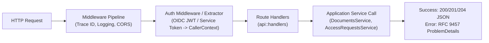

# Infrastructure API & Authentication Design

- **Target Modules**: `infrastructure::api`, `infrastructure::auth`
- **Canonical API Reference**: [`docs/api.md`](../api.md)
- **Governing RFCs**: [RFC 9457 (Problem Details for HTTP APIs)](https://www.rfc-editor.org/rfc/rfc9457.html)
- **Status**: Active Architecture Specification
- **Last Updated**: 2026-10-23

---

## 1. REST API Driving Adapter Architecture (`api`)

The `api` module is the HTTP driving adapter constructed with [Axum](https://github.com/tokio-rs/axum). It decodes incoming HTTP requests, passes control to the application layer via typed commands and `CallerContext`, and formats responses according to [`docs/api.md`](../api.md).



---

## 2. Canonical Error Translation (`api::error`)

Luminair conforms to RFC 9457 Problem Details for all non-2xx responses. While `application::errors` defines `ApplicationError` and machine-readable `ConflictCode`, the HTTP status code mapping and serialization machinery live in `infrastructure::api::error`:

```rust
use axum::http::StatusCode;
use axum::response::{IntoResponse, Response};
use axum::Json;
use application::errors::{ApplicationError, ProblemDetails};

pub struct ApiError(pub ApplicationError);

impl From<ApplicationError> for ApiError {
    fn from(err: ApplicationError) -> Self {
        ApiError(err)
    }
}

impl IntoResponse for ApiError {
    fn into_response(self) -> Response {
        let status = match &self.0 {
            ApplicationError::Unauthorized { .. } => StatusCode::FORBIDDEN,
            ApplicationError::NotFound { .. } => StatusCode::NOT_FOUND,
            ApplicationError::Conflict(_) => StatusCode::CONFLICT,
            ApplicationError::Validation(_) => StatusCode::UNPROCESSABLE_ENTITY,
            ApplicationError::Onboarding(_) => StatusCode::FORBIDDEN,
            ApplicationError::Internal(_) => StatusCode::INTERNAL_SERVER_ERROR,
            ApplicationError::Domain(de) => match de {
                domain::errors::DomainError::DocumentTypeNotFound(_) => StatusCode::NOT_FOUND,
                domain::errors::DomainError::InvalidStateTransition { .. } => StatusCode::CONFLICT,
                domain::errors::DomainError::Validation(_) => StatusCode::UNPROCESSABLE_ENTITY,
                _ => StatusCode::INTERNAL_SERVER_ERROR,
            },
        };

        let problem: ProblemDetails = self.0.into();
        (
            status,
            [("content-type", "application/problem+json")],
            Json(problem),
        ).into_response()
    }
}
```

---

## 3. Authentication Machinery (`auth`)

The `auth` module extracts and verifies incoming credentials, translating them into the domain's strongly typed `CallerContext`:

### 3.1 Authentication Providers

1. **OIDC Bearer Tokens (`auth::oidc`)**:
   - Validates incoming JWT tokens in the `Authorization: Bearer <token>` header.
   - Verifies signature against cached OIDC JWKS (JSON Web Key Set), validating audience (`aud`), issuer (`iss`), and expiration (`exp`).
   - Extracts subject (`sub`) as `UserId` and constructs `ActorId::User(user_id)`.
2. **Service API Tokens (`auth::service_token`)**:
   - For machine-to-machine integrations and background workers.
   - Validates pre-shared tokens or signed HMAC tokens mapping to `ActorId::Service(service_id)`.
3. **Internal System Actor**:
   - Used for startup hooks, background sync, and migrations: `CallerContext::system()` using `ActorId::System`.

### 3.2 `CallerContext` Axum Extractor (`auth::extractor`)

An Axum request extractor queries the `UserRoleAssignmentRepository` for the actor's assigned roles, assembling the full `CallerContext`:

```rust
#[derive(Clone)]
pub struct AuthAppState {
    pub oidc_validator: Arc<OidcTokenValidator>,
    pub service_tokens: Arc<ServiceTokenRegistry>,
    pub assignment_repo: SqlxUserRoleAssignmentRepository,
    pub role_repo: SqlxRoleRepository,
}
```

### 3.3 Shadow Users (`auth::shadow_user`)

When an authenticated user accesses the API for the first time via OIDC, their identity is automatically recorded in the `shadow_users` table with `first_seen` and `last_seen` timestamps.

---

## 4. Route Hierarchy & Endpoint Mapping

Conforming to [`docs/api.md`](../api.md):

```
/api/v1
├── /content/:type_id                         # Find, create, list documents
│   ├── /:id                                  # Find by ID, update, delete
│   ├── /:id/publish                          # Publish document
│   ├── /:id/unpublish                        # Unpublish document
│   ├── /:id/discard-draft                    # Discard draft edits
│   ├── /:id/snapshots                        # List revision snapshots
│   ├── /:id/snapshots/:revision              # Get single snapshot
│   ├── /:id/snapshots/:revision/restore      # Restore revision into draft
│   └── /admin-headers                        # Lightweight Admin Studio listing
├── /schemas                                  # List and inspect registered schemas
│   └── /:type_id                             # Get document type schema
├── /auth
│   └── /access-requests                      # Submit, list, approve, reject onboarding
├── /system
│   ├── /config                               # Inspect system configuration
│   └── /locales                              # List active locales
└── /healthz, /ready                          # Liveness and readiness probes
```
