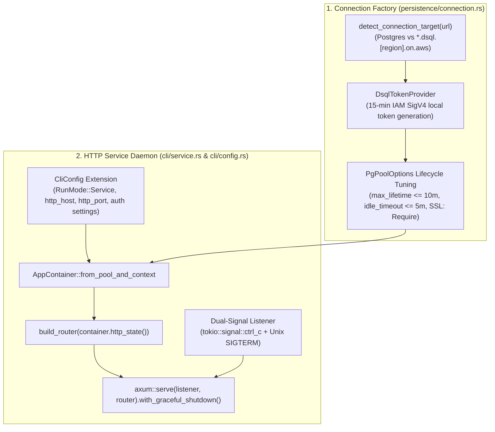

# Infrastructure Crate Overview & Architecture

- **Target Crate**: `infrastructure`
- **Governing Architecture**: [`ADR-002 (Hexagonal Architecture)`](../adr/ADR-002-hexagonal-architecture.md), [`ADR-003 (AWS DSQL Database)`](../adr/ADR-003-aws-dsql-database.md), [`ADR-004 (Asymmetric Hybrid Persistence)`](../adr/ADR-004-draft-and-publish-table-pattern.md)
- **Status**: Active Architecture Specification
- **Last Updated**: 2026-10-27

---

## 1. Architectural Position

Per [`docs/architecture.md`](../architecture.md), `infrastructure` is the single executable composition root and adapter layer:
- **Composition Root (`container.rs`, `main.rs`)**: Reads schemas/config into `SystemContext`, configures `sqlx::PgPool`, constructs repository adapters, injects them into application services (`DocumentsServiceImpl`, `AccessRequestsServiceImpl`, `SchemaServiceImpl`, `SystemConfigServiceImpl`), and projects `ProductionHttpState`.
- **Driving Adapter (`api`, `auth`)**: Axum REST layer decoding HTTP requests, verifying authentication tokens into `CallerContext` / `AuthenticatedUser`, and invoking application services.
- **Driven Adapter (`persistence`)**: SQL storage targeting Aurora DSQL / PostgreSQL implementing `domain` repository ports (`DocumentInstanceRepository`, `DocumentSnapshotRepository`, `RoleRepository`, `UserRoleAssignmentRepository`, `AccessRequestRepository`).
- **Strict Isolation**: All framework and driver dependencies (`axum`, `sqlx`, `sea-query`, `aws-sdk-dsql`, JWT) are strictly confined to `infrastructure`.

---

## 2. Directory & Module Structure

```
infrastructure/
├── Cargo.toml
├── migrations/                               # SQLx static migration scripts
│   ├── 20260924000001_create_system_tables.sql
│   ├── 20260924000002_seed_builtin_roles.sql
│   ├── 20261010000001_create_document_drafts.sql
│   └── 20261010000002_create_document_snapshots.sql
├── tests/                                    # Integration test suite
│   ├── migrations_test.rs                    # Static migration idempotency & DSQL compatibility
│   ├── schema_loader_test.rs                 # Schema parsing, validation, and domain conversion
│   ├── persistence_test.rs                   # Repository integration against live test database
│   ├── api_test.rs                           # End-to-end Axum HTTP route testing
│   └── cli_test.rs                           # CLI mode verification (Test, DryRun, Migrate)
└── src/
    ├── lib.rs                                # Public crate interface
    ├── main.rs                               # Binary entry point (CLI config + tracing subscriber + tokio::main)
    ├── container.rs                          # AppContainer & PersistenceContainer composition root wiring
    ├── health.rs                             # HealthStatus, HealthCheckService, SqlxHealthChecker, AlwaysHealthyChecker
    │
    ├── schema_loader/                        # Schema file discovery, Serde DTOs, validation & SystemContext assembly
    │   ├── mod.rs
    │   ├── dto.rs                            # Zero-copy borrowed Serde DTOs (AttributeRecord untagged enum)
    │   ├── error.rs                          # Schema loader error definitions
    │   └── loader.rs                         # Directory walking and SystemContext assembly
    │
    ├── persistence/                          # Database storage engine
    │   ├── mod.rs                            # Facade re-exporting repositories, migration, naming, and PersistenceError
    │   ├── error.rs                          # PersistenceError enum
    │   ├── naming/                           # SQL naming conventions & precomputed static cache
    │   │   ├── mod.rs                        # Naming Facade
    │   │   ├── sanitize.rs                   # join_snake_segments, kebab_to_snake, RESERVED_SQL_KEYWORDS
    │   │   ├── identifiers.rs                # Table, junction, column, index, and FK naming functions
    │   │   └── registry.rs                   # SchemaNaming, DocumentTypeNaming, StaticIden (&'static str)
    │   ├── migration/                        # Static and dynamic schema migrations
    │   │   ├── mod.rs                        # Migration Facade
    │   │   ├── embedded.rs                   # SQLx static migrator
    │   │   └── dynamic/                      # 9-module dynamic DDL synchronizer & preview planner
    │   │       ├── mod.rs
    │   │       ├── model.rs
    │   │       ├── step.rs
    │   │       ├── builder.rs
    │   │       ├── introspector.rs
    │   │       ├── diff.rs
    │   │       ├── planner.rs
    │   │       ├── ddl.rs
    │   │       ├── executor.rs
    │   │       └── sync.rs
    │   ├── query/                            # Pure Sea-Query SQL builders & OCC retry helper
    │   │   ├── mod.rs
    │   │   ├── common.rs                     # StaticIden constants, query compilers, filter & value mappers
    │   │   ├── wide_table.rs                 # Published wide table queries
    │   │   ├── drafts.rs                     # JSONB document_drafts queries
    │   │   ├── headers.rs                    # Admin headers & UNION ALL display title queries
    │   │   ├── junction.rs                   # Relational link table queries
    │   │   ├── snapshots.rs                  # Immutable document_snapshots queries
    │   │   ├── auth.rs                       # Roles, permissions, assignments & access request queries
    │   │   └── occ.rs                        # Concurrency retry loop for SQLSTATE 40001
    │   └── repositories/                     # Domain repository implementations, codecs & row mappers
    │       ├── mod.rs                        # Repositories Facade (exports 5 Sqlx*Repository structs & codec)
    │       ├── codec.rs                      # Schema-driven JSONB & URN serialization/deserialization
    │       ├── relations.rs                  # Junction table sync & batch relation loading helpers
    │       ├── mappers/                      # Pure PgRow -> Domain entity reconstitution mappers
    │       │   ├── mod.rs
    │       │   ├── document_row.rs
    │       │   ├── snapshot_row.rs
    │       │   └── auth_row.rs
    │       ├── document_instance.rs          # SqlxDocumentInstanceRepository (ADR-004)
    │       ├── document_snapshot.rs          # SqlxDocumentSnapshotRepository (ADR-004)
    │       ├── role.rs                       # SqlxRoleRepository
    │       ├── user_role_assignment.rs       # SqlxUserRoleAssignmentRepository
    │       └── access_request.rs             # SqlxAccessRequestRepository
    │
    ├── auth/                                 # Authentication and security machinery
    │   ├── mod.rs
    │   ├── claims.rs                         # AuthenticatedUser and AuthenticatedIdentity models
    │   ├── error.rs                          # AuthError and AuthResolutionError
    │   ├── oidc.rs                           # OidcConfig, JwtClaims, and OidcTokenValidator
    │   ├── service_token.rs                  # ServiceTokenEntry & ServiceTokenRegistry for Service actors
    │   ├── shadow_user.rs                    # ShadowUserRecorder, SqlxShadowUserRecorder, NoopShadowUserRecorder
    │   ├── resolver.rs                       # AuthContextResolver & DefaultAuthResolver (SqlxAuthResolver)
    │   └── extractor.rs                      # Axum Caller and OnboardingUser request extractors
    │
    ├── api/                                  # HTTP REST driving adapter
    │   ├── mod.rs
    │   ├── state.rs                          # Generic HttpState, ProductionHttpState, and Has* traits
    │   ├── error.rs                          # ApiError, ApiErrorKind, and RFC 9457 ApiProblemDetails
    │   ├── envelope.rs                       # JsonData, CreatedJson, PagedJson, PaginationMeta
    │   ├── extractors.rs                     # PaginationQuery, FindDocumentsQuery, FindByIdQuery, AdminHeadersQuery
    │   ├── middleware.rs                     # propagate_request_id and inject_problem_instance
    │   ├── routes.rs                         # Master Axum router builder (build_router)
    │   ├── codec/                            # Zero-clone request decoding and streaming response encoding
    │   │   ├── mod.rs
    │   │   ├── request.rs
    │   │   └── response.rs
    │   └── handlers/                         # Axum endpoint handlers
    │       ├── mod.rs
    │       ├── content.rs                    # Content CRUD, publish, unpublish, discard-draft, restore, snapshots
    │       ├── schema.rs                     # Schema discovery endpoints
    │       ├── access_requests.rs            # User onboarding & review endpoints
    │       ├── system.rs                     # Locales and system configuration endpoints
    │       └── health.rs                     # /healthz and /ready endpoints
    │
    └── cli/                                  # CLI configuration and execution modes
        ├── mod.rs                            # CLI Facade
        ├── config.rs                         # CliConfig, RunMode, OutputFormat & layered resolution
        ├── error.rs                          # CliError enum
        ├── report.rs                         # CliOutcome & text/JSON report formatters
        ├── runner.rs                         # Main runner dispatcher (Test, DryRun, Migrate; Service planned)
        ├── test_config.rs                    # Offline validation of config & schemas
        ├── dry_run.rs                        # Live/offline migration preview & DDL output
        ├── migrate.rs                        # Standalone static + dynamic migration execution
        └── service.rs                        # Long-running HTTP service startup (Phase 4B.3 / Phase 7)
```

---

## 3. Composition Root Wiring (`container.rs`)

The `AppContainer` serves as the single dependency container holding initialized services and repository adapters, and projects a repository-free `ProductionHttpState` for the HTTP driving layer:

```rust
use std::sync::Arc;
use sqlx::PgPool;
use application::services::{
    AccessRequestsServiceImpl, DocumentsServiceImpl, SchemaServiceImpl, SystemConfigServiceImpl,
};
use domain::system::SystemContext;

use crate::api::state::{HttpState, ProductionHttpState};
use crate::auth::{
    OidcTokenValidator, ServiceTokenRegistry, SqlxAuthResolver, SqlxShadowUserRecorder,
};
use crate::health::SqlxHealthChecker;
use crate::persistence::naming::SchemaNaming;
use crate::persistence::repositories::{
    SqlxAccessRequestRepository, SqlxDocumentInstanceRepository, SqlxDocumentSnapshotRepository,
    SqlxRoleRepository, SqlxUserRoleAssignmentRepository,
};

/// Sub-container aggregating SQLx repository adapters and database persistence machinery.
#[derive(Debug, Clone)]
pub struct PersistenceContainer {
    pub naming: &'static SchemaNaming,
    pub document_instance_repo: SqlxDocumentInstanceRepository,
    pub document_snapshot_repo: SqlxDocumentSnapshotRepository,
    pub role_repo: SqlxRoleRepository,
    pub assignment_repo: SqlxUserRoleAssignmentRepository,
    pub access_request_repo: SqlxAccessRequestRepository,
    pub shadow_user_recorder: SqlxShadowUserRecorder,
}

/// Central composition root container holding initialized services and adapters.
#[derive(Clone)]
pub struct AppContainer {
    pub context: &'static SystemContext,
    pub persistence: PersistenceContainer,
    pub auth_resolver: Arc<SqlxAuthResolver>,
    pub documents_service: Arc<
        DocumentsServiceImpl<SqlxDocumentInstanceRepository, SqlxDocumentSnapshotRepository>,
    >,
    pub access_requests_service: Arc<
        AccessRequestsServiceImpl<
            SqlxAccessRequestRepository,
            SqlxUserRoleAssignmentRepository,
            SqlxRoleRepository,
        >,
    >,
    pub schema_service: Arc<SchemaServiceImpl>,
    pub system_config_service: Arc<SystemConfigServiceImpl>,
    pub health_checker: Arc<SqlxHealthChecker>,
}
```

---

## 4. CLI Execution Modes & Dispatcher (`cli/runner.rs`)

The entry runner validates `CliConfig`, loads `&'static SystemContext`, and dispatches execution based on `config.mode`:

```rust
use domain::system::SystemContext;

use super::config::{CliConfig, RunMode};
use super::dry_run::execute_dry_run_mode;
use super::error::CliError;
use super::migrate::execute_migrate_mode;
use super::report::CliOutcome;
use super::test_config::execute_test_mode;
use crate::schema_loader::load_system_context_from_dir;

pub async fn run(config: &CliConfig) -> Result<CliOutcome, CliError> {
    config.validate()?;
    let context = load_system_context_from_dir(&config.schema_dir)?;
    dispatch_mode(config, context).await
}

async fn dispatch_mode(
    config: &CliConfig,
    context: &'static SystemContext,
) -> Result<CliOutcome, CliError> {
    match config.mode {
        RunMode::Test => Ok(CliOutcome::Test(execute_test_mode(config, context))),
        RunMode::DryRun => Ok(CliOutcome::DryRun(
            execute_dry_run_mode(config, context).await?,
        )),
        RunMode::Migrate => Ok(CliOutcome::Migrate(
            execute_migrate_mode(config, context).await?,
        )),
    }
}
```

*(Note: `RunMode::Service` in `cli/service.rs` is scheduled for Phase 4B.3 / Phase 7).*

### 4.1 Service Mode & Connection Factory Architecture




---

## 5. Sub-system Documentation References

For detailed design and code specifications of individual sub-systems, refer to:
- [`docs/infrastructure/schema-loader.md`](./schema-loader.md) — Disk layout, JSON schema format, zero-copy DTOs, and domain conversion.
- [`docs/infrastructure/persistence.md`](./persistence.md) — Database architecture, naming engine, dynamic DDL sync, queries, and repository implementations.
- [`docs/infrastructure/api-and-auth.md`](./api-and-auth.md) — Axum routing, RFC 9457 error translation, JWT/service token authentication, and middlewares.
- [`docs/plan-infrastructure.md`](../plan-infrastructure.md) — Step-by-step implementation plan and delivery roadmap.
