# Infrastructure Persistence Architecture & Adapters

- **Target Module**: `infrastructure::persistence`
- **Governing Architecture**: [`ADR-003 (AWS DSQL Database)`](../adr/ADR-003-aws-dsql-database.md), [`ADR-004 (Asymmetric Hybrid Persistence)`](../adr/ADR-004-draft-and-publish-table-pattern.md), [`ADR-005 (Trash, Undelete & Retention)`](../adr/ADR-005-trash-undelete-and-retention.md)
- **Detailed Design Notes**: [`docs/design-infrastructure-persistence.md`](../design-infrastructure-persistence.md)
- **Status**: Active Architecture Specification
- **Last Updated**: 2026-10-23

---

## 1. Relational Persistence Overview

Luminair targets **AWS Aurora DSQL** (distributed, active-active PostgreSQL-compatible SQL engine) while maintaining 100% portability with standard **PostgreSQL** (for local development, Docker, and CI) using a unified `sqlx::PgPool`.

Client-side `Uuid::now_v7()` primary keys, JSONB serialization for drafts/snapshots, parameterized queries via `sea-query`, and an OCC retry loop (`SQLSTATE 40001`) ensure active-active high concurrency. See [`docs/design-infrastructure-persistence.md`](../design-infrastructure-persistence.md) §1 for technology stack details and driver contracts.

### 1.1 Module Layout & Responsibility Matrix

```mermaid
flowchart TD
    subgraph Facade["infrastructure::persistence (Public Facade)"]
        PMod["persistence/mod.rs"]
    end

    subgraph Naming["persistence::naming (Generalized Rules & Precomputed Cache)"]
        NMod["naming/mod.rs"]
        NSanitize["naming/sanitize.rs<br/>(join_snake_segments, kebab_to_snake, RESERVED_SQL_KEYWORDS)"]
        NIdent["naming/identifiers.rs<br/>(System Constants & Generalized Name Builders)"]
        NReg["naming/registry.rs<br/>(SchemaNaming, DocumentTypeNaming, FieldColumnNaming, RelationNaming)"]
    end

    subgraph Query["persistence::query (Sea-Query SQL Builders)"]
        QMod["query/mod.rs"]
        QCommon["query/common.rs<br/>(StaticIden, SqlxBinder Helpers, Filters, Pagination, Value Mapping)"]
        QWide["query/wide_table.rs<br/>(Dynamic Wide Table SELECT, COUNT, UPSERT, UPDATE, DELETE)"]
        QDrafts["query/drafts.rs<br/>(document_drafts SELECT, UPSERT, DELETE, EXISTS)"]
        QHeaders["query/headers.rs<br/>(Admin Headers UNION ALL & Display Title Batch Lookup)"]
        QJunction["query/junction.rs<br/>(Junction Link Batch INSERT, DELETE, Owning & Inverse SELECT)"]
        QSnap["query/snapshots.rs<br/>(document_snapshots INSERT, LIST HEADERS, GET BY REVISION)"]
        QAuth["query/auth.rs<br/>(roles, role_permissions, user_role_assignments, access_requests, user_profiles)"]
        QOcc["query/occ.rs<br/>(with_occ_retry exponential backoff)"]
    end

    subgraph Repos["persistence::repositories (Thin Adapters + Helpers)"]
        RMod["repositories/mod.rs"]
        RCodec["repositories/codec.rs<br/>(JSONB Content/Relations DTOs, ActorId URN, Status/Reason)"]
        RMappers["repositories/mappers/<br/>(document_row.rs, snapshot_row.rs, auth_row.rs)"]
        RRel["repositories/relations.rs<br/>(Junction Sync & 2-Phase Owning/Inverse Relation Enrichment)"]
        RDoc["repositories/document_instance.rs<br/>(SqlxDocumentInstanceRepository)"]
        RSnap["repositories/document_snapshot.rs<br/>(SqlxDocumentSnapshotRepository)"]
        RRole["repositories/role.rs<br/>(SqlxRoleRepository)"]
        RAssign["repositories/user_role_assignment.rs<br/>(SqlxUserRoleAssignmentRepository)"]
        RAccess["repositories/access_request.rs<br/>(SqlxAccessRequestRepository)"]
        RProf["repositories/user_profile.rs<br/>(SqlxUserProfileRepository)"]
    end

    PMod --> NMod & QMod & RMod
    NReg --> NIdent --> NSanitize
    QWide & QHeaders & QJunction --> NReg & QCommon
    QDrafts & QSnap & QAuth --> NIdent & QCommon
    RDoc --> NReg & QWide & QDrafts & QHeaders & QJunction & QSnap & QOcc
    RDoc --> RMappers & RCodec & RRel
    RSnap --> NReg & QSnap & RMappers & RCodec & QOcc
    RRole & RAssign & RAccess & RProf --> QAuth & RMappers & QOcc
```



| Submodule | File | Single Responsibility |
|---|---|---|
| **`persistence::naming`** | `sanitize.rs` | Single-pass `join_snake_segments` builder, `kebab_to_snake`, and `RESERVED_SQL_KEYWORDS` checking. |
| | `identifiers.rs` | System table/column constants and generalized name constructors (`table_name_for_document_type`, `column_name`, `junction_table_name`, `index_name`, `foreign_key_name`). |
| | `registry.rs` | Startup-precomputed zero-allocation `SchemaNaming` cache (`DocumentTypeNaming`, `FieldColumnNaming`, `RelationNaming`, `StaticIden(&'static str)`). |
| **`persistence::query`** | `common.rs` | `SqlxBinder` compilation helpers (`compile_select`, `compile_insert`, `compile_update`, `compile_delete`), shared `StaticIden` constants, pagination, filter application, and `ContentValue`/`DomainValue` $\rightarrow$ `sea_query::Value` conversion. |
| | `wide_table.rs` | `sea-query` AST builders for dynamic wide tables `[type]` (`select_by_id`, `find_published`, `count_published`, `upsert_wide_table`, `update_has_pending_draft`, `delete_by_id`, `exists_in_wide_table`). |
| | `drafts.rs` | `sea-query` AST builders for `document_drafts` (`select_draft_by_id`, `select_drafts_by_type`, `upsert_draft`, `delete_draft`, `exists_draft_for_type`). |
| | `headers.rs` | `sea-query` AST builders for Admin Studio `list_admin_headers` (`UNION ALL` of drafts and clean published rows) and batched `find_display_titles_by_ids`. |
| | `junction.rs` | `sea-query` AST builders for `[source]_[rel]_links` junction tables (`insert_links_batch`, `delete_links_by_source`, `select_targets_by_source`, `select_links_by_sources`, `select_links_by_targets`). |
| | `snapshots.rs` | `sea-query` AST builders for `document_snapshots` (`insert_snapshot`, `list_snapshot_headers`, `get_snapshot_by_revision`). |
| | `auth.rs` | `sea-query` AST builders for `roles`, `role_permissions`, `user_role_assignments`, `access_requests`, and `user_profiles`. |
| | `occ.rs` | `with_occ_retry` exponential backoff wrapper for Aurora DSQL `SQLSTATE 40001`. |
| **`persistence::repositories`** | `codec.rs` | Schema-driven JSONB serialization/deserialization (`ContentValue`, `ResolvedRelation`, `display_values`), `ActorId` URN formatting/parsing, and `DocumentStatus`/`SnapshotReason` string mapping. |
| | `mappers/*` | Pure `sqlx::postgres::PgRow` $\rightarrow$ Domain entity reconstitution (`document_row.rs`, `snapshot_row.rs`, `auth_row.rs` including `UserProfileRowMapper`). |
| | `relations.rs` | Transactional junction table synchronization (`sync_owning_relations_in_tx`) and two-phase batch relation enrichment (`batch_fetch_relations` for both owning and pre-resolved inverse relations). |
| | `document_instance.rs`, `document_snapshot.rs`, `role.rs`, `user_role_assignment.rs`, `access_request.rs`, `user_profile.rs` | Ultra-thin repository trait adapters (5–20 lines per method) orchestrating `query`, `mappers`, `codec`, `relations`, and `with_occ_retry`. |

---

## 2. Naming Engine & Precomputed Cache (`persistence::naming`)

The naming engine provides deterministic mapping from schema identifiers to SQL database identifiers conforming to PostgreSQL and Aurora DSQL length limits (max 63 bytes) and reserved keyword rules, while eliminating per-request string allocations via a startup-precomputed cache:

- **Generalized Single-Pass Sanitization (`sanitize.rs` & `identifiers.rs`)**:
  - `RESERVED_SQL_KEYWORDS` & `is_reserved_sql_keyword(name)`: Prevents collision with ANSI and PostgreSQL reserved keywords (e.g. `user`, `order`, `table`, `select`). Also consumed by `schema_loader` during startup validation.
  - `join_snake_segments(segments: &[&str]) -> String`: Single-pass, exact-capacity builder that joins segments with `'_'` and converts any `'-'` to `'_'` in one allocation.
  - All identifier constructors delegate to `join_snake_segments`:
    - **Document Wide Table (`table_name_for_document_type`)**: `[type_id]` pluralized (collections) or singular (singletons) in `snake_case` (e.g. `article` -> `articles`, `blog-post` -> `blog_posts`).
    - **Junction Link Table (`junction_table_name`)**: `[source_table]_[rel_attr]_links` (e.g. `articles_tags_links`, `articles_category_links`).
    - **Column Identifiers (`column_name`)**: `[attr_id]` in `snake_case` (e.g. `hero-image-url` -> `hero_image_url`).
    - **Index & Foreign Key Identifiers (`index_name`, `foreign_key_name`)**: `idx_[table]_[col]`, `uq_[table]_[col]`, and `fk_[junction]_[side]`.
- **Startup-Precomputed Zero-Allocation Cache (`naming/registry.rs`)**:
  - Because `SchemaRegistry` (`&'static SystemContext`) is immutable after startup, `SchemaNaming::from_registry(registry)` precomputes and leaks (`Box::leak`) all SQL identifiers once at startup:
    - `StaticIden(pub &'static str)`: Copyable zero-allocation `sea_query::Iden` wrapper around `&'static str` (avoids `Arc<str>` allocation in `Alias::new`).
    - `DocumentTypeNaming`: Precomputed `table_name: &'static str`, `table_iden: StaticIden`, `field_columns: IndexMap<AttributeId, FieldColumnNaming>`, `wide_upsert_columns: &'static [StaticIden]`, `wide_update_columns: &'static [StaticIden]`, and `relations: IndexMap<AttributeId, RelationNaming>` (which pre-resolves junction tables for both owning `HasOne`/`HasMany` and inverse `BelongsToOne`/`BelongsToMany` relations).
- **Standard Lifecycle Columns**:
  - `id UUID PRIMARY KEY`
  - `has_pending_draft BOOLEAN NOT NULL DEFAULT FALSE`
  - `display_values JSONB NOT NULL DEFAULT '{}'::jsonb`
  - `display_title VARCHAR(255) NOT NULL`
  - `revision INT NOT NULL DEFAULT 1`
  - `published_at TIMESTAMPTZ NOT NULL`
  - `published_by VARCHAR(255) NOT NULL`
  - `created_at TIMESTAMPTZ NOT NULL`
  - `created_by VARCHAR(255) NOT NULL`
  - `updated_at TIMESTAMPTZ NOT NULL`
  - `updated_by VARCHAR(255) NOT NULL`

---

## 3. Migration Architecture (`persistence::migration`)

Persistence migrations are divided into **static migrations** and **dynamic schema synchronization**:

### 3.1 Static System Migrations (`infrastructure/migrations/`)

Pre-compiled SQL migrations embedded via `sqlx::migrate!("./migrations")`:
1. `20260924000001_create_system_tables.sql`: `roles`, `role_permissions`, `user_role_assignments`, `access_requests`, `user_profiles` ([`ADR-006`](../adr/ADR-006-user-profile-and-directory-architecture.md)).
2. `20260924000002_seed_builtin_roles.sql`: seeds deterministic built-in roles (`admin`, `editor`, `viewer`, `writer`).
3. `20261010000001_create_document_drafts.sql`: unified draft table storing `status` (`'draft'`, `'modified'`, `'unpublished'`), `display_values JSONB`, `display_title`, `content JSONB`, `relations JSONB`, and OCC `version`.
4. `20261010000002_create_document_snapshots.sql`: append-only revision history with `reason IN ('publish', 'unpublish')` and `UNIQUE (document_type_id, document_id, revision)`.

All static migration files strictly begin with `-- no-transaction` for Aurora DSQL DDL compatibility and use client UUIDv7.

### 3.1.1 Forward-Reserved Schema: `document_tombstones` (ADR-005)

The table identifier `TABLE_DOCUMENT_TOMBSTONES` is defined in `naming::identifiers` as a forward reservation for the proposed trash, undelete, and retention lifecycle ([`ADR-005`](../adr/ADR-005-trash-undelete-and-retention.md)).

Because ADR-005 is currently in *Proposed* status, its static migration has not been introduced into `infrastructure/migrations/` (maintaining exactly 4 static migrations). The dynamic schema introspector (`introspector.rs`) explicitly excludes `document_tombstones` alongside system tables until ADR-005 is accepted and activated.

### 3.2 Dynamic Additive Schema Synchronizer (`persistence::migration::dynamic_sync`)

At application startup or during `RunMode::Migrate`:
1. Inspects active database tables and columns via `information_schema`.
2. Compares active DB schema against loaded `SchemaRegistry`.
3. Emits and executes non-destructive, additive DDL statements:
   - `CREATE TABLE IF NOT EXISTS [type] (...)`
   - `ALTER TABLE [type] ADD COLUMN IF NOT EXISTS [column] [sql_type]`
   - `CREATE TABLE IF NOT EXISTS [type]_[attr]_links (...)`
   - Indexes: `CREATE INDEX IF NOT EXISTS ...`

---

## 4. Query Engine & Concurrency (`persistence::query`)

Dynamic SQL is generated using `sea-query` to support type-specific columns, filtering, and pagination:

### 4.1 Wide Table Queries (`query::wide_table`)
- Parameterized inserts, updates, and selects against `[type]`.
- Field equality filtering (`FieldFilter`) and cursor/page pagination.
- Visitor query targeting only published rows (`WHERE has_pending_draft = FALSE` or directly on `[type]`).

### 4.2 Junction Relation Queries (`query::junction`)
- Inserts/deletes on junction tables (`source_id UUID`, `target_id UUID`, `order_index INT`).
- Two-phase batch relation loading for `fetch_relations`.

### 4.3 OCC Concurrency Retry Loop (`query::occ`)
Aurora DSQL enforces strict serializable isolation with optimistic concurrency control. Concurrent transactions targeting intersecting keys receive SQLSTATE `40001` (serialization failure).

`with_occ_retry` wraps transaction execution with randomized exponential backoff:
```rust
pub async fn with_occ_retry<T, F, Fut>(max_retries: usize, mut op: F) -> Result<T, PersistenceError>
where
    F: FnMut() -> Fut,
    Fut: Future<Output = Result<T, sqlx::Error>>,
```

---

## 5. Repository Adapters (`persistence::repositories`)

### 5.1 `SqlxDocumentInstanceRepository` & `SqlxDocumentSnapshotRepository`
Implements `domain::content::DocumentInstanceRepository` and `domain::content::DocumentSnapshotRepository` adhering to ADR-004:
- `save_draft`: writes working draft to `document_drafts`; updates `has_pending_draft = TRUE` in wide table if live row exists (`Modified` state).
- `publish`: writes to wide table `[type]`, clears draft row from `document_drafts` (`has_pending_draft = FALSE`), and archives superseded revision to `document_snapshots` if `snapshot: Option<&DocumentSnapshot>` is passed.
- `unpublish`: deletes row from wide table `[type]`, preserves state in `document_drafts` with `status = 'unpublished'`, and archives snapshot atomically.
- `discard_draft`: deletes pending draft from `document_drafts` and resets `has_pending_draft = FALSE` on the clean wide table row.
- `find_by_id(type, id, view)`: fetches from wide table (`VersionView::Published`) or `document_drafts` (`VersionView::Working`).
- `list_admin_headers`: single query combining drafts and clean published rows (`has_pending_draft = FALSE`) using materialized `display_values` and `display_title`.
- `find_display_titles_by_ids`: batched lookup for Phase 2 singular relational display field enrichment.

### 5.2 Auth & Identity Repositories
- `SqlxRoleRepository`: loads static and custom roles, manages granular permissions.
- `SqlxUserRoleAssignmentRepository`: maps user IDs to assigned roles with `ActorId` URNs.
- `SqlxAccessRequestRepository`: manages user onboarding queue with partial unique active index.
- `SqlxUserProfileRepository`: stores synchronized user profile snapshots in `user_profiles`, implementing `UserProfileRepository` for single-user lookup by `ActorId` and multi-user directory search (prefix/contains) with deterministic sorting ([`ADR-006`](../adr/ADR-006-user-profile-and-directory-architecture.md)).
