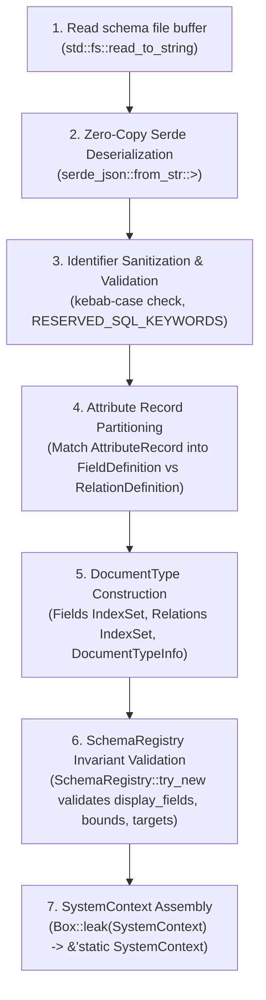

# Schema Loader & Configuration Design

- **Target Module**: `infrastructure::schema_loader`
- **Governing Domain**: `domain::schema`, `domain::system`
- **Status**: Active Architecture Specification
- **Last Updated**: 2026-10-23

---

## 1. Disk Organization & File Naming Conventions

Schema files are loaded from the configured schema directory (`config.schema_dir`):

```
schemas/
├── system-config.json                        # Global localization and instance settings (no id needed)
└── document-types/                           # Individual document type definitions
    ├── article.json                          # ID "article" matches file stem and info.singularName
    ├── category.json                         # ID "category" matches file stem and info.singularName
    └── author.json                           # ID "author" matches file stem and info.singularName
```

### 1.1 Identity & File Stem Invariant

1. **File Stem as Canonical ID**: Every schema file in `document-types/` must be named `<id>.json`, where `<id>` is a valid kebab-case `DocumentTypeId` matching regex `^[a-z][a-z0-9]*(-[a-z0-9]+)*$` (2..=64 characters).
2. **Singular Name Cohesion**: `info.singularName` within the JSON document MUST match the file stem `<id>` exactly (e.g. `article.json` must declare `"singularName": "article"`).
3. **Plural Name Distinctness**: `info.pluralName` must also be a valid kebab-case identifier and must differ from `singularName` for collection types.

---

## 2. JSON Structure Specifications & Examples

### 2.1 `system-config.json`

Global system configuration specifies internationalization locales and default instance behavior. **No `id` is required in the JSON file**; the loader generates a deterministic or UUIDv7 `SystemConfigId` internally:

```json
{
  "defaultLocale": "en",
  "availableLocales": [
    "en",
    "uk",
    "fr",
    "de"
  ],
  "instanceName": "Luminair Production"
}
```

- `defaultLocale`: Mandatory BCP-47 language tag (e.g. `"en"`, `"uk-UA"`). Must be contained in `availableLocales`.
- `availableLocales`: Mandatory non-empty array of valid BCP-47 locale identifiers.
- `instanceName`: Optional display name for the deployment instance.

---

### 2.2 `document-types/<id>.json`

Each file defines document kind (`collection` vs `singleType`), human-readable info, lifecycle options (`draftAndPublish`), typed scalar fields, relations, constraints, and composite display fields.

#### Example 1: `document-types/article.json` (Collection Type with Localized Text & Relations)

```json
{
  "kind": "collection",
  "info": {
    "singularName": "article",
    "pluralName": "articles",
    "displayName": "Blog Article",
    "description": "Company articles and announcements",
    "displayFields": ["title", "category"]
  },
  "options": {
    "draftAndPublish": true
  },
  "attributes": {
    "title": {
      "type": "text",
      "required": true,
      "unique": false,
      "constraints": [
        { "minLength": 5 },
        { "maxLength": 100 }
      ]
    },
    "summary": {
      "type": "localizedText",
      "required": true,
      "constraints": [
        { "minLength": 10 },
        { "maxLength": 500 }
      ]
    },
    "body": {
      "type": "localizedText",
      "required": false,
      "constraints": [
        { "minLength": 20 },
        { "maxLength": 50000 }
      ]
    },
    "priority": {
      "type": { "integer": "int32" },
      "required": true,
      "unique": true,
      "constraints": [
        { "min": 1 },
        { "max": 10 }
      ]
    },
    "price": {
      "type": { "decimal": { "precision": 10, "scale": 2 } },
      "required": false,
      "constraints": [
        { "minDecimal": "0.00" }
      ]
    },
    "metadata": {
      "type": "json",
      "required": false
    },
    "category": {
      "relation": "hasOne",
      "target": "category"
    },
    "author": {
      "relation": "belongsToOne",
      "target": "author"
    },
    "tags": {
      "relation": "hasMany",
      "target": "tag"
    }
  }
}
```

#### Example 2: `document-types/category.json` (Direct-Publish Taxonomy Type with Inverse Relation)

```json
{
  "kind": "collection",
  "info": {
    "singularName": "category",
    "pluralName": "categories",
    "displayName": "Article Category",
    "description": "Taxonomy category for content grouping",
    "displayFields": ["name"]
  },
  "options": {
    "draftAndPublish": false
  },
  "attributes": {
    "name": {
      "type": "text",
      "required": true,
      "unique": true,
      "constraints": [
        { "minLength": 2 },
        { "maxLength": 50 }
      ]
    },
    "articles": {
      "relation": "belongsToMany",
      "target": "article"
    }
  }
}
```

---

## 3. Zero-Copy Borrowed References DTO Architecture (`schema_loader::dto`)

### 3.1 Untagged Attribute Record Enum Layout

In Luminair's domain model, attributes are partitioned into **Fields** (`FieldDefinition`) and **Relations** (`RelationDefinition`).

Using an **untagged Serde enum** cleanly separates them without synthetic discriminant wrappers:
- `AttributeRecord::Relation` matches when `target` and `relation` are present.
- `AttributeRecord::Field` matches when `type` (aliased to `field_type`) is present.

```rust
use std::collections::HashSet;
use indexmap::IndexMap;
use serde::Deserialize;

/// Top-level record for a document type JSON file.
#[derive(Clone, Debug, Deserialize)]
#[serde(bound = "'de: 'a")]
#[serde(rename_all = "camelCase")]
pub struct DocumentRecord<'a> {
    #[serde(alias = "type")]
    pub kind: DocumentKindDto,
    pub info: DocumentInfoRecord<'a>,
    pub options: Option<DocumentOptionsRecord>,
    pub attributes: IndexMap<&'a str, AttributeRecord<'a>>,
}

#[derive(Clone, Copy, Debug, PartialEq, Eq, Deserialize)]
#[serde(rename_all = "camelCase")]
pub enum DocumentKindDto {
    Collection,
    #[serde(alias = "single")]
    SingleType,
}

#[derive(Clone, Debug, Deserialize)]
#[serde(bound = "'de: 'a")]
#[serde(rename_all = "camelCase")]
pub struct DocumentInfoRecord<'a> {
    #[serde(alias = "title")]
    pub display_name: &'a str,
    pub singular_name: &'a str,
    pub plural_name: &'a str,
    pub description: Option<&'a str>,
    #[serde(default)]
    pub display_fields: Vec<&'a str>,
}

#[derive(Clone, Copy, Debug, PartialEq, Eq, Deserialize, Default)]
#[serde(rename_all = "camelCase")]
pub struct DocumentOptionsRecord {
    #[serde(default)]
    pub draft_and_publish: bool,
}

/// Discriminated attribute record cleanly separating scalar fields from relational associations.
#[derive(Clone, Debug, Deserialize)]
#[serde(bound = "'de: 'a")]
#[serde(rename_all = "camelCase", untagged)]
pub enum AttributeRecord<'a> {
    /// Relational association targeting another document type.
    Relation {
        #[serde(alias = "type")]
        relation_type: RelationTypeDto,
        target: &'a str,
    },
    /// Typed scalar field with validation constraints.
    Field {
        #[serde(alias = "type")]
        field_type: FieldTypeDto<'a>,
        #[serde(default)]
        unique: bool,
        #[serde(default)]
        required: bool,
        #[serde(default)]
        constraints: Vec<ConstraintRecord<'a>>,
    },
}

/// Supported scalar field types in JSON schema.
#[derive(Clone, Debug, Deserialize)]
#[serde(bound = "'de: 'a")]
#[serde(untagged)]
pub enum FieldTypeDto<'a> {
    /// String shorthand: "text", "localizedText", "boolean", "date", "dateTime", "email", "url", "json", "uid", "uuid".
    Simple(&'a str),
    /// Structured integer: {"integer": "int16" | "int32" | "int64"}.
    Integer { integer: &'a str },
    /// Structured decimal with precision and scale: {"decimal": {"precision": 10, "scale": 2}}.
    Decimal { decimal: DecimalBoundsDto },
}

#[derive(Clone, Copy, Debug, Deserialize)]
pub struct DecimalBoundsDto {
    pub precision: u8,
    pub scale: u8,
}

/// Relation cardinality and direction matching domain `RelationType`.
#[derive(Clone, Copy, Debug, PartialEq, Eq, Deserialize)]
#[serde(rename_all = "camelCase")]
pub enum RelationTypeDto {
    HasOne,
    HasMany,
    BelongsToOne,
    BelongsToMany,
}

/// Permissive constraint DTO supporting standard and alias keys.
#[derive(Clone, Debug, Deserialize)]
#[serde(bound = "'de: 'a")]
#[serde(rename_all = "camelCase")]
pub struct ConstraintRecord<'a> {
    pub min_length: Option<usize>,
    #[serde(alias = "minimalLength")]
    pub min_len_alias: Option<usize>,
    pub max_length: Option<usize>,
    pub min: Option<serde_json::Value>,
    pub max: Option<serde_json::Value>,
    pub min_integer: Option<i64>,
    pub max_integer: Option<i64>,
    pub min_decimal: Option<&'a str>,
    pub max_decimal: Option<&'a str>,
    pub pattern: Option<&'a str>,
}

/// Root DTO for `system-config.json` (no `id` required).
#[derive(Clone, Debug, Deserialize)]
#[serde(bound = "'de: 'a")]
#[serde(rename_all = "camelCase")]
pub struct SystemConfigRecord<'a> {
    pub default_locale: &'a str,
    pub available_locales: Vec<&'a str>,
    pub instance_name: Option<&'a str>,
}
```

---

## 4. Domain Model Mapping & Validation Rules

### 4.1 Conversion Pipeline



### 4.2 Detailed Mapping Rules

1. **Identifier Sanitization**:
   - Every attribute key `&'a str` is checked against `RESERVED_SQL_KEYWORDS` (e.g. `user`, `order`, `table`, `select`).
   - Attribute keys must be valid kebab-case (`^[a-z][a-z0-9]*(-[a-z0-9]+)*$`) and are converted via `AttributeId::try_new(...)`.
2. **Partitioning `attributes` into `fields` and `relations`**:
   - `AttributeRecord::Field` maps to `domain::schema::FieldDefinition`:
     - `field_type`: mapped to `FieldType::Primitive(...)`, `FieldType::LocalizedText`, `FieldType::Json`, etc.
     - `constraints`: mapped to `HashSet<FieldConstraint>`.
     - `unique`: `bool`.
     - `required`: `bool`.
     - Inserted into `doc_type.fields: IndexSet<FieldDefinition>` preserving declared JSON order.
   - `AttributeRecord::Relation` maps to `domain::schema::RelationDefinition`:
     - `relation_type`: mapped to `domain::schema::RelationType`.
     - `target`: `DocumentTypeId::try_new(target)?`.
     - Inserted into `doc_type.relations: IndexSet<RelationDefinition>` preserving declared JSON order.
3. **`display_fields` Validation**:
   - Parsed from `info.display_fields`.
   - Validated automatically by `SchemaRegistry::try_new`:
     - At most 3 fields total.
     - No duplicates.
     - Only scalar fields (excluding `FieldType::Json`) or singular relations (`HasOne` / `BelongsToOne`).
     - At most 1 singular relation across all display fields.
4. **Target Existence & Constraint Applicability**:
   - `SchemaRegistry::try_new` verifies that every relation's `target` exists in the registered types list.
   - Verifies that `MinInteger` / `MaxInteger` are only attached to `Integer` fields, `MinDecimal` / `MaxDecimal` only to `Decimal` fields, and `MinLength` / `MaxLength` / `Pattern` only to text or localized text fields.
