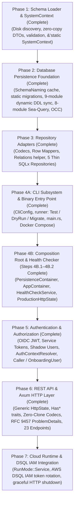
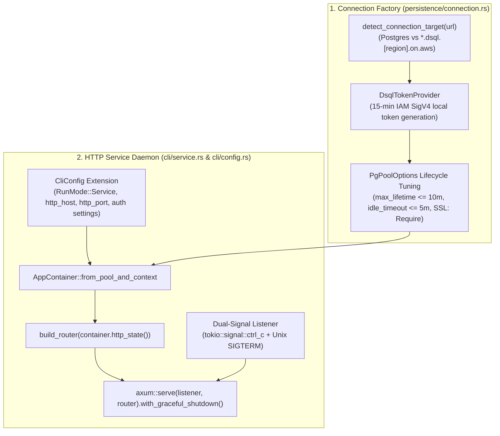

# Infrastructure Crate Implementation Plan

- **Target Crate**: `infrastructure`
- **Governing Architecture & Sub-system Documentation**:
  - Overview & Composition Root: [`docs/infrastructure/overview.md`](./infrastructure/overview.md)
  - Schema Loader & Config Specification: [`docs/infrastructure/schema-loader.md`](./infrastructure/schema-loader.md)
  - Database Persistence & Adapters: [`docs/infrastructure/persistence.md`](./infrastructure/persistence.md)
  - REST API & Authentication: [`docs/infrastructure/api-and-auth.md`](./infrastructure/api-and-auth.md)
  - Canonical API Reference: [`docs/api.md`](./api.md)
- **Status**: Phases 1–6 Complete (Schema Loader, Persistence Foundation, Repository Adapters, CLI `test`/`dry-run`/`migrate` Modes, `AppContainer`, Health Checker, Authentication & Authorization, Generic `HttpState`, Zero-Clone Codecs & REST API) — Ready for Phase 4B.3 / Phase 7 (`RunMode::Service` & Cloud Runtime / DSQL IAM Integration)
- **Last Updated**: 2026-10-27

---

## 1. Plan Overview & Roadmap

The `infrastructure` crate is implemented incrementally across 7 testable phases, beginning with the offline-testable schema loader and culminating in a production-ready binary with AWS Aurora DSQL compatibility:

---

## 2. Phase-by-Phase Implementation Tasks (Adapted to De-Facto Implementation)

### Phase 1: Schema Loader & System Context Assembly (Complete)

> **Detailed Specification**: See [`docs/infrastructure/schema-loader.md`](./infrastructure/schema-loader.md) for disk layout, JSON examples (`system-config.json`, `article.json`, `category.json`), and the zero-copy DTO contracts (`AttributeRecord` untagged enum).

- [x] **Step 1.1: Zero-Copy Borrowed DTOs (`infrastructure/src/schema_loader/dto.rs`)**
  - Borrowed Serde records using `#[serde(bound = "'de: 'a")]` and `&'a str`.
  - `AttributeRecord<'a>` untagged enum with `Field` (`#[serde(alias = "type")] field_type`) and `Relation` (`#[serde(alias = "relation")] relation_type`, `target`) variants.
  - `DocumentKindDto` supporting `"collection"`, `"singleton"`, and `"singleType"` aliases.
  - `FieldTypeDto<'a>`, `DecimalBoundsDto`, `RelationTypeDto`, `ConstraintRecord<'a>`, `DocumentRecord<'a>`, `DocumentInfoRecord<'a>`, `DocumentOptionsRecord`, and `SystemConfigRecord<'a>`.
  - Deterministic attribute ordering preserved using `IndexMap<&'a str, AttributeRecord<'a>>`.
- [x] **Step 1.2: Identifier Sanitization & Validation (`infrastructure/src/persistence/naming/sanitize.rs`)**
  - Verify identifiers against `RESERVED_SQL_KEYWORDS` (e.g. `order`, `table`, `user`).
  - Single-pass pre-allocated `join_snake_segments` and `kebab_to_snake` conversion.
- [x] **Step 1.3: Schema Loader & Domain Transformation (`infrastructure/src/schema_loader/loader.rs`, `error.rs`)**
  - `load_system_context_from_dir(schema_dir)` and `load_schemas_from_dir(schema_dir)` walking `system-config.json` and `document-types/*.json`.
  - Validate that each file stem matches `info.singularName` (`file_stem == info.singularName == DocumentTypeId`).
  - Partition `attributes` into `IndexSet<FieldDefinition>` and `IndexSet<RelationDefinition>`.
  - Construct `DocumentType` instances and pass to `SchemaRegistry::try_new(types)` for cross-schema graph validation.
  - Parse `system-config.json` into `SystemConfig` (generating internal `SystemConfigId`).
  - Construct `SystemContext` and promote to `&'static SystemContext` via `Box::leak`.
- [x] **Step 1.4: Integration Test Suite (`infrastructure/tests/schema_loader_test.rs`)**
  - Valid schema loading with fixtures (`article.json`, `category.json`, `system-config.json`).
  - Rejection of invalid identifiers, reserved SQL keywords, file stem mismatches, unresolvable relation targets, and invalid display fields.

---

### Phase 2: Database Persistence Foundation (Complete)

> **Detailed Specification**: See [`docs/infrastructure/persistence.md`](./infrastructure/persistence.md) and [`docs/design-infrastructure-persistence.md`](./design-infrastructure-persistence.md).

- [x] **Step 2.1: Generalized SQL Naming Engine & Precomputed Cache (`infrastructure/src/persistence/naming/`)**
  - `sanitize.rs`: `join_snake_segments`, `kebab_to_snake`, `is_reserved_sql_keyword`, `RESERVED_SQL_KEYWORDS`.
  - `identifiers.rs`: System, content, and auth column constants (`COL_*`, `TABLE_*`), `table_name_for_document_type`, `junction_table_name`, `column_name`, `index_name`, and `foreign_key_name`.
  - `registry.rs`: Startup-precomputed zero-allocation `SchemaNaming` (`SchemaNaming::from_registry(&registry) -> &'static SchemaNaming`), `DocumentTypeNaming`, `FieldColumnNaming`, `RelationNaming` (pre-resolving both owning and inverse relation junction tables), and `StaticIden(&'static str)` implementing `sea_query::Iden`.
  - `mod.rs`: Clean Facade re-exporting public types and functions over private submodules.
- [x] **Step 2.2: Static System Migrations (`infrastructure/migrations/` & `persistence/migration/embedded.rs`)**
  - `20260924000001_create_system_tables.sql` (`roles`, `role_permissions`, `shadow_users`, `user_role_assignments`, `access_requests`).
  - `20260924000002_seed_builtin_roles.sql` (`ROLE_ADMIN_ID`, `ROLE_EDITOR_ID`, `ROLE_WRITER_ID`, `ROLE_VIEWER_ID`).
  - `20261010000001_create_document_drafts.sql` (`document_drafts` table).
  - `20261010000002_create_document_snapshots.sql` (`document_snapshots` table).
  - All migration files begin with `-- no-transaction` for Aurora DSQL compatibility and are verified by `infrastructure/tests/migrations_test.rs`.
- [x] **Step 2.3: Modular Dynamic Schema Synchronizer (`infrastructure/src/persistence/migration/dynamic/`)**
  - Structured as a 9-module pipeline behind the `persistence::migration` Facade:
    - `model.rs`: `DatabaseSchema`, `TableDefinition`, `TableKind`, `ColumnDefinition`, `IndexDefinition`, `ForeignKeyDefinition`, `ForeignKeyAction`, `SqlColumnType` (using `IndexSet<T>` with `Borrow<str>`).
    - `step.rs`: `MigrationStep` and `SafetyPolicy` (`AdditiveOnly`, `AllowDestructive`).
    - `builder.rs`: Pure transformation from `SchemaRegistry` to desired `DatabaseSchema` (`build_desired_schema`).
    - `introspector.rs`: Live PostgreSQL introspection via `information_schema` and `pg_catalog` (`introspect_database_schema`).
    - `diff.rs`: Pure schema diff calculation (`compute_diff`).
    - `planner.rs`: Topological dependency ordering (`MigrationPlan`, `PlannerError`, `plan_migrations`).
    - `ddl.rs`: Pure `sea-query` DDL SQL rendering (`step_to_sql`).
    - `executor.rs`: Sequential DDL statement execution (`ExecutionSummary`, `execute_migration_plan`).
    - `sync.rs`: Public entry points `sync_dynamic_schemas`, `sync_dynamic_schemas_from_dir`, `preview_dynamic_schemas`, and `generate_ddl_for_registry`, returning `SchemaSyncResult` and `PlannedMigrationStep`.
- [x] **Step 2.4: Modular `sea-query` SQL Generation & OCC Engine (`infrastructure/src/persistence/query/`)**
  - Separated into 8 focused SQL generation modules consuming `&DocumentTypeNaming` and `StaticIden`:
    - `common.rs`: Shared `StaticIden` constants, `compile_select`, `compile_insert`, `compile_update`, `compile_delete`, `apply_pagination`, `apply_wide_table_filters`, `content_value_to_sea_value`.
    - `wide_table.rs`: `select_by_id_query`, `select_clean_published_query`, `find_published_query`, `count_published_query`, `upsert_wide_table_query`, `update_has_pending_draft_query`, `delete_by_id_query`, `exists_in_wide_table_query`.
    - `drafts.rs`: `DraftUpsertParams`, `select_draft_by_id_query`, `select_drafts_by_type_query`, `upsert_draft_query`, `delete_draft_query`, `exists_draft_for_type_query`.
    - `headers.rs`: `list_single_lifecycle_headers_query`, `count_single_lifecycle_headers_query`, `list_draft_enabled_headers_query`, `count_draft_enabled_headers_query`, `find_display_titles_by_ids_query`.
    - `junction.rs`: `insert_link_query`, `insert_links_batch_query`, `delete_links_by_source_query`, `select_targets_by_source_query`, `select_links_by_sources_query`, `select_links_by_targets_query`.
    - `snapshots.rs`: `insert_snapshot_query`, `list_snapshot_headers_query`, `get_snapshot_by_revision_query`.
    - `auth.rs`: Query builders for `roles`, `role_permissions`, `user_role_assignments`, and `access_requests`.
    - `occ.rs`: `with_occ_retry` and `with_occ_retry_opts` handling SQLSTATE `40001` (serialization failure) with exponential backoff and jitter.

---

### Phase 3: Repository Adapters (Complete)

> **Detailed Specification**: See [`docs/infrastructure/persistence.md`](./infrastructure/persistence.md#5-repository-adapters-persistencerepositories).

- [x] **Step 3.1: Codecs, Row Mappers & Relation Helpers (`infrastructure/src/persistence/repositories/`)**
  - `codec.rs`: Schema-driven JSONB field/relation/display_values serialization & deserialization, `ActorId` URN codecs, and status/reason/permission wire mapping.
  - `mappers/`: Pure `PgRow` $\rightarrow$ domain entity reconstitution (`document_row.rs`, `snapshot_row.rs`, `auth_row.rs`).
  - `relations.rs`: `sync_owning_relations_in_tx`, `load_owning_relations_for_instance`, `load_owning_relations_batch`, `batch_fetch_relations` (owning & inverse), and `populate_header_relational_targets`.
- [x] **Step 3.2: Thin Content & Auth Repository Adapters (`infrastructure/src/persistence/repositories/`)**
  - `document_instance.rs`: `SqlxDocumentInstanceRepository` (holding `PgPool`, `&'static SystemContext`, `&'static SchemaNaming`) implementing ADR-004 Asymmetric Hybrid lifecycle.
  - `document_snapshot.rs`: `SqlxDocumentSnapshotRepository` (`save_snapshot`, `list_snapshots`, `get_snapshot`).
  - `role.rs`: `SqlxRoleRepository`.
  - `user_role_assignment.rs`: `SqlxUserRoleAssignmentRepository`.
  - `access_request.rs`: `SqlxAccessRequestRepository`.
  - `mod.rs`: Clean Facade hiding internal helper/mapper modules (`pub(crate)` / private `mod`) and re-exporting only the 5 `Sqlx*Repository` adapters and `codec`.
- [x] **Step 3.3: Integration Test Suite (`infrastructure/tests/persistence_test.rs`)**
  - Offline tests for `SchemaNaming` precomputation, symmetric relation resolution, query compilation, and codec round-tripping.
  - Live PostgreSQL integration tests (in isolated schemas) for full content lifecycle, snapshots, roles, user role assignments, and access requests.

---

### Phase 4: CLI Subsystem, Binary Entry Point & Composition Root

> **Detailed Specification**: See [`docs/infrastructure/overview.md`](./infrastructure/overview.md#3-composition-root-wiring-containerrs).

#### Phase 4A: CLI Modes (`Test`, `DryRun`, `Migrate`), Binary Entry Point & Docker Compose (Complete)

- [x] **Step 4A.1: CLI Configuration & Reports (`infrastructure/src/cli/config.rs`, `report.rs`, `error.rs`)**
  - `CliConfig`, `RunMode` (`Test`, `DryRun`, `Migrate`), and `OutputFormat` (`Text`, `Json`).
  - Layered configuration resolution: `Defaults` $\rightarrow$ JSON config file (`--config` / `LUMINAIR_CONFIG_FILE`) $\rightarrow$ `LUMINAIR_*` env vars $\rightarrow$ CLI flags.
  - `CliOutcome` (`Test(ConfigTestReport)`, `DryRun(DryRunReport)`, `Migrate(MigrationReport)`) with text/JSON rendering and file output (`write_report`).
- [x] **Step 4A.2: Mode Workers & Dispatcher (`infrastructure/src/cli/runner.rs`, `test_config.rs`, `dry_run.rs`, `migrate.rs`)**
  - `run(config: &CliConfig) -> Result<CliOutcome, CliError>` loading `&'static SystemContext` and dispatching to mode workers.
  - `execute_test_mode`: Offline config and schema validation report.
  - `execute_dry_run_mode`: Live DB introspection or `--offline` baseline producing planned steps and DDL SQL without mutating the database.
  - `execute_migrate_mode`: Static SQLx migrations + dynamic schema synchronization returning `MigrationReport`.
- [x] **Step 4A.3: Binary Entry Point & Docker Compose (`infrastructure/src/main.rs`, `docker-compose.yml`, `Dockerfile`, `config/cli-config.json`)**
  - `main.rs` entry point with `tracing_subscriber` (stderr) and `ExitCode` handling.
  - Prepared config file (`config/cli-config.json`), `docker-compose.yml` services (`cli-test`, `cli-dry-run-offline`, `cli-dry-run`, `cli-migrate` under profile `cli`), and CLI integration tests (`infrastructure/tests/cli_test.rs`).

#### Phase 4B: Composition Root (`container.rs`), Health Checker & `Service` Mode

- [x] **Step 4B.1: Composition Root Wiring (`infrastructure/src/container.rs`)**
  - Assemble `PersistenceContainer` (initializing `&'static SchemaNaming` via `SchemaNaming::from_registry(&context.schema)` and constructing all 5 `Sqlx*Repository` adapters + `SqlxShadowUserRecorder`).
  - Assemble `AppContainer` (`from_pool_and_context`) wiring `DocumentsServiceImpl`, `AccessRequestsServiceImpl`, `SchemaServiceImpl`, `SystemConfigServiceImpl`, `SqlxHealthChecker`, and `SqlxAuthResolver`, plus `AppContainer::http_state() -> ProductionHttpState`.
- [x] **Step 4B.2: Health Checker (`infrastructure/src/health.rs`)**
  - Implement `HealthStatus` (`Healthy`, `Unhealthy { reason }`), `HealthCheckService` port trait, `SqlxHealthChecker` (`/healthz` liveness and `/ready` readiness via `SELECT 1` on `PgPool`), and `AlwaysHealthyChecker`.
- [ ] **Step 4B.3: `RunMode::Service` Worker (`infrastructure/src/cli/service.rs`)**
  - Extend `RunMode`, `CliConfig`, and `CliOutcome` with HTTP server settings (`host`, `port`, auth configuration) and `RunMode::Service` startup.

---

### Phase 5: Authentication & Authorization Machinery (Complete)

> **Detailed Specification**: See [`docs/infrastructure/api-and-auth.md`](./infrastructure/api-and-auth.md#4-authentication-machinery-auth).

- [x] **Step 5.1: Claims & OIDC JWT Verification (`infrastructure/src/auth/claims.rs`, `oidc.rs`, `error.rs`)**
  - `AuthenticatedUser` (`UserId`, `Option<Email>`, `Option<DisplayName>`) and `AuthenticatedIdentity` (`User`, `Service`).
  - `OidcConfig`, `JwtClaims`, and `OidcTokenValidator`: validate JWT signatures (HS256, RS256 PEM, disabled test mode), verify `aud`/`iss`, and extract `AuthenticatedUser` with zero-clone `claims.sub` move.
  - `AuthError` (`MissingToken`, `MalformedHeader`, `InvalidToken`) and `AuthResolutionError`.
- [x] **Step 5.2: Service API Tokens (`infrastructure/src/auth/service_token.rs`)**
  - `ServiceTokenEntry` and `ServiceTokenRegistry` validating pre-shared service bearer tokens mapping to `ServiceId` and assigned `Vec<RoleId>`.
- [x] **Step 5.3: Auth Context Resolver & Axum Extractors (`infrastructure/src/auth/resolver.rs`, `extractor.rs`)**
  - `AuthContextResolver` port and `DefaultAuthResolver<A, U, R, S>` (`SqlxAuthResolver`) resolving `CallerContext` (`ActorId::User` or `ActorId::Service`) and onboarding errors (`access_not_requested`, `access_pending`, `access_rejected`).
  - Axum `FromRequestParts<St>` where `St: HasAuthResolver` for `Caller(pub CallerContext)` and `OnboardingUser(pub AuthenticatedUser)`.
- [x] **Step 5.4: Shadow Users (`infrastructure/src/auth/shadow_user.rs`)**
  - `ShadowUserRecorder`, `SqlxShadowUserRecorder` (upserting `shadow_users` with zero-allocation borrowed `&str` bindings), and `NoopShadowUserRecorder`.

---

### Phase 6: REST API & Axum HTTP Layer (Complete)

> **Detailed Specification**: See [`docs/infrastructure/api-and-auth.md`](./infrastructure/api-and-auth.md) and canonical endpoint catalog in [`docs/api.md`](./api.md).

- [x] **Step 6.1: Generic `HttpState` & Interface-Segregated `Has*` Traits (`infrastructure/src/api/state.rs`)**
  - Generic `HttpState<D, A, S, C, H, Auth>` (`ProductionHttpState`) holding `&'static SystemContext` and `Arc`-wrapped service traits (`auth_resolver`, `documents_service`, `access_requests_service`, `schema_service`, `system_config_service`, `health_checker`) with manual `Clone` implementation and `HasSystemContext`, `HasAuthResolver`, `HasDocumentsService`, `HasAccessRequestsService`, `HasSchemaService`, `HasSystemConfigService`, and `HasHealthChecker` traits.
- [x] **Step 6.2: Zero-Clone Codecs, Extractors, Envelopes, Middleware & RFC 9457 Error Translation (`infrastructure/src/api/`)**
  - `error.rs`: `ApiError`, `ApiErrorKind` (`Application`, `Unauthenticated`, `BadRequest`), and `ApiProblemDetails` mapping errors to `application/problem+json` responses.
  - `extractors.rs`: `PaginationQuery`, `FindDocumentsQuery`, `FindByIdQuery`, `AdminHeadersQuery`, `resolve_document_type`, `parse_instance_id`, `parse_access_request_id`, `parse_view_param`, `parse_populate_param`.
  - `middleware.rs`: `propagate_request_id` (`x-request-id`) and `inject_problem_instance` (populating RFC 9457 `instance` URI).
  - `envelope.rs`: `JsonData<T>`, `CreatedJson<T>`, `PagedJson<T>`, `PaginationMeta`.
  - `codec/request.rs` & `codec/response.rs`: Zero-clone consuming request decoding (`decode_document_payload`, `decode_fields_map`, `decode_relations_map`) and streaming `serde::Serialize` response wrappers (`SerFieldsMap`, `SerContentValue`, `DocumentInstanceDto`, `SystemConfigDto<'a>`, etc.).
- [x] **Step 6.3: Route Handlers & Router Assembly (`infrastructure/src/api/handlers/`, `routes.rs`)**
  - 12 content routes including `/admin-headers` alias (`handlers/content.rs`), 5 access request routes (`handlers/access_requests.rs`), 4 schema routes including `/schemas` aliases (`handlers/schema.rs`), 2 system routes (`handlers/system.rs`), and 2 health routes (`handlers/health.rs`), assembled via `build_router` (25 total route paths across 21 distinct operations).
- [x] **Step 6.4: HTTP Integration Test Suite (`infrastructure/tests/api_test.rs`)**
  - End-to-end route tests using `axum-test` over generic `HttpState` backed by in-memory fake repositories.

---

### Phase 7: Cloud Runtime Packaging & DSQL IAM Integration

> **Detailed Specification**: See [`docs/infrastructure/overview.md`](./infrastructure/overview.md#4-cli-execution-modes--dispatcher-clirunnerrs) and artifact implementation plan.

- [ ] **Step 7.1: HTTP Service Worker & Graceful Shutdown (`infrastructure/src/cli/service.rs`, `config.rs`, `runner.rs`, `report.rs`)**
  - Extend `RunMode` with `RunMode::Service` and `CliConfig` with HTTP settings (`http_host`, `http_port`, `auto_migrate`, `oidc_jwt_secret`, `oidc_jwt_public_key_pem`, `oidc_issuer`, `oidc_audience`, `service_tokens`).
  - Implement `execute_service_mode` orchestrator binding `tokio::net::TcpListener` and mounting `build_router(container.http_state())`.
  - Handle cross-platform graceful termination via `tokio::signal::ctrl_c()` (`SIGINT`) and Unix `SIGTERM`, passing shutdown signal to `axum::serve(listener, router).with_graceful_shutdown()`.
  - Output structured `ServiceReport` via `CliOutcome::Service`.
- [ ] **Step 7.2: AWS Aurora DSQL Connection Factory (`infrastructure/src/persistence/connection.rs`)**
  - Implement `create_connection_pool` supporting both standard PostgreSQL (`postgres://...`) and Aurora DSQL (`*.dsql.[region].on.aws`).
  - Implement `DsqlTokenProvider` trait with local SigV4 / environment token generator.
  - Enforce SSL/TLS requirement for Aurora DSQL and configure `PgPoolOptions` with `max_lifetime = 10 minutes` (well within the 15-minute token lifecycle) and `idle_timeout = 5 minutes`.
  - Refactor `cli/migrate.rs` and `cli/dry_run.rs` to route through the centralized connection factory.
- [ ] **Step 7.3: Operational Configuration & Integration Tests (`config/cli-config.json`, `docker-compose.yml`, `infrastructure/tests/cli_test.rs`)**
  - Update `config/cli-config.json` with service parameters.
  - Update `docker-compose.yml` adding service / web container profile.
  - Write integration tests in `cli_test.rs` testing service mode ephemeral port binding, `/healthz` HTTP probe, and clean signal termination.

---

## 3. Immediate Next Execution Step

Execute **Phase 4B.3 & Phase 7 (HTTP Server `RunMode::Service` & Cloud Runtime / DSQL IAM Integration)**:
- Step 7.2: Implement AWS Aurora DSQL connection factory in `infrastructure/src/persistence/connection.rs`.
- Step 7.1: Implement `RunMode::Service` in `infrastructure/src/cli/` with server settings and graceful shutdown.
- Step 7.3: Operational packaging and CLI integration tests.
