# Infrastructure Crate Implementation Plan

- **Target Crates**:
  - `infrastructure/schema-loader` (`luminair-schema-loader`)
  - `infrastructure/persistence` (`luminair-persistence`)
  - `infrastructure/auth` (`luminair-auth`)
  - `infrastructure/auth-cognito-edge` (`luminair-auth-cognito-edge`)
  - `infrastructure/http` (`luminair-http`)
  - `bootstrap/aws-lambda` (`aws-lambda`)
  - `bootstrap/luminair-server` (`luminair-server`)
  - `bootstrap/luminair-cli` (`luminair-cli`)
- **Governing Architecture & Sub-system Documentation**:
  - Workspace Architecture: [`docs/architecture.md`](./architecture.md)
  - Dual-Target AWS Deployment: [`docs/deploy-with-aws.md`](./deploy-with-aws.md)
  - Dual-Target Refactoring Specification: [`docs/refactoring/refactoring-dual-target-lambda-and-microservice.md`](./refactoring/refactoring-dual-target-lambda-and-microservice.md)
  - ADR-007: [`docs/adr/ADR-007-dual-target-deployment-lambda-and-microservice.md`](./adr/ADR-007-dual-target-deployment-lambda-and-microservice.md)
  - Canonical API Reference: [`docs/api.md`](./api.md)
- **Status**: Phases 1–8 Complete (Schema Loader, Persistence Foundation, Repository Adapters, CLI `test`/`dry-run`/`migrate`/`service` Modes, Composition Root, Health Checker, Authentication & Authorization, Generic `HttpState`, Zero-Clone Codecs, REST API, AWS Aurora DSQL Connection Factory, Dual-Target Deployment & Granular Infrastructure Crates)
- **Last Updated**: 2026-11-12

---

## 1. Plan Overview & Roadmap

The infrastructure layer was initially developed as a single crate and subsequently refactored into focused, single-responsibility adapter libraries under `infrastructure/*` and dedicated platform binary entrypoints under `bootstrap/*` to support dual-target deployment (Container Microservice vs. Serverless AWS Lambda):

```mermaid
flowchart TD
    P1["Phase 1: Schema Loader & SystemContext (Complete)<br/>(Disk discovery, zero-copy DTOs, validation, &'static SystemContext)"]
    P2["Phase 2: Database Persistence Foundation (Complete)<br/>(SchemaNaming cache, static migrations, 9-module dynamic DDL sync, 8-module Sea-Query, OCC)"]
    P3["Phase 3: Repository Adapters (Complete)<br/>(Codecs, Row Mappers, Relations helper, 6 Thin SQLx Repositories)"]
    P4A["Phase 4A: CLI Subsystem & Binary Entry Point (Complete)<br/>(CliConfig, runner: Test / DryRun / Migrate, main.rs, Docker Compose)"]
    P4B["Phase 4B: Composition Root & Health Checker (Complete)<br/>(PersistenceContainer, AppContainer, HealthCheckService, ProductionHttpState)"]
    P5["Phase 5: Authentication & Authorization (Complete)<br/>(OIDC JWT, Service Tokens, User Profile Directory & Sync, AuthContextResolver, Caller / OnboardingUser)"]
    P6["Phase 6: REST API & Axum HTTP Layer (Complete)<br/>(Generic HttpState, Has* traits, Zero-Clone Codecs, RFC 9457 ProblemDetails, 25 Routes across 21 Operations)"]
    P7["Phase 7: Cloud Runtime & DSQL IAM Integration (Complete)<br/>(RunMode::Serve, AWS DSQL IAM token rotation, graceful HTTP shutdown)"]
    P8["Phase 8: Dual-Target Deployment & Granular Infrastructure Crates (Complete)<br/>(5 granular adapter crates, 3 bootstrap binaries, edge Cognito auth, serverless DSQL pool, ADR-007)"]

    P1 --> P2
    P2 --> P3
    P3 --> P4A
    P4A --> P4B
    P4B --> P5
    P5 --> P6
    P6 --> P7
    P7 --> P8
```

---

## 2. Phase-by-Phase Implementation Tasks (Adapted to De-Facto Implementation)

### Phase 1: Schema Loader & System Context Assembly (Complete)

> **Detailed Specification**: See [`docs/infrastructure/schema-loader.md`](./infrastructure/schema-loader.md) for disk layout, JSON examples (`system-config.json`, `article.json`, `category.json`), and the zero-copy DTO contracts (`AttributeRecord` untagged enum).

- [x] **Step 1.1: Zero-Copy Borrowed DTOs (`infrastructure/src/schema_loader/dto.rs`)**
  - Borrowed Serde records using `#[serde(bound = "'de: 'a")]` and `&'a str`.
  - `AttributeRecord<'a>` untagged enum with `Field` (`#[serde(alias = "type")] field_type`) and `Relation` (`#[serde(alias = "relation")] relation_type`, `target`) variants.
  - Direct reuse of domain `DocumentKind` (`"collection"`, `"singleton"`) and `RelationType` without redundant mirror DTOs.
  - `FieldTypeDto<'a>`, `DecimalBoundsDto`, `ConstraintRecord<'a>`, `DocumentRecord<'a>`, `DocumentInfoRecord<'a>`, `DocumentOptionsRecord`, and `SystemConfigRecord<'a>`.
  - Deterministic attribute ordering preserved using `IndexMap<&'a str, AttributeRecord<'a>>`.
- [x] **Step 1.2: Identifier Sanitization & Validation (`infrastructure/src/persistence/naming/sanitize.rs`)**
  - Verify identifiers against `RESERVED_SQL_KEYWORDS` (e.g. `order`, `table`, `user`).
  - Single-pass pre-allocated `join_snake_segments` and `kebab_to_snake` conversion.
- [x] **Step 1.3: Schema Loader & Domain Transformation (`infrastructure/src/schema_loader/loader.rs`, `error.rs`)**
  - `load_system_context_from_dir(schema_dir)` and `load_schemas_from_dir(schema_dir)` walking `system-config.json` and `document-types/*.json`.
  - Validate that each file stem matches `info.singularName` (`file_stem == info.singularName == DocumentTypeId`).
  - Partition `attributes` into `IndexSet<FieldDefinition>` and `IndexSet<RelationDefinition>`.
  - Construct `DocumentType` instances and pass to `SchemaRegistry::try_new(types)` for cross-schema graph validation.
  - Parse `system-config.json` into `SystemConfig` (generating internal `SystemConfigId`).
  - Construct `SystemContext` and promote to `&'static SystemContext` via `Box::leak`.
- [x] **Step 1.4: Integration Test Suite (`infrastructure/tests/schema_loader_test.rs`)**
  - Valid schema loading with fixtures (`article.json`, `category.json`, `system-config.json`).
  - Rejection of invalid identifiers, reserved SQL keywords, file stem mismatches, unresolvable relation targets, and invalid display fields.

---

### Phase 2: Database Persistence Foundation (Complete)

> **Detailed Specification**: See [`docs/infrastructure/persistence.md`](./infrastructure/persistence.md) and [`docs/design-infrastructure-persistence.md`](./design-infrastructure-persistence.md).

- [x] **Step 2.1: Generalized SQL Naming Engine & Precomputed Cache (`infrastructure/src/persistence/naming/`)**
  - `sanitize.rs`: `join_snake_segments`, `kebab_to_snake`, `is_reserved_sql_keyword`, `RESERVED_SQL_KEYWORDS`.
  - `identifiers.rs`: System, content, and auth column constants (`COL_*`, `TABLE_*`), `table_name_for_document_type`, `junction_table_name`, `column_name`, `index_name`, and `foreign_key_name`.
  - `registry.rs`: Startup-precomputed zero-allocation `SchemaNaming` (`SchemaNaming::from_registry(&registry) -> &'static SchemaNaming`), `DocumentTypeNaming`, `FieldColumnNaming`, `RelationNaming` (pre-resolving both owning and inverse relation junction tables), and `StaticIden(&'static str)` implementing `sea_query::Iden`.
  - `mod.rs`: Clean Facade re-exporting public types and functions over private submodules.
- [x] **Step 2.2: Static System Migrations (`infrastructure/migrations/` & `persistence/migration/embedded.rs`)**
  - `20260924000001_create_system_tables.sql` (`roles`, `role_permissions`, `user_role_assignments`, `access_requests`, `user_profiles`).
  - `20260924000002_seed_builtin_roles.sql` (`ROLE_ADMIN_ID`, `ROLE_EDITOR_ID`, `ROLE_WRITER_ID`, `ROLE_VIEWER_ID`).
  - `20261010000001_create_document_drafts.sql` (`document_drafts` table).
  - `20261010000002_create_document_snapshots.sql` (`document_snapshots` table).
  - All migration files begin with `-- no-transaction` for Aurora DSQL compatibility and are verified by `infrastructure/tests/migrations_test.rs`.
- [x] **Step 2.3: Modular Dynamic Schema Synchronizer (`infrastructure/src/persistence/migration/dynamic/`)**
  - Structured as a 9-module pipeline behind the `persistence::migration` Facade:
    - `model.rs`: `DatabaseSchema`, `TableDefinition`, `TableKind`, `ColumnDefinition`, `IndexDefinition`, `ForeignKeyDefinition`, `ForeignKeyAction`, `SqlColumnType` (using `IndexSet<T>` with `Borrow<str>`).
    - `step.rs`: `MigrationStep` and `SafetyPolicy` (`AdditiveOnly`, `AllowDestructive`).
    - `builder.rs`: Pure transformation from `SchemaRegistry` to desired `DatabaseSchema` (`build_desired_schema`).
    - `introspector.rs`: Live PostgreSQL introspection via `information_schema` and `pg_catalog` (`introspect_database_schema`).
    - `diff.rs`: Pure schema diff calculation (`compute_diff`).
    - `planner.rs`: Topological dependency ordering (`MigrationPlan`, `PlannerError`, `plan_migrations`).
    - `ddl.rs`: Pure `sea-query` DDL SQL rendering (`step_to_sql`).
    - `executor.rs`: Sequential DDL statement execution (`ExecutionSummary`, `execute_migration_plan`).
    - `sync.rs`: Public entry points `sync_dynamic_schemas`, `sync_dynamic_schemas_from_dir`, `preview_dynamic_schemas`, and `generate_ddl_for_registry`, returning `SchemaSyncResult` and `PlannedMigrationStep`.
- [x] **Step 2.4: Modular `sea-query` SQL Generation & OCC Engine (`infrastructure/src/persistence/query/`)**
  - Separated into 8 focused SQL generation modules consuming `&DocumentTypeNaming` and `StaticIden`:
    - `common.rs`: Shared `StaticIden` constants, `compile_select`, `compile_insert`, `compile_update`, `compile_delete`, `apply_pagination`, `apply_wide_table_filters`, `content_value_to_sea_value`.
    - `wide_table.rs`: `select_by_id_query`, `select_clean_published_query`, `find_published_query`, `count_published_query`, `upsert_wide_table_query`, `update_has_pending_draft_query`, `delete_by_id_query`, `exists_in_wide_table_query`.
    - `drafts.rs`: `DraftUpsertParams`, `select_draft_by_id_query`, `select_drafts_by_type_query`, `upsert_draft_query`, `delete_draft_query`, `exists_draft_for_type_query`.
    - `headers.rs`: `list_single_lifecycle_headers_query`, `count_single_lifecycle_headers_query`, `list_draft_enabled_headers_query`, `count_draft_enabled_headers_query`, `find_display_titles_by_ids_query`.
    - `junction.rs`: `insert_link_query`, `insert_links_batch_query`, `delete_links_by_source_query`, `select_targets_by_source_query`, `select_links_by_sources_query`, `select_links_by_targets_query`.
    - `snapshots.rs`: `insert_snapshot_query`, `list_snapshot_headers_query`, `get_snapshot_by_revision_query`.
    - `auth.rs`: Query builders for `roles`, `role_permissions`, `user_role_assignments`, and `access_requests`.
    - `occ.rs`: `with_occ_retry` and `with_occ_retry_opts` handling SQLSTATE `40001` (serialization failure) with exponential backoff and jitter.

---

### Phase 3: Repository Adapters (Complete)

> **Detailed Specification**: See [`docs/infrastructure/persistence.md`](./infrastructure/persistence.md#5-repository-adapters-persistencerepositories).

- [x] **Step 3.1: Codecs, Row Mappers & Relation Helpers (`infrastructure/src/persistence/repositories/`)**
  - `codec.rs`: Schema-driven JSONB field/relation/display_values serialization & deserialization, `ActorId` URN codecs, and status/reason/permission wire mapping.
  - `mappers/`: Pure `PgRow` $\rightarrow$ domain entity reconstitution (`document_row.rs`, `snapshot_row.rs`, `auth_row.rs`).
  - `relations.rs`: `sync_owning_relations_in_tx`, `load_owning_relations_for_instance`, `load_owning_relations_batch`, `batch_fetch_relations` (owning & inverse), and `populate_header_relational_targets`.
- [x] **Step 3.2: Thin Content & Auth Repository Adapters (`infrastructure/src/persistence/repositories/`)**
  - `document_instance.rs`: `SqlxDocumentInstanceRepository` (holding `PgPool`, `&'static SystemContext`, `&'static SchemaNaming`) implementing ADR-004 Asymmetric Hybrid lifecycle.
  - `document_snapshot.rs`: `SqlxDocumentSnapshotRepository` (`save_snapshot`, `list_snapshots`, `get_snapshot`).
  - `role.rs`: `SqlxRoleRepository`.
  - `user_role_assignment.rs`: `SqlxUserRoleAssignmentRepository`.
  - `access_request.rs`: `SqlxAccessRequestRepository`.
  - `user_profile.rs`: `SqlxUserProfileRepository`.
  - `mod.rs`: Clean Facade hiding internal helper/mapper modules (`pub(crate)` / private `mod`) and re-exporting only the 6 `Sqlx*Repository` adapters and `codec`.
- [x] **Step 3.3: Integration Test Suite (`infrastructure/tests/persistence_test.rs`)**
  - Offline tests for `SchemaNaming` precomputation, symmetric relation resolution, query compilation, and codec round-tripping.
  - Live PostgreSQL integration tests (in isolated schemas) for full content lifecycle, snapshots, roles, user role assignments, and access requests.

---

### Phase 4: CLI Subsystem, Binary Entry Point & Composition Root

> **Detailed Specification**: See [`docs/infrastructure/overview.md`](./infrastructure/overview.md#3-composition-root-wiring-containerrs).

#### Phase 4A: CLI Modes (`Test`, `DryRun`, `Migrate`), Binary Entry Point & Docker Compose (Complete)

- [x] **Step 4A.1: CLI Configuration & Reports (`infrastructure/src/cli/config.rs`, `report.rs`, `error.rs`)**
  - `CliConfig`, `RunMode` (`Validate`, `DryRun`, `Migrate`, `Serve`), and `OutputFormat` (`Text`, `Json`).
  - Layered configuration resolution: `Defaults` $\rightarrow$ JSON config file (`--config` / `LUMINAIR_CONFIG_FILE`) $\rightarrow$ `LUMINAIR_*` env vars $\rightarrow$ CLI flags.
  - `CliOutcome` (`Validate(ValidationReport)`, `DryRun(DryRunReport)`, `Migrate(MigrationReport)`, `Serve(ServiceReport)`) with text/JSON rendering and file output (`write_report`).
- [x] **Step 4A.2: Mode Workers & Dispatcher (`infrastructure/src/cli/runner.rs`, `validate.rs`, `dry_run.rs`, `migrate.rs`)**
  - `run(config: &CliConfig) -> Result<CliOutcome, CliError>` loading `&'static SystemContext` and dispatching to mode workers.
  - `execute_validate_mode`: Offline config and schema validation report.
  - `execute_dry_run_mode`: Live DB introspection or `--offline` baseline producing planned steps and DDL SQL without mutating the database.
  - `execute_migrate_mode`: Static SQLx migrations + dynamic schema synchronization returning `MigrationReport`.
- [x] **Step 4A.3: Binary Entry Point & Docker Compose (`infrastructure/src/main.rs`, `docker-compose.yml`, `Dockerfile`, `config/cli-config.json`)**
  - `main.rs` entry point with `tracing_subscriber` (stderr) and `ExitCode` handling.
  - Prepared config file (`config/cli-config.json`), `docker-compose.yml` services (`cli-validate`, `cli-dry-run-offline`, `cli-dry-run`, `cli-migrate` under profile `cli`), and CLI integration tests (`infrastructure/tests/cli_test.rs`).

#### Phase 4B: Composition Root (`container.rs`), Health Checker & `Serve` Mode (Complete)

- [x] **Step 4B.1: Composition Root Wiring (`infrastructure/src/container.rs`)**
  - `PersistenceContainer` and `AppContainer` assembling database connection pools, leaked static contexts, repositories, and application services.
- [x] **Step 4B.2: Database Health Checker (`infrastructure/src/persistence/health.rs`)**
  - `SqlxHealthChecker` executing active ping verification against the database connection pool.

---

### Phase 5: Authentication & Authorization (Complete)

> **Detailed Specification**: See [`docs/infrastructure/api-and-auth.md`](./infrastructure/api-and-auth.md) and [`ADR-006`](./adr/ADR-006-user-profile-and-directory-architecture.md).

- [x] **Step 5.1: In-Process OIDC JWT Verification (`infrastructure/src/auth/oidc.rs`, `error.rs`)**
  - `OidcTokenValidator` with configurable JWKS fetching and RS256/ES256 public key verification.
- [x] **Step 5.2: Static Service Tokens (`infrastructure/src/auth/service_tokens.rs`)**
  - `ServiceTokenRegistry` for machine-to-machine authentication with role mapping.
- [x] **Step 5.3: User Directory & Profile Synchronization (`infrastructure/src/auth/resolver.rs`)**
  - `SqlxAuthResolver` implementing `AuthContextResolver` with user identity extraction, role resolution, and user profile persistence adhering to ADR-006.

---

### Phase 6: REST API & Axum HTTP Layer (Complete)

> **Detailed Specification**: See [`docs/infrastructure/api-and-auth.md`](./infrastructure/api-and-auth.md) and canonical endpoint catalog in [`docs/api.md`](./api.md).

- [x] **Step 6.1: Generic `HttpState` & Interface-Segregated `Has*` Traits (`infrastructure/src/api/state.rs`)**
  - Generic `HttpState<D, A, S, C, H, Auth>` (`ProductionHttpState`) holding `&'static SystemContext` and `Arc`-wrapped service traits with manual `Clone` implementation and segregated `Has*` traits.
- [x] **Step 6.2: Zero-Clone Codecs, Extractors, Envelopes, Middleware & RFC 9457 Error Translation (`infrastructure/src/api/`)**
  - `error.rs`: `ApiError`, `ApiErrorKind`, and `ApiProblemDetails` mapping errors to RFC 9457 `application/problem+json` responses.
  - `extractors.rs`: `PaginationQuery`, `FindDocumentsQuery`, `FindByIdQuery`, `AdminHeadersQuery`, etc.
  - `middleware.rs`: `propagate_request_id` (`x-request-id`) and `inject_problem_instance`.
  - `envelope.rs`: `JsonData<T>`, `CreatedJson<T>`, `PagedJson<T>`, `PaginationMeta`.
  - `codec/request.rs` & `codec/response.rs`: Zero-clone request decoding and streaming response serializers.
- [x] **Step 6.3: Route Handlers & Router Assembly (`infrastructure/src/api/handlers/`, `routes.rs`)**
  - 25 route paths across 21 distinct operations assembled via `build_router`.
- [x] **Step 6.4: HTTP Integration Test Suite (`infrastructure/tests/api_test.rs`)**
  - End-to-end route tests using `axum-test` over generic `HttpState` backed by in-memory fake repositories.

---

### Phase 7: Cloud Runtime Packaging & DSQL IAM Integration (Complete)

> **Detailed Specification**: See [`docs/infrastructure/overview.md`](./infrastructure/overview.md#4-cli-execution-modes--dispatcher-clirunnerrs).

- [x] **Step 7.1: HTTP Service Worker & Graceful Shutdown (`infrastructure/src/cli/service.rs`, `config.rs`, `runner.rs`, `report.rs`)**
  - `RunMode::Serve` orchestrator binding `tokio::net::TcpListener`, mounting `build_router(container.http_state())`, and handling cross-platform graceful termination via `tokio::signal::ctrl_c()` (`SIGINT`) and Unix `SIGTERM`.
- [x] **Step 7.2: AWS Aurora DSQL Connection Factory (`infrastructure/src/persistence/connection.rs`)**
  - `create_connection_pool` supporting both PostgreSQL and Aurora DSQL endpoints.
  - `DsqlTokenProvider` trait with local SigV4 / environment token generator and `PgPoolOptions` lifecycle tuning (`max_lifetime = 10m`, `idle_timeout = 5m`).
- [x] **Step 7.3: Operational Configuration & Integration Tests (`config/cli-config.json`, `docker-compose.yml`, `infrastructure/tests/cli_test.rs`)**
  - Full container-to-container E2E component test suite using `testcontainers` (`postgres`, `dex`, and `luminair-cli:local` in `--mode serve --auto-migrate`).

---

### Phase 8: Dual-Target Deployment (Microservice & AWS Lambda) with Edge Cognito Auth and Granular Infrastructure Crates (Complete)

> **Detailed Specification**: See [`docs/refactoring/refactoring-dual-target-lambda-and-microservice.md`](./refactoring/refactoring-dual-target-lambda-and-microservice.md), [`ADR-007`](./adr/ADR-007-dual-target-deployment-lambda-and-microservice.md), and [`docs/deploy-with-aws.md`](./deploy-with-aws.md).

- [x] **Step 8.1: Granular `infrastructure/*` Adapter Libraries**
  - Decompose monolithic `infrastructure` into 5 focused, single-responsibility crates:
    - `infrastructure/schema-loader` (`luminair-schema-loader`): Schema disk discovery, zero-copy DTOs, cross-schema graph validation, and `&'static SystemContext` assembly. Zero DB or web deps.
    - `infrastructure/persistence` (`luminair-persistence`): Database adapters, connection factory, `SchemaNaming`, static and dynamic migrations, modular `sea-query` builders, OCC retry loops, and 6 SQLx repository implementations.
    - `infrastructure/auth` (`luminair-auth`): In-process OIDC token validation (`OidcTokenValidator`), JWKS caching, `ServiceTokenRegistry`, and `SqlxAuthResolver`.
    - `infrastructure/auth-cognito-edge` (`luminair-auth-cognito-edge`): Edge-authenticated `CognitoEdgeAuthResolver` with zero RSA cryptography and zero outbound network calls, conforming to ADR-006.
    - `infrastructure/http` (`luminair-http`): Axum HTTP router, handlers, zero-clone codecs, RFC 9457 Problem Details, `AuthCredentials<'a>` enum, and monomorphized `AppContainer<Auth: AuthContextResolver>`.
- [x] **Step 8.2: Isolated Platform Execution Entrypoints (`bootstrap/*`)**
  - `bootstrap/luminair-cli` (`luminair-cli`): Dedicated administrative and migration CLI binary. Compiles in seconds with zero HTTP, Axum, or Lambda dependencies.
  - `bootstrap/luminair-server` (`luminair-server`): High-throughput container microservice daemon (`axum::serve`, graceful shutdown, in-process OIDC).
  - `bootstrap/aws-lambda` (`aws-lambda`): Produces native `bootstrap` binary for AWS Lambda (`provided.al2023`, `arm64` Graviton) using `lambda_http`.
- [x] **Step 8.3: Edge Cognito Auth with Decoupled Credentials**
  - Transport-agnostic `AuthCredentials<'a>` (`BearerToken(&str)` vs `EdgeCognito { user_id, email, name }`).
  - Amazon API Gateway HTTP API (v2) JWT Authorizer + Parameter Mappings (`x-cognito-sub`, `x-cognito-email`, `x-cognito-name`).
  - Rejection of unauthenticated requests at the AWS network edge (**$0 Lambda invocation cost**).
  - Zero-cryptography Lambda execution eliminating 5–15ms of billable CPU duration per request.
- [x] **Step 8.4: Aurora DSQL Serverless Pool Sizing & Dynamic IAM Token Refresh**
  - `AwsSdkDsqlTokenProvider` automatically generates fresh IAM credentials before the 15-minute token expiry.
  - Enforce serverless connection pool sizing: clamps `max_connections = 1` (clamped to max 2) in AWS Lambda sandboxes to prevent connection pool exhaustion across horizontally scaled instances.
- [x] **Step 8.5: Static RPITIT Monomorphization of Composition Root**
  - Retain modern Rust Return-Position Impl Trait in Trait (`impl Future<Output = ...> + Send`) without dynamic dispatch heap overhead (`dyn Trait`).
  - `AppContainer<Auth>` and `HttpState` monomorphize cleanly for both microservice (`SqlxAuthResolver`) and serverless (`CognitoEdgeAuthResolver`) deployments.
- [x] **Step 8.6: Bundled Schemas & Pre-Deployment CLI Migration Lifecycle**
  - Project-agnostic CMS engine bundles schemas inside deployment artifacts (`LUMINAIR_SCHEMA_DIR=/var/task/schemas` or `/app/schemas`).
  - Dynamic migrations are hard-disabled on Lambda cold starts, moving to deterministic pre-deployment pipelines with `luminair-cli --mode migrate`.
- [x] **Step 8.7: Comprehensive Documentation, AWS Deployment Guide & ADR-007**
  - Updated [`docs/architecture.md`](./architecture.md) and [`docs/deploy-with-aws.md`](./deploy-with-aws.md).
  - Authored [`ADR-007: Dual-Target Deployment (Microservice & AWS Lambda) with Edge Cognito Auth and Granular Infrastructure Crates`](./adr/ADR-007-dual-target-deployment-lambda-and-microservice.md).

---

## 3. Plan Completion Summary

All 8 implementation phases are **100% complete**.
The Luminair architecture cleanly bifurcates execution entrypoints between a high-throughput long-running container microservice (`luminair-server`) and a lean, serverless, event-driven function on AWS Lambda (`aws-lambda` / `bootstrap`), backed by a shared Amazon Aurora DSQL database and unified declarative schema engine.
