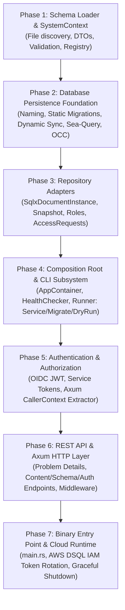

# Infrastructure Crate Architecture & Implementation Plan

- **Target Crate**: `infrastructure`
- **Governing Architecture**: [`ADR-002`](./adr/ADR-002-hexagonal-architecture.md), [`ADR-003`](./adr/ADR-003-aws-dsql-database.md), [`ADR-004`](./adr/ADR-004-draft-and-publish-table-pattern.md), [`ADR-005`](./adr/ADR-005-trash-undelete-and-retention.md)
- **API Specification**: [`docs/api.md`](./api.md)
- **Persistence Pattern**: [`docs/design-infrastructure-persistence.md`](./design-infrastructure-persistence.md)
- **Status**: Draft Architecture Plan — Ready for Step 1 (JSON Schema Design)
- **Date**: 2026-10-23

---

## 1. Role of the Infrastructure Crate

In Luminair's Hexagonal Architecture (Ports and Adapters):
1. **Outer Boundary & Driving/Driven Adapters**:
   - **Driving Adapter (Inbound)**: Axum REST API layer decoding HTTP requests, verifying OIDC JWT / Service tokens into `CallerContext`, invoking application services, and encoding responses/errors as RFC 9457 `ProblemDetails`.
   - **Driven Adapter (Outbound)**: SQL database persistence via `sqlx::PgPool` (targeting AWS Aurora DSQL and PostgreSQL), implementing repository traits defined in `domain` (`DocumentInstanceRepository`, `DocumentSnapshotRepository`, `RoleRepository`, `UserRoleAssignmentRepository`, `AccessRequestRepository`).
2. **Composition Root (`container.rs` & `main.rs`)**:
   - The `infrastructure` crate is the single executable composition root of the application workspace.
   - It reads server configuration and schema files, instantiates the static `SystemContext`, configures connection pools, constructs repository adapters, injects them into application services (`DocumentsServiceImpl`, `AccessRequestsServiceImpl`, `SystemConfigServiceImpl`, `SchemaServiceImpl`), and boots the Axum HTTP server.
3. **Strict Technology Isolation**:
   - `domain` and `application` remain 100% agnostic of HTTP frameworks, database drivers, SQL, and AWS SDKs.
   - All technology-specific concerns (Axum, SQLx, Sea-Query, JWT validation, AWS IAM token refresh, DSQL non-transactional DDL) reside exclusively in `infrastructure`.

---

## 2. Directory & Module Structure

```
infrastructure/
├── Cargo.toml
├── migrations/                               # SQLx static migration scripts
│   ├── 20260924000001_create_system_tables.sql
│   ├── 20260924000002_seed_builtin_roles.sql
│   ├── 20261010000001_create_document_drafts.sql
│   ├── 20261010000002_create_document_snapshots.sql
│   └── 20261022000001_create_document_tombstones.sql
├── tests/                                    # Integration tests
│   ├── migrations_test.rs                    # Static migration idempotency & DSQL compatibility
│   ├── schema_loader_test.rs                 # Schema parsing, validation, and domain conversion
│   ├── persistence_test.rs                   # Repository integration against live test database
│   ├── api_test.rs                           # End-to-end Axum HTTP route testing
│   └── cli_test.rs                           # CLI mode verification (Service, Migrate, DryRun)
└── src/
    ├── lib.rs                                # Public crate interface
    ├── main.rs                               # Binary entry point
    ├── container.rs                          # AppContainer composition root wiring
    │
    ├── schema_loader/                        # Schema file discovery, parsing, and context build
    │   ├── mod.rs
    │   ├── dto.rs                            # Serde DTOs for schema JSON representation
    │   ├── sanitize.rs                       # Identifier sanitization and reserved SQL keywords
    │   ├── validator.rs                      # Schema validation before domain construction
    │   └── loader.rs                         # Directory walking and SystemContext assembly
    │
    ├── persistence/                          # Database storage engine
    │   ├── mod.rs
    │   ├── naming/                           # SQL naming conventions (tables, junction, columns)
    │   │   ├── mod.rs
    │   │   └── identifiers.rs
    │   ├── migration/                        # Static and dynamic schema migrations
    │   │   ├── mod.rs
    │   │   ├── embedded.rs                   # SQLx static migrator
    │   │   └── dynamic_sync.rs               # DDL generator for wide tables & junction tables
    │   ├── query/                            # Dynamic query generation & OCC helpers
    │   │   ├── mod.rs
    │   │   ├── wide_table.rs                 # Sea-query builder for published wide tables
    │   │   ├── junction.rs                   # Sea-query builder for relation link tables
    │   │   └── occ.rs                        # Concurrency retry loop for SQLSTATE 40001
    │   └── repositories/                     # Domain repository implementations
    │       ├── mod.rs
    │       ├── document_instance.rs          # SqlxDocumentInstanceRepository (ADR-004)
    │       ├── document_snapshot.rs          # SqlxDocumentSnapshotRepository (ADR-004)
    │       ├── role.rs                       # SqlxRoleRepository (ADR-005)
    │       ├── user_role_assignment.rs       # SqlxUserRoleAssignmentRepository (ADR-005)
    │       └── access_request.rs             # SqlxAccessRequestRepository (ADR-005)
    │
    ├── auth/                                 # Authentication and security machinery
    │   ├── mod.rs
    │   ├── oidc.rs                           # OIDC JWT validation and JWKS caching
    │   ├── service_token.rs                  # Static / Bearer token validation for Service actors
    │   ├── shadow_user.rs                    # Auto-provisioning of shadow users in database
    │   └── extractor.rs                      # Axum CallerContext request extractor & middleware
    │
    ├── api/                                  # HTTP REST driving adapter
    │   ├── mod.rs
    │   ├── error.rs                          # RFC 9457 Problem Details error translation
    │   ├── routes.rs                         # Master Axum router builder
    │   ├── middleware/                       # Request logging, trace ID, CORS, rate limiting
    │   │   ├── mod.rs
    │   │   ├── logging.rs
    │   │   └── request_id.rs
    │   └── handlers/                         # Axum endpoint handlers
    │       ├── mod.rs
    │       ├── content.rs                    # Content CRUD, publish, unpublish, restore, snapshots
    │       ├── schema.rs                     # Schema discovery endpoints
    │       ├── access_requests.rs            # User onboarding & review endpoints
    │       ├── system.rs                     # Locales and system configuration endpoints
    │       └── health.rs                     # /healthz and /ready endpoints
    │
    └── cli/                                  # CLI configuration and execution modes
        ├── mod.rs
        ├── config.rs                         # ServerConfig, RunMode, and environment parsing
        ├── runner.rs                         # Main runner dispatcher (Service, Migrate, DryRun)
        ├── dry_run.rs                        # Offline validation of config & schemas
        ├── migrate.rs                        # Standalone migration execution
        └── service.rs                        # Long-running HTTP service startup
```

---

## 3. Core Architectural Contracts

### 3.1 Central Composition Root Container (`container.rs`)

```rust
use std::sync::Arc;
use application::services::{
    AccessRequestsServiceImpl, DocumentsServiceImpl, SchemaServiceImpl, SystemConfigServiceImpl,
};
use domain::system::SystemContext;
use sqlx::PgPool;

use crate::auth::AuthAppState;
use crate::persistence::repositories::{
    SqlxAccessRequestRepository, SqlxDocumentInstanceRepository, SqlxDocumentSnapshotRepository,
    SqlxRoleRepository, SqlxUserRoleAssignmentRepository,
};

/// Sub-container holding shared database persistence resources.
#[derive(Clone)]
pub struct PersistenceContainer {
    pub pool: PgPool,
    pub instance_repo: SqlxDocumentInstanceRepository,
    pub snapshot_repo: SqlxDocumentSnapshotRepository,
    pub role_repo: SqlxRoleRepository,
    pub assignment_repo: SqlxUserRoleAssignmentRepository,
    pub access_request_repo: SqlxAccessRequestRepository,
}

/// Central composition root container holding initialized services and adapters.
#[derive(Clone)]
pub struct AppContainer {
    pub context: &'static SystemContext,
    pub persistence: PersistenceContainer,
    pub documents_service: Arc<
        DocumentsServiceImpl<SqlxDocumentInstanceRepository, SqlxDocumentSnapshotRepository>,
    >,
    pub access_requests_service: Arc<
        AccessRequestsServiceImpl<
            SqlxAccessRequestRepository,
            SqlxUserRoleAssignmentRepository,
            SqlxRoleRepository,
        >,
    >,
    pub schema_service: Arc<SchemaServiceImpl>,
    pub system_config_service: Arc<SystemConfigServiceImpl>,
    pub health_checker: Arc<HealthChecker>,
    pub auth: AuthAppState,
}
```

### 3.2 CLI Runner Dispatcher (`cli/runner.rs`)

```rust
use crate::cli::config::{CliError, CliOutcome, RunMode, ServerConfig};
use crate::cli::dry_run::dry_run;
use crate::cli::migrate::migrate;
use crate::cli::service::start_service;

/// Dispatches execution based on `config.mode`:
/// - `RunMode::Service`: executes static migrations, dynamic schema sync, admin bootstrap hook,
///   and starts the HTTP server.
/// - `RunMode::Migrate`: executes static migrations and dynamic schema sync, then returns migration summary.
/// - `RunMode::DryRun`: validates configuration, auth, and schema definitions without connecting to the database.
pub async fn run(config: &ServerConfig) -> Result<CliOutcome, CliError> {
    match config.mode {
        RunMode::Service => {
            let container = start_service(config).await?;
            Ok(CliOutcome::Service(container))
        }
        RunMode::Migrate => {
            let summary = migrate(config).await?;
            Ok(CliOutcome::Migrated(summary))
        }
        RunMode::DryRun => {
            let summary = dry_run(config)?;
            Ok(CliOutcome::DryRunValidated(summary))
        }
    }
}
```

---

## 4. Step-by-Step Implementation Roadmap

The system will be constructed incrementally through testable, self-contained milestones:



---

### Phase 1: Schema Loader & System Context Assembly (Immediate Next Step)

**Objective**: Allow Luminair to load its entire schema catalog and system localization configuration from human-readable JSON files on disk into domain objects and assemble `&'static SystemContext` without touching the database.

- **Step 1.1: Design JSON Schema Format**:
  - Define canonical JSON schema files:
    - `system.json`: default locale, available locales, instance name, audit options.
    - Content type definitions (e.g. `articles.json`, `categories.json`):
      - Document kind (`CollectionType` vs `SingleType`).
      - Attributes: Primitives (`Text`, `Integer`, `Decimal`, `Boolean`, `DateTime`, `Uid`), `LocalizedText`, `Json`.
      - Relations: `HasOne`, `HasMany`, `BelongsToOne`, `BelongsToMany` targeting other document types.
      - Constraints: `MinLength`, `MaxLength`, `MinInteger`, `MaxInteger`, `MinDecimal`, `MaxDecimal`, `RegexPattern`.
      - Options: `draft_and_publish`, `timestamps`.
      - Display fields: `display_fields: ["title", "category"]` (enforcing max 3 fields, max 1 singular relation).
- **Step 1.2: Serde DTOs (`schema_loader::dto`)**:
  - Strongly typed Serde models in `infrastructure::schema_loader::dto` mirroring the JSON schema specifications.
  - Keeps domain entities pure (`domain::schema` remains free of Serde dependencies).
- **Step 1.3: Sanitization & Identifier Validation (`schema_loader::sanitize`)**:
  - Verify identifiers: kebab-case validation, conversion to snake_case (`kebab_to_snake`), length limits (max 64 chars).
  - Reserved SQL keyword check (`RESERVED_SQL_KEYWORDS`) to prevent naming collisions with PostgreSQL / AWS DSQL.
- **Step 1.4: Schema Loader & Domain Transformation (`schema_loader::loader`)**:
  - Walk the schema directory, parse JSON files, and map DTOs into domain value objects and entities:
    - Map to `DocumentTypeInfo`, `FieldDefinition`, `RelationDefinition`, `DocumentType`.
    - Map `system.json` to `SystemConfig`.
  - Validate schema graph using `SchemaRegistry::try_new`:
    - Validates `display_fields` constraints (max 3, max 1 relation, valid fields).
    - Validates field constraint applicability to field types.
    - Validates all relation targets exist in the registry.
- **Step 1.5: Static System Context Provider**:
  - Initialize `SystemContext::new(registry, config)` and leak once to `'static` lifetime via `Box::leak`.
- **Step 1.6: Verification & Test Suite**:
  - Write integration tests in `infrastructure/tests/schema_loader_test.rs`:
    - Successful loading of valid schema sets.
    - Proper rejection of invalid identifiers, unresolvable relation targets, incompatible constraints, and invalid display fields.

---

### Phase 2: Database Persistence Foundation (Naming, Migrations & Dynamic Sync)

**Objective**: Establish the relational schema foundation adhering to AWS Aurora DSQL rules (client UUIDv7, non-transactional DDL, no sequences/serials, OCC retry loops).

- **Step 2.1: SQL Identifier Naming Engine (`persistence::naming`)**:
  - Deterministic mapping from `DocumentTypeId` and `AttributeId` to table and column names:
    - Content wide table: `articles` (pluralized snake_case).
    - Junction link table: `articles_author_links`.
    - Column names: `hero_image_url`, `published_at`, `has_pending_draft`.
- **Step 2.2: Complete Static Migrations (`infrastructure/migrations/`)**:
  - `20261010000001_create_document_drafts.sql`: unified draft table storing `status` (`'draft'`, `'modified'`, `'unpublished'`), `display_values`, `display_title`, `content JSONB`, `relations JSONB`, and OCC `version`.
  - `20261010000002_create_document_snapshots.sql`: immutable revision snapshot archive with `reason IN ('publish', 'unpublish')` and `UNIQUE (document_type_id, document_id, revision)`.
- **Step 2.3: Dynamic Schema Synchronizer (`persistence::migration::dynamic_sync`)**:
  - Generate additive DDL from `SchemaRegistry`:
    - Wide tables for each document type with typed columns matching primitive attributes.
    - Junction tables for relations (`source_id UUID`, `target_id UUID`, `order_index INT`).
    - Standard columns: `id UUID PRIMARY KEY`, `revision INT`, `created_at`, `created_by`, `updated_at`, `updated_by`, `published_at`, `published_by`, `has_pending_draft BOOLEAN NOT NULL DEFAULT FALSE`.
    - Strictly use `CREATE TABLE IF NOT EXISTS` and `ALTER TABLE ... ADD COLUMN IF NOT EXISTS` (DSQL-safe non-transactional DDL).
- **Step 2.4: Query Construction & OCC Retry Engine (`persistence::query`)**:
  - Build parameterized queries using `sea-query` for PostgreSQL / Aurora DSQL.
  - Implement `with_occ_retry` helper for automatic exponential backoff on SQLSTATE `40001` (serialization failure).

---

### Phase 3: Repository Adapters

**Objective**: Implement domain repository ports on top of SQLx.

- **Step 3.1: Content Repositories (`SqlxDocumentInstanceRepository` & `SqlxDocumentSnapshotRepository`)**:
  - Implement the **Asymmetric Hybrid Pattern** ([`ADR-004`](./adr/ADR-004-draft-and-publish-table-pattern.md)):
    - `save_draft`: writes working draft to `document_drafts` and updates `has_pending_draft = TRUE` in wide table if currently published (`Modified` state).
    - `publish`: writes to wide table `[type]`, clears draft from `document_drafts` (`has_pending_draft = FALSE`), and archives superseded revision to `document_snapshots` if `snapshot: Option<&DocumentSnapshot>` is provided.
    - `unpublish`: deletes row from wide table `[type]`, preserves state in `document_drafts` with `status = 'unpublished'`, and archives snapshot atomically.
    - `discard_draft`: deletes pending draft from `document_drafts` and sets `has_pending_draft = FALSE` on the clean wide table row.
    - `find_by_id(type, id, view)`: fetches from wide table (`VersionView::Published`) or `document_drafts` (`VersionView::Working`).
    - `list_admin_headers`: single query combining drafts and clean published rows (`has_pending_draft = FALSE`) using materialized `display_values` and `display_title`.
    - `find_display_titles_by_ids`: batched lookup for Phase 2 singular relational display field enrichment.
- **Step 3.2: Auth Repositories**:
  - `SqlxRoleRepository`: loads static and custom roles, manages permissions.
  - `SqlxUserRoleAssignmentRepository`: persists user role assignments with `ActorId` URNs.
  - `SqlxAccessRequestRepository`: manages user onboarding queue (`access_requests` table).
- **Step 3.3: Integration Tests**:
  - Verify repositories against PostgreSQL container using `#[sqlx::test]`.

---

### Phase 4: Composition Root (`container.rs`) & CLI Subsystem

**Objective**: Wire dependencies and implement the execution runner.

- **Step 4.1: Assembly of `PersistenceContainer` and `AppContainer`**:
  - Connect `PgPool`, wire repositories, instantiate application services, and package `AppContainer`.
- **Step 4.2: Health Checker**:
  - Implement `/healthz` (liveness: process running) and `/ready` (readiness: DB pool reachable, schemas valid).
- **Step 4.3: CLI Subsystem (`cli/runner.rs`)**:
  - Parse `ServerConfig` from CLI flags and environment variables.
  - Implement `run(config: &ServerConfig) -> Result<CliOutcome, CliError>`:
    - `RunMode::DryRun`: runs `schema_loader` and validates without connecting to DB.
    - `RunMode::Migrate`: executes static migrations and dynamic DDL schema sync, prints summary, exits.
    - `RunMode::Service`: executes migrations/sync, boots `AppContainer`, starts Axum HTTP server.

---

### Phase 5: Authentication & Authorization Machinery (`auth`)

**Objective**: Secure HTTP endpoints and populate domain `CallerContext`.

- **Step 5.1: OIDC JWT Validation (`auth::oidc`)**:
  - Verify incoming Bearer tokens using `jsonwebtoken`, JWKS caching, audience & issuer checks.
  - Extract subject to `UserId` and construct `ActorId::User(user_id)`.
- **Step 5.2: Service Token Validation (`auth::service_token`)**:
  - Support pre-shared service API tokens mapping to `ActorId::Service(service_id)`.
- **Step 5.3: Axum CallerContext Extractor (`auth::extractor`)**:
  - Load assigned roles from `UserRoleAssignmentRepository`.
  - Assemble `CallerContext` and inject into Axum request extensions.
- **Step 5.4: Shadow User Provisioning (`auth::shadow_user`)**:
  - Upsert OIDC identities into `shadow_users` table on first login.

---

### Phase 6: REST API & Axum HTTP Layer (`api`)

**Objective**: Expose Strapi-like REST endpoints conforming to [`docs/api.md`](./api.md).

- **Step 6.1: RFC 9457 Problem Details Error Translation (`api::error`)**:
  - Migrate HTTP status mapping and Problem Details serialization from `application::errors` into `infrastructure::api::error`.
  - Map `ApplicationError` variants to standardized HTTP status codes and machine-readable `code` keys.
- **Step 6.2: Content Endpoints (`api::handlers::content`)**:
  - `GET /api/v1/content/:type_id` (filter, paginate, populate).
  - `GET /api/v1/content/:type_id/:id` (find by ID with `?view=published` or `?view=working`).
  - `POST /api/v1/content/:type_id` (create draft/instance).
  - `PUT /api/v1/content/:type_id/:id` (update draft with OCC `expected_version`).
  - `DELETE /api/v1/content/:type_id/:id` (delete document).
  - `POST /api/v1/content/:type_id/:id/publish` (publish).
  - `POST /api/v1/content/:type_id/:id/unpublish` (unpublish with `draft_resolution`).
  - `POST /api/v1/content/:type_id/:id/discard-draft` (discard draft edits).
  - `GET /api/v1/content/:type_id/:id/snapshots` (list revision history).
  - `GET /api/v1/content/:type_id/:id/snapshots/:revision` (get revision snapshot).
  - `POST /api/v1/content/:type_id/:id/snapshots/:revision/restore` (restore snapshot into draft).
  - `GET /api/v1/content/:type_id/admin-headers` (lightweight Admin Studio listing).
- **Step 6.3: Schema & System Endpoints (`api::handlers::schema` & `system`)**:
  - `GET /api/v1/schemas` & `GET /api/v1/schemas/:type_id`.
  - `GET /api/v1/system/config` & `GET /api/v1/system/locales`.
- **Step 6.4: Auth & Access Requests Endpoints (`api::handlers::access_requests`)**:
  - `POST /api/v1/auth/access-requests` (submit onboarding request).
  - `GET /api/v1/auth/access-requests` (list pending requests for admin).
  - `POST /api/v1/auth/access-requests/:id/approve` & `reject`.
- **Step 6.5: End-to-End HTTP Route Tests**:
  - Test suite using `axum-test` verifying serialization, auth extraction, status codes, and Problem Details payloads.

---

### Phase 7: Binary Entry Point & Cloud Runtime Packaging

**Objective**: Complete the runnable service with production-grade telemetry and AWS Aurora DSQL compatibility.

- **Step 7.1: `main.rs` Binary**:
  - CLI argument parsing via `clap`.
  - Setup structured logging via `tracing-subscriber` (JSON in production, human-friendly in development).
  - Wire graceful shutdown on `SIGINT` / `SIGTERM`.
- **Step 7.2: AWS Aurora DSQL Connection Factory**:
  - Dynamic token refresher generating short-lived IAM credentials (15-min token rotation) when connecting to Aurora DSQL endpoints.
  - Fallback to standard connection string for PostgreSQL / Docker / local development.

---

## 5. Next Immediate Session Action: Designing the JSON Schema

Per the project roadmap, the next immediate task is **Phase 1: Step 1.1 — Designing the JSON Schema Format**.

Before writing code in `infrastructure/src/schema_loader/`:
1. Design the exact JSON specification for content type definitions (`articles.json`, `categories.json`) and system configuration (`system.json`).
2. Specify attribute representations, relation definitions, validation constraints, and display identity properties.
3. Review and approve the schema JSON contract with the user.
