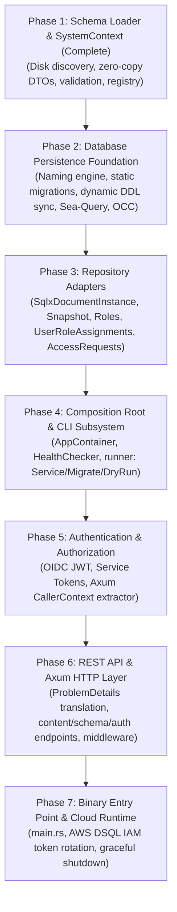

# Infrastructure Crate Implementation Plan

- **Target Crate**: `infrastructure`
- **Governing Architecture & Sub-system Documentation**:
  - Overview & Composition Root: [`docs/infrastructure/overview.md`](./infrastructure/overview.md)
  - Schema Loader & Config Specification: [`docs/infrastructure/schema-loader.md`](./infrastructure/schema-loader.md)
  - Database Persistence & Adapters: [`docs/infrastructure/persistence.md`](./infrastructure/persistence.md)
  - REST API & Authentication: [`docs/infrastructure/api-and-auth.md`](./infrastructure/api-and-auth.md)
  - Canonical API Reference: [`docs/api.md`](./api.md)
- **Status**: Phase 1 Complete — Ready for Phase 2 Execution
- **Last Updated**: 2026-10-23

---

## 1. Plan Overview & Roadmap

The `infrastructure` crate is implemented incrementally across 7 testable phases, beginning with the offline-testable schema loader and culminating in a production-ready binary with AWS Aurora DSQL compatibility:

---

## 2. Phase-by-Phase Implementation Tasks

### Phase 1: Schema Loader & System Context Assembly (Complete)

> **Detailed Specification**: See [`docs/infrastructure/schema-loader.md`](./infrastructure/schema-loader.md) for disk layout, JSON examples (`system-config.json`, `article.json`, `category.json`), and the zero-copy DTO contracts (`AttributeRecord` untagged enum).

- [x] **Step 1.1: Zero-Copy Borrowed DTOs (`infrastructure/src/schema_loader/dto.rs`)**
  - Implement borrowed Serde records using `#[serde(bound = "'de: 'a")]` and `&'a str`.
  - Implement `AttributeRecord<'a>` as an untagged enum with `Field` and `Relation` variants.
  - Implement `FieldTypeDto<'a>`, `RelationTypeDto`, `ConstraintRecord<'a>`, `DocumentRecord<'a>`, `DocumentInfoRecord<'a>`, `DocumentOptionsRecord`, and `SystemConfigRecord<'a>`.
  - Preserve field ordering using `IndexMap<&'a str, AttributeRecord<'a>>`.
- [x] **Step 1.2: Identifier Sanitization & Validation (`infrastructure/src/schema_loader/sanitize.rs`)**
  - Verify identifiers against `RESERVED_SQL_KEYWORDS` (e.g. `order`, `table`, `user`).
  - Enforce kebab-case rules matching domain `DocumentTypeId` and `AttributeId`.
- [x] **Step 1.3: Schema Loader & Domain Transformation (`infrastructure/src/schema_loader/loader.rs`)**
  - Walk `config.schema_dir` to load `system-config.json` and all files under `document-types/*.json`.
  - Validate that each file stem matches `info.singularName` (`file_stem == info.singularName == DocumentTypeId`).
  - Partition `attributes` into `IndexSet<FieldDefinition>` and `IndexSet<RelationDefinition>`.
  - Construct `DocumentType` instances and pass to `SchemaRegistry::try_new(types)` for cross-schema graph validation.
  - Parse `system-config.json` into `SystemConfig` (generating internal `SystemConfigId`).
  - Construct `SystemContext` and promote to `'static` via `Box::leak`.
- [x] **Step 1.4: Integration Test Suite (`infrastructure/tests/schema_loader_test.rs`)**
  - Test valid schema loading with fixtures (`article.json`, `category.json`, `system-config.json`).
  - Test rejection of invalid identifiers, unresolvable relation targets, invalid display fields, and incompatible constraints.

---

### Phase 2: Database Persistence Foundation (Naming, Migrations & Dynamic Sync)

> **Detailed Specification**: See [`docs/infrastructure/persistence.md`](./infrastructure/persistence.md) and [`docs/design-infrastructure-persistence.md`](./design-infrastructure-persistence.md).

- [ ] **Step 2.1: SQL Identifier Naming Engine (`infrastructure/src/persistence/naming/`)**
  - Map `DocumentTypeId` to snake_case pluralized table names (`article` -> `articles`).
  - Map relations to junction link table names (`articles_tags_links`).
  - Map `AttributeId` to column names with keyword escaping where required.
- [ ] **Step 2.2: Static System Migrations (`infrastructure/migrations/`)**
  - Add `20261010000001_create_document_drafts.sql` (`document_drafts` table).
  - Add `20261010000002_create_document_snapshots.sql` (`document_snapshots` table).
  - Ensure all migration files begin with `-- no-transaction` and use client UUIDv7.
- [ ] **Step 2.3: Dynamic Schema Synchronizer (`infrastructure/src/persistence/migration/dynamic_sync.rs`)**
  - Generate additive DDL from `SchemaRegistry` (`CREATE TABLE IF NOT EXISTS`, `ALTER TABLE ... ADD COLUMN IF NOT EXISTS`).
  - Provision relational junction tables and B-tree indexes.
- [ ] **Step 2.4: Query Construction & OCC Engine (`infrastructure/src/persistence/query/`)**
  - Sea-Query dynamic wide table and junction table queries.
  - Implement `with_occ_retry` handling SQLSTATE `40001` (serialization failure) with exponential backoff.

---

### Phase 3: Repository Adapters

> **Detailed Specification**: See [`docs/infrastructure/persistence.md`](./infrastructure/persistence.md#5-repository-adapters-persistencerepositories).

- [ ] **Step 3.1: Content Repositories (`infrastructure/src/persistence/repositories/`)**
  - Implement `SqlxDocumentInstanceRepository` conforming to ADR-004 Asymmetric Hybrid pattern (`save_draft`, `publish`, `unpublish`, `discard_draft`, `find_by_id`, `list_admin_headers`, `find_display_titles_by_ids`).
  - Implement `SqlxDocumentSnapshotRepository` (`save_snapshot`, `list_snapshots`, `get_snapshot`).
- [ ] **Step 3.2: Auth Repositories**
  - Implement `SqlxRoleRepository`, `SqlxUserRoleAssignmentRepository`, and `SqlxAccessRequestRepository`.
- [ ] **Step 3.3: Integration Test Suite (`infrastructure/tests/persistence_test.rs`)**
  - Test all repository operations against a live PostgreSQL test database.

---

### Phase 4: Composition Root (`container.rs`) & CLI Subsystem

> **Detailed Specification**: See [`docs/infrastructure/overview.md`](./infrastructure/overview.md#3-composition-root-wiring-containerrs).

- [ ] **Step 4.1: Composition Root Wiring (`infrastructure/src/container.rs`)**
  - Assemble `PersistenceContainer` and `AppContainer`.
- [ ] **Step 4.2: Health Checker**
  - Implement `/healthz` (liveness) and `/ready` (readiness) checks.
- [ ] **Step 4.3: CLI Subsystem & Runner (`infrastructure/src/cli/`)**
  - Implement `ServerConfig` and `run(config: &ServerConfig) -> Result<CliOutcome, CliError>` dispatching `Service`, `Migrate`, and `DryRun`.

---

### Phase 5: Authentication & Authorization Machinery

> **Detailed Specification**: See [`docs/infrastructure/api-and-auth.md`](./infrastructure/api-and-auth.md#3-authentication-machinery-auth).

- [ ] **Step 5.1: OIDC JWT Verification (`infrastructure/src/auth/oidc.rs`)**
  - Validate JWT signatures via JWKS, verify `aud`/`iss`, and extract `UserId`.
- [ ] **Step 5.2: Service API Tokens (`infrastructure/src/auth/service_token.rs`)**
  - Validate pre-shared service tokens mapping to `ActorId::Service`.
- [ ] **Step 5.3: Axum CallerContext Extractor (`infrastructure/src/auth/extractor.rs`)**
  - Middleware loading assigned roles and populating `CallerContext`.
- [ ] **Step 5.4: Shadow Users (`infrastructure/src/auth/shadow_user.rs`)**
  - Upsert first-seen OIDC identities into `shadow_users`.

---

### Phase 6: REST API & Axum HTTP Layer

> **Detailed Specification**: See [`docs/infrastructure/api-and-auth.md`](./infrastructure/api-and-auth.md) and canonical endpoint catalog in [`docs/api.md`](./api.md).

- [ ] **Step 6.1: Problem Details Error Translation (`infrastructure/src/api/error.rs`)**
  - Map `ApplicationError` variants to standardized HTTP status codes and RFC 9457 `ProblemDetails` payloads.
- [ ] **Step 6.2: Route Handlers (`infrastructure/src/api/handlers/`)**
  - Implement content endpoints (CRUD, publish, unpublish, discard draft, restore snapshot, list snapshots, admin headers).
  - Implement schema discovery and system configuration endpoints.
  - Implement access requests onboarding endpoints.
- [ ] **Step 6.3: HTTP Integration Test Suite (`infrastructure/tests/api_test.rs`)**
  - End-to-end route tests using `axum-test`.

---

### Phase 7: Binary Entry Point & Cloud Runtime Packaging

> **Detailed Specification**: See [`docs/infrastructure/overview.md`](./infrastructure/overview.md#4-cli-execution-modes--dispatcher-clirunnerrs).

- [ ] **Step 7.1: Binary Wiring (`infrastructure/src/main.rs`)**
  - Clap CLI argument parsing, JSON/pretty `tracing-subscriber`, and graceful shutdown signals (`SIGINT`, `SIGTERM`).
- [ ] **Step 7.2: AWS Aurora DSQL Connection Factory**
  - Dynamic IAM token rotation (15-min lifecycle) for Aurora DSQL endpoints with fallback to standard PostgreSQL.

---

## 3. Immediate Next Execution Step

Execute **Phase 2: Database Persistence Foundation**:
- Step 2.1: Implement SQL identifier naming engine (`infrastructure/src/persistence/naming/`).
- Step 2.2: Add static migrations for `document_drafts` and `document_snapshots`.
- Step 2.3: Implement dynamic additive schema synchronizer (`dynamic_sync.rs`).
- Step 2.4: Build Sea-Query wide-table query builders and OCC retry helper (`with_occ_retry`).
