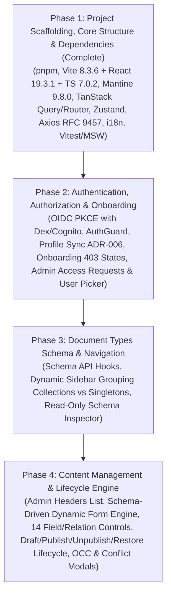

# Luminair Admin Studio (`frontend/`) Implementation Plan

- **Target Directory**: `frontend/`
- **Governing Architecture & Sub-system Documentation**:
  - UI Architecture: [`docs/ui-architecture.md`](./ui-architecture.md)
  - Canonical API Reference: [`docs/api.md`](./api.md)
  - Content Lifecycle & Transitions: [`docs/content-lifecycle.md`](./content-lifecycle.md)
  - Coding Rules: [`.ai/rules/frontend-react.md`](../.ai/rules/frontend-react.md)
  - Frontend Patterns Skill: [`.ai/skills/frontend/react-patterns.md`](../.ai/skills/frontend/react-patterns.md)
  - Testing Skill: [`.ai/skills/frontend/react-testing.md`](../.ai/skills/frontend/react-testing.md)
- **Backend Driving Adapter**: [`infrastructure::api`](../infrastructure/src/api/routes.rs) (`luminair-server` on port `8080` in Docker Compose)
- **Status**: Phase 1 Complete (Scaffolding, Dependencies, Core API/Store/i18n Infrastructure, Layout, Common Components, MSW Test Harness, 69/69 Tests Passing); Phases 2–4 Planned.
- **Last Updated**: 2026-11-09

---

## 1. Plan Overview & Roadmap

The Admin Studio UI is structured into **4 sequential, independently verifiable phases**:

> [!IMPORTANT]
> **Mandatory Coding & Quality Gates ([`.ai/rules/frontend-react.md`](../.ai/rules/frontend-react.md))**:
> - **Package Manager**: Use `pnpm` exclusively (`pnpm install`, `pnpm run lint`, `pnpm exec tsc --noEmit`, `pnpm test`).
> - **Zero `any`**: Strict TypeScript (`pnpm exec tsc --noEmit` with TypeScript `7.0.2`) and ESLint (`pnpm run lint`) with zero warnings.
> - **Mantine Design System Only**: Zero raw CSS files or inline `style={{ ... }}` objects when Mantine style props/tokens exist.
> - **React Compiler 1.0 & Rules of React**: Zero manual `useMemo`/`useCallback` for performance; render functions strictly pure; zero compiler diagnostic suppressions; `"use no memo"` only as temporary tracked escape hatch.
> - **React 19.0 / 19.2 / 19.3 Modern Primitives**:
>   - Pass `ref` as a regular prop (forbid `React.forwardRef`); render `<Context value={...}>` directly (forbid `<Context.Provider>`); use `use(Context)` for conditional context access.
>   - Use `<Activity mode={isActive ? 'visible' : 'hidden'}>` (React 19.2) to preserve DOM/form state across tabs (`LocalizedTextTabs`, `Working Draft` vs `Published Live`, `SnapshotHistoryPanel`) while pausing effects while hidden.
>   - Use `useEffectEvent` (React 19.2) for non-reactive callbacks inside `useEffect` (OIDC token listeners, auto-save timers).
>   - Use native `<title>` inside route components, and `<ViewTransition>` / `addTransitionType` / `<Fragment ref={...}>` (React 19.3) + `useOptimistic` / `useTransition` alongside TanStack Query and Mantine Form.
> - **SLAP & Component Size**: Target $\le 50$ lines per component, max JSX conditional/loop nesting depth of 2, and "newspaper style" top-down file ordering.
> - **Server vs. Client State**: Zero `useEffect` or raw `use(fetchPromise)` for HTTP data fetching; all remote state goes through `@tanstack/react-query` hooks with centralized tuple keys in `src/api/query-keys.ts`.
> - **RFC 9457 i18n**: Always map `error.code` via `t('errors.' + error.code, error.details)`—never display raw backend developer `detail` strings as user copy.

### 1.1 React 19.0, 19.2, 19.3 & React Compiler 1.0 Feature Harmonization Matrix

| React Feature | Release | Role in Luminair Admin Studio (`frontend/`) | Harmonization with Mantine v9 / TanStack Query v5 / Zustand v5 |
|---|---|---|---|
| **React Compiler 1.0 (Automatic Memoization)** | 1.0 | Eliminates manual `useMemo`, `useCallback`, and `React.memo` for performance; compiler auto-memoizes component & hook returns and expressions | Requires pure render functions, immutable state, and zero `useEffect` state mirroring (`set-state-in-effect`); works with Mantine v9 and TanStack Query v5 |
| **`ref` as Prop & Ref Cleanup** | 19.0 | Custom field controls (`TextInputControl`, `NumberInputControl`, etc.) accept `ref` directly; DOM observer refs return cleanup callbacks | Replaces `React.forwardRef` when wrapping Mantine v9 inputs |
| **`<Context>` & `use(Context)`** | 19.0 | Used for schema/form context providers and conditional context reading after early guard returns | Note: `use(promise)` is **not** used for HTTP fetches—TanStack Query v5 owns caching, retries, and `queryKeys` invalidation |
| **Actions (`useTransition`, `useOptimistic`, `useDeferredValue`)** | 19.0 | Smooth non-blocking search/status filtering, optimistic status badge toggles, and pending action transitions | `@mantine/form` remains mandatory for schema validation and RFC 9457 `422 invalid_params` `form.setErrors(...)`; form submission can wrap mutations in `startTransition` |
| **Native `<title>` & `<meta>` Hoisting** | 19.0 | Every route (`Dashboard`, `Schema Inspector`, `Content List`, `Document Editor`, `Onboarding`) renders `<title>` directly | Eliminates `document.title` `useEffect` side-effects |
| **`<Activity>` (`visible` \| `hidden`)** | 19.2 | Preserves DOM, cursor position, and unsaved state in `LocalizedTextTabs`, `Working Draft` vs `Published Live` editor tabs, and `SnapshotHistoryPanel` | Unmounts effects when `hidden` (pausing background timers/query observers) while keeping Mantine/TipTap DOM nodes alive |
| **`useEffectEvent`** | 19.2 | Wraps non-reactive callbacks inside `useEffect` (e.g., `oidc-client-ts` userManager event subscriptions in Phase 2, draft buffer auto-sync in Phase 4) | Prevents stale closures and unnecessary effect re-subscriptions without ESLint disable comments |
| **`<ViewTransition>` & `addTransitionType`** | 19.3 | Animates master-detail navigation in Schema Inspector (Phase 3) and Content List $\leftrightarrow$ Editor transitions (Phase 4) | Works seamlessly with TanStack Router state transitions |
| **Fragment Refs (`<Fragment ref={...}>`)** | 19.3 | Focus management (`focus()`, `scrollIntoView()`) and `ResizeObserver` on multi-node dynamic form fields | Avoids extra wrapper `
` elements that would break Mantine `Stack`/`Group`/`Grid` layouts |
| **SSR/RSC Features (`cacheSignal`, PPR, `browser()`)** | 19.2 / 19.3 | **Excluded** | Luminair Admin Studio is a pure client-side Vite SPA (CloudFront + S3); SSR-only APIs are not needed |

---

## 2. Phase 1: Project Scaffolding, Core Structure & Dependencies (Complete)

**Goal**: Initialize the `frontend/` workspace using `pnpm`, install and configure the latest production and testing packages, establish the directory structure, wire up the centralized Axios RFC 9457 client, i18n catalogs, Zustand UI store, AppShell layout skeleton, and verify everything with `pnpm exec tsc --noEmit`, `pnpm run lint`, and `pnpm test`.

### 2.1 Workspace, `pnpm` & Latest Package Versions

All dependency versions below were queried directly via `pnpm view <pkg> version`:

| Category | Package | Latest Version | Purpose |
|---|---|---|---|
| **Package Manager** | `pnpm` | `10.26.0+` | Fast, disk-efficient package management (`packageManager` field in `package.json`) |
| **Core Runtime** | `react`, `react-dom` | `^19.3.1` | React 19 UI runtime |
| **Compiler** | `typescript` | `^7.0.2` | TypeScript 7.0 native/strict static type checking |
| **Build & Bundler** | `vite` | `^8.3.6` | Next-gen Vite bundler, dev server, and HMR |
| **Vite React Plugin** | `@vitejs/plugin-react` | `^6.3.0` | React Fast Refresh and JSX transform |
| **Design System** | `@mantine/core`, `@mantine/hooks`, `@mantine/form`, `@mantine/notifications`, `@mantine/modals`, `@mantine/dates`, `@mantine/tiptap` | `^9.8.0` | Accessible UI primitives, forms, modals, dates, notifications |
| **Rich Text Engine** | `@tiptap/react`, `@tiptap/starter-kit` | `^3.33.0` | Headless WYSIWYG editor core for `@mantine/tiptap` |
| **Date Library** | `dayjs` | `^1.11.23` | Lightweight date parsing and formatting for `@mantine/dates` |
| **Icons** | `@tabler/icons-react` | `^3.51.0` | Tabler SVG icons |
| **Routing** | `@tanstack/react-router` | `^1.170.46` | 100% type-safe file/code routing & search param validation |
| **Server State** | `@tanstack/react-query` | `^5.107.1` | Declarative server state, caching, and mutations |
| **Client State** | `zustand` | `^5.1.0` | Lightweight stores for auth, UI layout, and draft buffers |
| **HTTP Client** | `axios` | `^1.21.0` | HTTP client with Bearer & RFC 9457 `ProblemDetails` interceptors |
| **OIDC Auth** | `oidc-client-ts` | `^3.5.0` | OIDC Authorization Code Flow with PKCE |
| **Validation** | `zod` | `^4.6.7` | Schema validation for route search parameters and payloads |
| **Localization** | `i18next` (`^27.0.1`), `react-i18next` (`^18.0.1`) | `^27.0.1` / `^18.0.1` | Frontend i18n translation catalogs for UI & RFC 9457 error codes |
| **Test Runner** | `vitest` (`^5.1.0`), `jsdom` (`^31.0.0`) | `^5.1.0` / `^31.0.0` | Unit and component test execution |
| **Testing Library** | `@testing-library/react` (`^16.3.3`), `@testing-library/jest-dom` (`^7.0.1`), `@testing-library/user-event` (`^14.6.8`) | `^16.3.3` | React 19 component rendering & user interaction testing |
| **API Mocking** | `msw` | `^3.0.4` | Mock Service Worker for deterministic HTTP/RFC 9457 test handlers |
| **Linting** | `eslint` (`^10.14.0`), `typescript-eslint` (`^8.72.1`) | `^10.14.0` / `^8.72.1` | Flat-config ESLint 10 + TypeScript strict linting |

1. **Initialize Project (`frontend/`)**:
   - `frontend/package.json`: Configured `"packageManager": "pnpm@10.26.0"`, scripts (`dev`, `build`, `lint`, `typecheck`, `test`), and the latest dependencies from the table above.
   - `frontend/tsconfig.json` & `frontend/tsconfig.node.json`: Configured for TypeScript `7.0.2` with `strict: true`, `noImplicitAny: true`, `noUnusedLocals: true`, `noUnusedParameters: true`, and path alias `"@/*": ["./src/*"]`.
   - `frontend/vite.config.ts`: Configured Vite `8.3.6` with `@` alias, port `5173`, and `/api` dev proxy targeting backend (`http://localhost:8080` to match [`docker-compose.yml`](../docker-compose.yml) and [`config/cli-config.json`](../config/cli-config.json), configurable via env).
   - `frontend/.env.development` & `frontend/.env.production`: Configured `VITE_API_BASE_URL`, `VITE_OIDC_AUTHORITY` (`http://localhost:5556/dex`), `VITE_OIDC_CLIENT_ID` (`luminair-admin-spa`), `VITE_OIDC_REDIRECT_URI` (`http://localhost:5173/callback`), `VITE_OIDC_SCOPE` (`openid email profile`).

### 2.2 Core Infrastructure Modules (`src/api/`, `src/i18n/`, `src/store/`)

1. **Response Envelopes & RFC 9457 Error Types (`src/api/errors.ts`, `src/api/types.ts`)**:
   - Defined `JsonData<T>`, `PagedJson<T>`, `PaginationMeta` matching [`infrastructure/src/api/envelope.rs`](../infrastructure/src/api/envelope.rs).
   - Defined `ProblemDetails` and `InvalidParam` matching [`docs/api.md`](./api.md).
2. **Axios Client & Interceptors (`src/api/client.ts`)**:
   - Request interceptor injecting `Authorization: Bearer <token>` from `useAuthStore` and normalizing duplicate `/api` path prefixes and root health endpoints.
   - Response interceptor normalizing non-2xx responses (`application/problem+json`) into typed `ProblemDetails` objects.
3. **Centralized Query Keys (`src/api/query-keys.ts`)**:
   - Tuple factories for `system`, `schema`, `documents` (`list`, `headers`, `detail`, `snapshots`, `snapshotDetail`), `accessRequests`, and `users`.
4. **System API Hooks (`src/api/system.api.ts`)**:
   - `useSystemConfig()` (`GET /api/v1/system/config`) and `useSystemLocales()` (`GET /api/v1/system/locales`) returning `SystemConfigDto` / `LocalesDto`.
5. **Localization & Error Mapper (`src/i18n/`)**:
   - Configured `i18next` with English (`en`), Ukrainian (`uk`), and Russian (`ru`) catalogs covering all standard RFC 9457 error codes.
   - Implemented `getLocalizedErrorMessage(error, t)` and `mapValidationErrorsToForm(error, form)`.
6. **UI Store & Theme (`src/store/use-ui-store.ts`, `src/theme.ts`)**:
   - Zustand persisted store for `sidebarCollapsed`, `colorScheme` (`light` | `dark` | `auto`), and `activeLocale`.
   - Mantine `createTheme` configuration (`src/theme.ts`).
7. **Base Layout & Common Widgets (`src/components/layout/`, `src/components/common/`)**:
   - `AppShellLayout.tsx`, `AppHeader.tsx` (theme toggle, active locale switcher, user menu), `AppSidebar.tsx`, `BreadcrumbBar.tsx`.
   - `ErrorAlert.tsx`, `ConfirmModal.tsx`, `StatusBadge.tsx`, `DataTable.tsx`.
8. **Test Harness (`src/test-utils/`)**:
   - `renderWithProviders` wrapping `QueryClientProvider`, `MantineProvider`, `ModalsProvider`, and `i18next`.
   - Base MSW `3.0.4` server setup (`src/test-utils/server.ts`, `src/test-utils/server-handlers.ts`).

### Phase 1 Deliverables & Verification (Complete)

- [x] **Subtask 1.1**: Workspace scaffolding (`frontend/`), `pnpm` setup, latest packages installed, Vite 8 + TypeScript 7 + ESLint 10 + Vitest 5 configured.
- [x] **Subtask 1.2**: Core API envelopes (`src/api/types.ts`), RFC 9457 error normalizer (`src/api/errors.ts`), Axios client with Bearer & URL normalization interceptors (`src/api/client.ts`), tuple query keys (`src/api/query-keys.ts`), system hooks (`src/api/system.api.ts`), Zustand stores (`useAuthStore`, `useUiStore`, `useDraftStore`), and `i18next` catalogs (`en`, `uk`, `ru`) with `getLocalizedErrorMessage` / `mapValidationErrorsToForm`.
- [x] **Subtask 1.3**: MSW `3.0.4` test harness (`src/test-utils/`), reusable common widgets (`StatusBadge`, `ErrorAlert`, `ConfirmModal`, `DataTable`), application shell (`AppShellLayout`, `AppHeader`, `AppSidebar`, `BreadcrumbBar`), and TanStack Router root & dashboard skeleton (`src/routes/__root.tsx`, `src/routes/index.tsx`, `src/router.ts`).
- [x] `pnpm run lint` and `pnpm exec tsc --noEmit` pass with **0 errors and 0 warnings**.
- [x] **15 test suites (69 unit & component tests)** pass via `pnpm test`.
- [x] Production bundle (`pnpm run build`) succeeds cleanly in ~785ms.

---

## 2.3 Phase 1 Implementation Notes, Contradictions & Difficulties Discovered

During Phase 1 execution and review, the following technical contradictions and ecosystem changes in the latest tool versions were identified and resolved:

1. **Contradiction — Backend Port (`3000` vs `8080`)**:
   - *Finding*: `docs/ui-architecture.md` (§1 diagram and §7.4 `vite.config.ts`) specified port `3000` for the Axum backend, whereas `docker-compose.yml`, `config/cli-config.json`, and the Rust `infrastructure` crate standardize on port `8080`.
   - *Resolution*: Configured `vite.config.ts` dev proxy to target `http://localhost:8080` and updated `docs/ui-architecture.md` to match `8080`.
2. **Contradiction — `VITE_API_BASE_URL="/api"` vs `/api/v1/...` Endpoint Paths & Root Health Probes**:
   - *Finding*: `docs/ui-architecture.md` §7.3 specifies `VITE_API_BASE_URL="/api"`, while `docs/api.md` and `.ai/skills/frontend/react-patterns.md` document all API calls with full `/api/v1/...` paths (e.g. `apiClient.get('/api/v1/system/config')`) and root-level health probes (`/healthz`, `/ready`). Naive Axios concatenation with `baseURL: '/api'` produces `/api/api/v1/...` (404) and `/api/healthz` (404).
   - *Resolution*: Added `normalizeRequestUrl` in `src/api/client.ts` request interceptor to strip duplicate `/api` prefixes when `baseURL` ends with `/api` and `url` begins with `/api/`, and to bypass the `/api` prefix for root health probes (`/healthz`, `/ready`). Also added `/healthz` and `/ready` proxy rules in `vite.config.ts`.
3. **Difficulty — TypeScript `7.0.2` (Native Go Compiler) & `typescript-eslint` Compatibility**:
   - *Finding*: TypeScript `7.0.2` is the native Go rewrite (`tsgo`). First, it removed the deprecated `"baseUrl"` compiler option (`TS5102`), requiring pure `"paths": { "@/*": ["./src/*"] }`. Second, the `typescript` npm package in 7.0 no longer exports the legacy JS compiler AST API used by `typescript-eslint`, causing ESLint to throw: *"typescript-eslint does not support TS 7.0. Please see https://devblogs.microsoft.com/typescript/announcing-typescript-7-0/#running-side-by-side-with-typescript-6.0"*.
   - *Resolution*: Installed Microsoft's official compatibility package `@typescript/typescript6@^6.0.2` and configured `eslint.config.js` to resolve `'typescript'` to `'@typescript/typescript6'` for ESLint AST parsing while keeping `tsc --noEmit` on native TypeScript `7.0.2`.
4. **Difficulty — MSW `3.0.4` API Change (`onUnhandledFrame`)**:
   - *Finding*: MSW `3.0.4` unified HTTP and WebSocket interception into "frames" and replaced `server.listen({ onUnhandledRequest })` with `server.listen({ onUnhandledFrame: 'bypass' })`.
   - *Resolution*: Updated `src/test/setup.ts` to use `onUnhandledFrame: 'bypass'`.
5. **Difficulty — Mantine `9.8.0` in `jsdom` `31.0.0`**:
   - *Finding*: Mantine 9's `Select` / `Combobox` and responsive hooks invoke `window.matchMedia`, `ResizeObserver`, and `HTMLElement.prototype.scrollIntoView`, which are unimplemented in `jsdom`.
   - *Resolution*: Added deterministic shims for `matchMedia`, `ResizeObserver`, `scrollIntoView`, and `scrollTo` in `src/test/setup.ts`.
6. **Difficulty — Vite `8.3.6` (Rolldown Bundler) & `@tabler/icons-react`**:
   - *Finding*: Vite 8 uses Rolldown under the hood and warns against `__dirname` in ESM config files (resolved via `import.meta.dirname`). Additionally, `@tabler/icons-react` barrel imports transform ~5,000 icon modules during production builds and produce a >500 kB chunk notice.
   - *Note for Later Phases*: When route count grows in Phases 2–4, we can configure `build.rolldownOptions.output.codeSplitting` or lazy route splitting to keep chunks compact.

---

## 2.4 Phase 1 Overall Self-Review Scorecard (`.ai/skills/common/review.md`)

| Review Category | Status | Notes |
|---|---|---|
| **1. Automated Gates** | ✅ PASS | `pnpm exec tsc --noEmit` (0 errors), `pnpm run lint` (0 warnings/errors), `pnpm test` (15 suites, 69/69 tests green), `pnpm run build` (passes in ~785ms). |
| **2. Architecture & State Separation** | ✅ PASS | Server state strictly in `src/api/*.api.ts` using `queryKeys` tuple factories; client state in Zustand (`useAuthStore`, `useUiStore`, `useDraftStore`); zero `useEffect` data fetching. |
| **3. Clean Code (SRP & SLAP)** | ✅ PASS | All components decomposed into focused sub-components ($\le 35$ lines per component, well under the 50-line limit); JSX conditional/loop nesting depth $\le 2$. |
| **4. Newspaper Ordering** | ✅ PASS | Every `.ts`/`.tsx` file follows top-down ordering: Imports $\rightarrow$ Types & Interfaces $\rightarrow$ Primary Export $\rightarrow$ Internal Helpers & Sub-Components $\rightarrow$ Constants. |
| **5. Strict TypeScript & Mantine** | ✅ PASS | Zero `any` across all source and test files; explicit return types (`ReactElement`, `UseQueryResult<...>`) on all exports; Mantine 9 primitives and theme tokens used throughout with zero raw CSS or inline `style` objects. |
| **6. RFC 9457 Error & i18n Contract** | ✅ PASS | `normalizeAxiosError` normalizes all errors into `ProblemDetails`; `getLocalizedErrorMessage` maps `errors.${error.code}` with `error.details` interpolation and never leaks raw backend developer `detail` strings. |

---

## 3. Phase 2: Authentication, Authorization & Onboarding

**Goal**: Implement OIDC Authorization Code Flow with PKCE against Dex (`localhost:5556/dex`), session management in Zustand, automatic profile synchronization ([`ADR-006`](./adr/ADR-006-user-profile-and-directory-architecture.md)), route protection (`AuthGuard`), the 3-state Onboarding flow (`403` problem codes), and the Administrator Access Requests & User Directory panel.

### 3.1 OIDC PKCE & Session Store (`src/auth/`)

1. **OIDC Configuration (`src/auth/oidc-config.ts`)**:
   - Configure `UserManager` from `oidc-client-ts` using `VITE_OIDC_*` environment variables with PKCE (`response_type: 'code'`).
2. **Auth Store (`src/auth/use-auth-store.ts`)**:
   - Store `user` (`sub`, `email`, `name`), `accessToken`, `idToken`, `isAuthenticated`, and `onboardingStatus` (`'not_requested' | 'pending' | 'rejected' | 'approved' | null`).
3. **Auth Service (`src/auth/auth-service.ts`)**:
   - `login()`, `handleCallback()`, `logout()`, token expiration listener, and bootstrap call to `POST /api/v1/auth/profile/sync` ([`users::sync_profile`](../infrastructure/src/api/handlers/users.rs)) upon session establishment.

### 3.2 Auth Guard & Onboarding State Machine (`src/auth/AuthGuard.tsx`, `src/routes/onboarding.tsx`)

1. **Route Guard (`AuthGuard.tsx`)**:
   - Redirects unauthenticated users to `/login`.
   - Executes initial enrollment probe (`GET /api/v1/schema/document-types`).
   - Branches on RFC 9457 `error.code`:
     - `access_not_requested` $\rightarrow$ sets `onboardingStatus = 'not_requested'`, renders onboarding request view.
     - `access_pending` $\rightarrow$ sets `onboardingStatus = 'pending'`, renders pending review screen with auto-polling via TanStack Query `refetchInterval`.
     - `access_rejected` $\rightarrow$ sets `onboardingStatus = 'rejected'`, displays rejection reason (`error.details.reason`) and re-submit action.
     - `200 OK` $\rightarrow$ sets `onboardingStatus = 'approved'`, renders child dashboard routes.
2. **Auth Routes (`src/routes/login.tsx`, `src/routes/callback.tsx`, `src/routes/onboarding.tsx`)**:
   - Clean login landing screen, PKCE callback handler exchanging authorization code and syncing profile, and interactive onboarding status/submission page (`POST /api/v1/auth/access-requests`).

### 3.3 Admin Access Request Review & Role Assignment (`src/api/access-requests.api.ts`, `src/routes/admin/access-requests.tsx`)

1. **API Hooks (`src/api/access-requests.api.ts`, `src/api/users.api.ts`)**:
   - `useSubmitAccessRequest()` (`POST /api/v1/auth/access-requests`)
   - `usePendingAccessRequests()` (`GET /api/v1/auth/access-requests`)
   - `useApproveAccessRequest()` (`POST /api/v1/auth/access-requests/{id}/approve` with `{ roleIds: UUID[] }`)
   - `useRejectAccessRequest()` (`POST /api/v1/auth/access-requests/{id}/reject` with `{ reason?: string }`)
   - `useUsersDirectory(query, pagination)` (`GET /api/v1/auth/users?q=&page=&pageSize=`)
2. **Role Constants & Built-in Roles Mapping**:
   - Map built-in role UUIDs seeded in [`20260924000002_seed_builtin_roles.sql`](../infrastructure/migrations/20260924000002_seed_builtin_roles.sql) (`admin`, `editor`, `writer`, `viewer`) for the role assignment `MultiSelect` modal when approving requests.
3. **Admin Panel UI (`src/routes/admin/access-requests.tsx`)**:
   - Table of pending requests showing user `name`, `email`, `userId`, and `requestedAt`.
   - **Approve Modal**: Select one or more roles (`admin`, `editor`, `writer`, `viewer`) and submit approval.
   - **Reject Modal**: Optional rejection reason input and confirmation.
   - Graceful handling of `403 unauthorized` if a non-admin navigates to `/admin/access-requests`.

### Phase 2 Deliverables & Verification

- Component & integration tests with MSW verifying all 4 `AuthGuard` branches (`200 OK`, `access_not_requested`, `access_pending`, `access_rejected`), onboarding submission, and admin approval/rejection flows.

---

## 4. Phase 3: Document Types Info (Schema Discovery & Inspector)

**Goal**: Fetch and cache registered `DocumentType` schemas from the backend, drive the dynamic sidebar navigation (separating `collection` and `singleton` types), and provide a comprehensive read-only Schema Inspector view for exploring fields, constraints, display fields, and relational graphs.

### 4.1 Schema API & Types (`src/api/schema.api.ts`)

1. **TypeScript DTO Contracts** (matching [`DocumentTypeDto`](../infrastructure/src/api/codec/response.rs)):
   - `DocumentTypeDto`: `id`, `kind` (`'collection' | 'singleton'`), `info` (`title`, `singularName`, `pluralName`, `description`, `displayFields`), `options` (`draftAndPublish`), `fields` (`FieldDefinitionDto[]`), `relations` (`RelationDefinitionDto[]`).
   - `FieldDefinitionDto`: `id`, `type` (`'uid' | 'uuid' | 'text' | 'int16' | 'int32' | 'int64' | 'decimal' | 'date' | 'dateTime' | 'boolean' | 'localizedText' | 'email' | 'url' | 'json'`), `precision`, `scale`, `unique`, `required`, `constraints` (`FieldConstraintDto[]`).
   - `RelationDefinitionDto`: `id`, `relationType` (`'hasOne' | 'hasMany'`), `target`.
2. **TanStack Query Hooks**:
   - `useDocumentTypes()` (`GET /api/v1/schema/document-types`, `staleTime: 5 * 60 * 1000`).
   - `useDocumentType(typeId)` (`GET /api/v1/schema/document-types/{id}`).

### 4.2 Dynamic Sidebar & Dashboard Summary (`src/components/layout/AppSidebar.tsx`, `src/routes/index.tsx`)

1. **Dynamic Sidebar Navigation (`AppSidebar.tsx`)**:
   - Groups schemas by `kind`:
     - **Collections** $\rightarrow$ links to `/content/$typeId` (e.g., Blog Article, Category, Tag).
     - **Singletons** $\rightarrow$ links to `/content/singleton/$typeId` (e.g., Global Site Settings).
   - Displays **Schema Inspector** link (`/schema`) and **Access Requests** link (`/admin/access-requests`).
2. **Dashboard Home (`src/routes/index.tsx`)**:
   - Displays system overview cards: active locales from `useSystemConfig()`, registered Collection types count, Singleton types count, and quick-jump cards into each content type.

### 4.3 Read-Only Schema Inspector (`src/routes/schema/index.tsx`)

1. **Master-Detail Schema Explorer**:
   - Left pane / selector listing all registered document types with badges for `collection` vs `singleton` and `draftAndPublish` enabled/disabled.
   - Main detail tabs for the selected `DocumentType`:
     - **Overview & Options**: `title`, `singularName`, `pluralName`, `description`, `displayFields` badges, `draftAndPublish` lifecycle indicator.
     - **Fields Table**: Attribute `id`, `type` (with `precision`/`scale` for decimals), `required` badge, `unique` badge, and formatted `constraints` (`minLength`, `maxLength`, `minInteger`, `maxInteger`, `minDecimal`, `maxDecimal`, `pattern`).
     - **Relations Table**: Attribute `id`, `relationType` (`hasOne` / `hasMany`), and clickable link to the `target` document type schema.

### Phase 3 Deliverables & Verification

- Unit and RTL tests verifying sidebar grouping of collections vs. singletons and Schema Inspector rendering of field constraints and relation targets (`article.json`, `site-settings.json` fixtures).

---

## 5. Phase 4: Content Management & Lifecycle Engine

**Goal**: Build the complete content authoring experience: paginated collection listings using lightweight Admin Studio headers, the schema-driven dynamic form engine supporting all 14 field & relation types, draft buffer persistence, and the full `Draft` / `Published` / `Modified` / `Unpublished` state machine with revision snapshot history, rollback restore, and Optimistic Concurrency Control (`version_mismatch` / `draft_has_pending_edits`).

### 5.1 Content API & Mutation Hooks (`src/api/documents.api.ts`)

1. **DTO Contracts** (matching [`infrastructure/src/api/codec/response.rs`](../infrastructure/src/api/codec/response.rs)):
   - `DocumentHeaderDto`: `id`, `documentTypeId`, `displayValues`, `displayTitle`, `relationalDisplayTarget`, `status` (`'draft' | 'published' | 'modified' | 'unpublished'`), `slug`, `revision`, `draftVersion`, `createdAt`, `createdBy`, `updatedAt`, `updatedBy`, `publishedAt`, `publishedBy`.
   - `DocumentInstanceDto`: `id`, `documentTypeId`, `fields`, `publicationState` (tagged by `status`), `relations`, `populatedRelations`, `audit` (`version`, timestamps, actors).
   - `SnapshotHeaderDto` & `DocumentSnapshotDto`: `id`, `revision`, `reason` (`'publish' | 'unpublish'`), `fields`, `relations`, `createdAt`, `createdBy`.
2. **Query & Mutation Hooks**:
   - `useAdminHeaders(typeId, { page, pageSize, status })` (`GET /api/v1/content/{typeId}/admin/headers`)
   - `useDocument(typeId, id, { view, populate })` (`GET /api/v1/content/{typeId}/{id}?view=working|published&populate=*`)
   - `useCreateDocument(typeId)` (`POST /api/v1/content/{typeId}`)
   - `useUpdateDocument(typeId, id)` (`PUT /api/v1/content/{typeId}/{id}` with `expectedVersion`)
   - `useDeleteDocument(typeId)` (`DELETE /api/v1/content/{typeId}/{id}`)
   - `usePublishDocument(typeId, id)` (`POST /api/v1/content/{typeId}/{id}/publish` with `expectedVersion`)
   - `useUnpublishDocument(typeId, id)` (`POST /api/v1/content/{typeId}/{id}/unpublish` with `draftResolution: 'keep_draft' | 'replace_with_published'`)
   - `useDiscardDraft(typeId, id)` (`POST /api/v1/content/{typeId}/{id}/discard-draft`)
   - `useDocumentSnapshots(typeId, id)` (`GET /api/v1/content/{typeId}/{id}/snapshots`)
   - `useDocumentSnapshot(typeId, id, revision)` (`GET /api/v1/content/{typeId}/{id}/snapshots/{revision}`)
   - `useRestoreSnapshot(typeId, id)` (`POST /api/v1/content/{typeId}/{id}/snapshots/{revision}/restore` with `discardPendingEdits: boolean`)

### 5.2 Collection List View (`src/routes/content/$typeId/index.tsx`)

1. **Type-Safe Search Params (`validateSearch` with Zod)**:
   - `page` (default `1`), `pageSize` (default `20`), `status` (`'draft' | 'published' | 'modified' | 'unpublished'` optional filter).
2. **Dynamic Display Columns**:
   - Uses `DocumentTypeDto.info.displayFields` (up to 3 schema-configured attributes) to render dynamic columns from `DocumentHeaderDto.displayValues`, falling back to `displayTitle` and `id`.
   - Renders `StatusBadge` (`Draft`, `Published (vN)`, `Modified (vN / draft vV)`, `Unpublished`), `updatedAt`, and quick actions (Edit, Delete with confirmation modal).

### 5.3 Schema-Driven Dynamic Form Engine (`src/components/dynamic-form/`)

1. **Client-Side Validation Builder (`validation.ts`)**:
   - Translates `FieldDefinitionDto` (`required`, `type`, `precision`, `scale`, `constraints`) into `@mantine/form` validators before submission.
   - Maps server-side `422 validation_failed` `invalid_params` directly onto form fields via `form.setErrors(...)`.
2. **Field Dispatcher & Specialized Controls (`DynamicField.tsx`, `fields/*`)**:
   - `TextInputControl.tsx`: Handles `text` (`TextInput` or `Textarea` based on `maxLength`), `uid` (with auto-slugify button derived from the primary display/title field), and `uuid` (read-only/UUID generator).
   - `LocalizedTextTabs.tsx`: Renders Mantine `Tabs` for each locale in `SystemConfig.availableLocales` (`en`, `uk`, `fr`, `de`), showing completion indicators per locale and mapping to `{ [locale]: string }`.
   - `NumberInputControl.tsx`: Handles `int16`, `int32`, `int64` (integer bounds & step `1`), and `decimal` (formatted string serialization preserving exact `scale` and `precision`).
   - `DateTimeControl.tsx`: Handles `date` (`DatePickerInput` $\rightarrow$ `YYYY-MM-DD`) and `dateTime` (`DateTimePicker` $\rightarrow$ RFC 3339 UTC ISO string).
   - `BooleanControl.tsx`: Mantine `Switch` handling `boolean`.
   - `EmailUrlControl.tsx`: Validated `email` and `url` inputs with icons.
   - `JsonEditorControl.tsx`: Key-value / JSON object editor enforcing flat primitive values (`string | number | boolean`) per backend `DomainValue::Json` contract ([`decode_json_map`](../infrastructure/src/api/codec/request.rs)).
   - `RelationPickerModal.tsx`: Handles `hasOne` (single target UUID) and `hasMany` (array of target UUIDs) by querying `GET /api/v1/content/{target}/admin/headers` to search and select target documents by `displayTitle`.
3. **In-Memory Unsaved Draft Buffer (`src/store/use-draft-store.ts`)**:
   - Preserves unsaved form edits keyed by `(typeId, instanceId | 'new')` across accidental route changes, with a "Reset unsaved changes" action.

### 5.4 Document Editor, Lifecycle Actions & Snapshot History (`src/routes/content/$typeId/$instanceId.tsx`, `new.tsx`, `singleton/$typeId.tsx`)

1. **Dual-View Editor (`Working Draft` vs `Live Published` Tab)**:
   - For types with `options.draftAndPublish === true`:
     - **Working Draft Tab (`?view=working`)**: Editable `DynamicForm` bound to the working copy, displaying current `audit.version` and `publicationState` badge.
     - **Published Live Tab (`?view=published`)**: Read-only view of the currently live revision when in `Published` or `Modified` state.
   - For single-lifecycle types (`options.draftAndPublish === false`):
     - Single direct-save editor (`PUT` updates live revision immediately; Publish/Unpublish buttons hidden per `DS-07`).
2. **State-Driven Lifecycle Action Toolbar** (strictly following [`docs/content-lifecycle.md`](./content-lifecycle.md)):
   - **`Draft`**: `[Save Draft]`, `[Publish]` (creates rev 1), `[Delete]`. (`Unpublish`, `Discard Draft`, `Restore Snapshot` disabled).
   - **`Published(N)`**: `[Save Edits]` (transitions to `Modified(N, V)`), `[Unpublish]`, `[Delete]`. (`Publish` disabled per `DS-17` "nothing to publish"; `Discard Draft` disabled).
   - **`Modified(N, V)`**: `[Save Draft]`, `[Publish (Rev N+1)]`, `[Discard Draft]` (reverts to clean `Published(N)`), `[Unpublish]` (opens modal choosing `keep_draft` vs `replace_with_published`), `[Delete]`.
   - **`Unpublished(N)`**: `[Save Draft]`, `[Publish (Rev N+1)]`, `[Delete]`.
3. **Snapshot History Drawer / Panel (`SnapshotHistoryPanel.tsx`)**:
   - Lists archived revisions from `useDocumentSnapshots(typeId, id)` showing `revision`, `reason` (`publish` / `unpublish`), `createdAt`, and `createdBy`.
   - **Inspect Snapshot Modal**: Fetches `useDocumentSnapshot(typeId, id, revision)` and renders a read-only preview of historical fields and relations.
   - **Restore Revision Action**: Calls `restoreSnapshotMutation`.
     - If the document is in `Modified` state and backend returns `409 draft_has_pending_edits`, intercepts the error code and opens a confirmation modal ([`docs/api.md` §5.3](./api.md)) to retry with `discardPendingEdits: true`.
4. **Optimistic Concurrency Control (`409 version_mismatch`)**:
   - Sends `expectedVersion: doc.audit.version` on `PUT` and `POST .../publish`.
   - On `409 version_mismatch`, displays a conflict alert/modal allowing the user to reload the latest server state (`expected_version` vs `found_version`).
5. **Singleton Editor (`src/routes/content/singleton/$typeId.tsx`)**:
   - Queries existing singleton instance (`GET /api/v1/content/{typeId}/admin/headers` with `pageSize=1`).
   - If an instance exists, renders the full document editor for that instance ID; if none exists yet, initializes the create form (`POST /api/v1/content/{typeId}`) and transitions seamlessly to edit mode.

### Phase 4 Deliverables & Verification

- Comprehensive Vitest + RTL + MSW test suite covering:
  - Collection list pagination, status filtering, and dynamic `displayFields` columns.
  - `DynamicForm` rendering and validation for all 14 field/relation types (including `LocalizedText` tabs, `Decimal` scale/precision, `Json` flat map, and `RelationPickerModal`).
  - Lifecycle toolbar state transitions (`Draft` $\rightarrow$ `Published` $\rightarrow$ `Modified` $\rightarrow$ `Discard Draft` / `Unpublish` / `Publish`).
  - Interactive conflict resolution modals for `409 draft_has_pending_edits` and `409 version_mismatch`.
  - Full `tsc --noEmit` and `npm run lint` verification, followed by the mandatory self-review checklist ([`.ai/skills/common/review.md`](../.ai/skills/common/review.md)).
