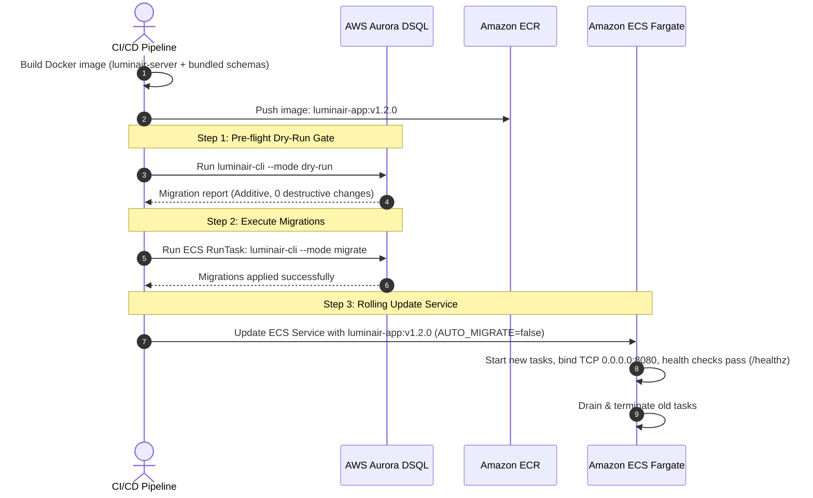
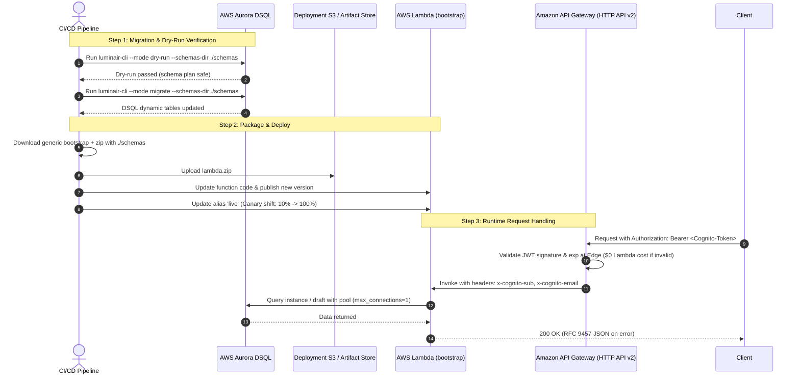
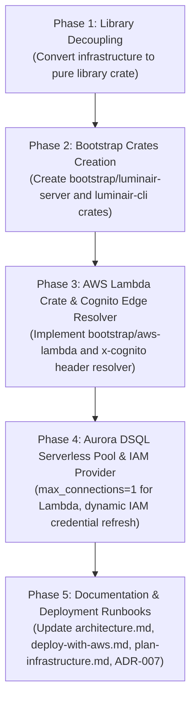

# Refactoring Plan: Dual-Target Deployment (Microservice & AWS Lambda) with Edge Cognito Auth and Bundled Schemas

- **Target Crates**: `infrastructure` (library extraction), `bootstrap/aws-lambda` (new crate), `bootstrap/luminair-server` (new crate), `bootstrap/luminair-cli` (new crate)
- **Governing Architecture**: [`docs/architecture.md`](../architecture.md), [`ADR-002`](../adr/ADR-002-hexagonal-architecture.md), [`ADR-003`](../adr/ADR-003-aws-dsql-database.md), [`ADR-006`](../adr/ADR-006-user-profile-and-directory-architecture.md)
- **Status**: Proposed (Specification & Implementation Plan)
- **Date**: 2026-11-11

---

## 1. Executive Summary & Objectives

The purpose of this refactoring is to enable the Luminair backend to be deployed in two first-class target environments from a single unified codebase:
1. **Standard Long-Running Microservice**: Runs as a persistent Linux daemon listening on a TCP socket (`luminair-server` using `axum::serve`) inside Docker, AWS ECS Fargate, Kubernetes, or EC2.
2. **Serverless AWS Lambda**: Runs as an event-driven function (`bootstrap` using `lambda_http`) on AWS Lambda (`provided.al2023`, `arm64` Graviton) fronted by Amazon API Gateway HTTP API (v2) and backed by Amazon Aurora DSQL.

### Core Architectural Directives
- **Zero Business Logic Modification**: Pure business domain ([`domain`](../../domain)) and application orchestration ([`application`](../../application)) crates remain 100% agnostic and untouched.
- **`bootstrap/` Directory of Independent Crates**: Group entrypoints under a `bootstrap/` folder containing 3 focused, independent binary crates (`bootstrap/aws-lambda`, `bootstrap/luminair-cli`, `bootstrap/luminair-server`), keeping dependencies completely isolated.
- **AWS Cognito Edge Authentication**: Offload JWT validation to Amazon API Gateway HTTP API (v2) at the AWS network edge. Unauthenticated requests are rejected with zero Lambda invocations ($0 compute cost). Valid requests pass verified claims (`sub`, `email`, `name`, `cognito:groups`) directly into Lambda without in-process RSA cryptography.
- **Pattern 1: Bundled Schemas per Project Artifact**: Luminair functions as a reusable, project-agnostic engine. Any project with custom JSON schemas bundles its own schemas inside its deployment artifact (`lambda.zip` or Docker image) with zero Rust code changes.
- **Strict Migration & Dry-Run Lifecycle Separation**: Hard-disable auto-migrations on Lambda cold starts. Provide deterministic, explicit `dry-run` and `migrate` CLI flows for both long-running and serverless deployments.

---

## 2. Architectural Decisions & Key Concepts

### Decision 1: Crate Layout — `bootstrap/` Directory with 3 Independent Crates

Currently, `infrastructure` is both a library of adapters and a binary containing CLI/server execution logic. To separate reusable adapters from platform-specific deployment runners with strict dependency isolation, the workspace is reorganized into library layers and entrypoint runners:

```text
luminair-system/
├── Cargo.toml                         # Workspace root
├── domain/                            # Pure domain entities, value objects, ports (unchanged)
├── application/                       # Pure use-cases, services (unchanged)
├── infrastructure/                    # Shared library of adapters (no [[bin]])
│   ├── src/
│   │   ├── api/                       # Axum Router, Handlers, DTOs, RFC 9457 middleware
│   │   ├── auth/                      # Auth resolver traits, Cognito claim extractors, service tokens
│   │   ├── persistence/               # SQLx, SeaQuery, Aurora DSQL pool, dynamic DDL sync
│   │   ├── schema_loader/             # Schema discovery & SystemContext assembly
│   │   ├── health.rs                  # Health checkers
│   │   ├── container.rs               # AppContainer composition root
│   │   └── lib.rs                     # Pure library root (main.rs removed)
│   └── Cargo.toml
│
└── bootstrap/                         # Execution entrypoints folder (3 independent crates)
    ├── aws-lambda/                    # AWS Lambda custom runtime crate
    │   ├── Cargo.toml                 # Dependencies: lambda_http, infrastructure, tokio, tracing
    │   └── src/
    │       └── main.rs                # Generates the 'bootstrap' binary required by AWS Lambda
    ├── luminair-cli/                  # Administrative & migration CLI crate
    │   ├── Cargo.toml                 # Dependencies: infrastructure, tokio, tracing (no HTTP/lambda deps)
    │   └── src/
    │       └── main.rs                # Generates the 'luminair-cli' binary (migrate, dry-run, validate)
    └── luminair-server/               # Long-running HTTP service daemon crate
        ├── Cargo.toml                 # Dependencies: infrastructure, tokio, tracing (no lambda deps)
        └── src/
            └── main.rs                # Generates the 'luminair-server' binary (axum::serve)
```

#### Workspace Members in Root `Cargo.toml`:
```toml
[workspace]
resolver = "2"
members = [
    "domain",
    "application",
    "infrastructure",
    "bootstrap/aws-lambda",
    "bootstrap/luminair-cli",
    "bootstrap/luminair-server",
]
```

#### Why 3 Independent Crates in `bootstrap/`:
1. **Total Dependency Isolation**:
   - `aws-lambda` pulls in `lambda_http`, but does NOT depend on CLI arg parsers or TCP daemon logic.
   - `luminair-server` pulls in Tokio TCP and signal handling, but does NOT depend on `lambda_http`.
   - `luminair-cli` is lean and only contains migration/validation runners, pulling in zero web-server or Lambda dependencies.
2. **Deterministic Build Targets**:
   - `cargo lambda build -p aws-lambda --release --arm64` directly produces the `bootstrap` executable for AWS Lambda (`provided.al2023`).
   - `cargo build -p luminair-server --release` produces the microservice server executable.
   - `cargo build -p luminair-cli --release` produces the CLI migration tool.
3. **No Feature-Flag Contamination**:
   Avoids complex Cargo feature unification issues that occur when gating dependencies inside a single crate.

---

### Decision 2: AWS Cognito Authentication at API Gateway Edge

#### Cost & Performance Penalty of In-Process JWT Validation in Lambda:
1. Every invocation spends CPU cycles computing `RS256` RSA signature checks, adding ~5–15ms of billable execution duration per request.
2. Unauthenticated or spam requests invoke Lambda sandboxes, racking up execution costs just to return `401 Unauthorized`.
3. Fetching and caching JWKS keys from Cognito over the network complicates cold-start predictability.

#### The Edge Solution: API Gateway HTTP API (v2) JWT Authorizer
1. Configure API Gateway HTTP API (v2) with a native JWT Authorizer pointing to the AWS Cognito User Pool.
2. API Gateway verifies `iss`, `aud`, `exp`, and RSA cryptographic signatures at the AWS edge network:
   - **Invalid/missing tokens**: Rejected immediately at the edge with `401 Unauthorized`. **Lambda is NOT invoked (Cost = $0)**.
   - **Valid tokens**: Injected with claims into `requestContext.authorizer.jwt.claims`.
3. **Parameter Mapping to Trusted Headers**:
   API Gateway is configured to map validated claims into HTTP headers sent to the integration:
   ```yaml
   ParameterMappings:
     - Header:
         Name: x-cognito-sub
         Value: $context.authorizer.jwt.claims.sub
     - Header:
         Name: x-cognito-email
         Value: $context.authorizer.jwt.claims.email
     - Header:
         Name: x-cognito-name
         Value: $context.authorizer.jwt.claims.name
     - Header:
         Name: x-cognito-groups
         Value: $context.authorizer.jwt.claims['cognito:groups']
   ```
4. **Hexagonal Auth Resolver (`CognitoEdgeAuthResolver`)**:
   In `infrastructure/src/auth/resolver.rs`, introduce an implementation of `AuthContextResolver` that reads the trusted `x-cognito-*` headers (or `RequestContext` extension):
   - Zero RSA cryptography in Lambda.
   - Directly maps `x-cognito-sub` into `UserId` and performs local role resolution (`user_role_assignments`) and profile synchronization ([`ADR-006`](../adr/ADR-006-user-profile-and-directory-architecture.md)).

---

### Decision 3: Pattern 1 — Bundled Schemas per Project Artifact

Luminair acts as a generic, headless content engine. Different projects define their own distinct domain schemas (e.g. Project 1: `article`, `category`; Project 2: `product`, `order`, `store`).

#### Bundling Strategy:
- The compiled `bootstrap` binary is completely generic and published as a reusable artifact (GitHub Releases, Amazon S3, or internal OCI registry).
- Each project repository maintains:
  ```text
  my-project-repo/
  ├── schemas/
  │   ├── system-config.json
  │   └── document-types/
  │       ├── product.json
  │       └── category.json
  ├── deploy/                  # Terraform / CDK / SAM descriptors
  └── Makefile / CI script
  ```
- **Packaging Phase**:
  The project build pipeline packages the generic `bootstrap` binary together with the project's local `schemas/` directory:
  ```text
  lambda.zip
  ├── bootstrap                # Generic executable (zero code changes)
  └── schemas/                 # Specific project schema definitions
      ├── system-config.json
      └── document-types/*.json
  ```
- **Runtime Discovery**:
  - `LUMINAIR_SCHEMA_DIR=/var/task/schemas` (for Lambda)
  - `LUMINAIR_SCHEMA_DIR=/app/config/schemas` (for Docker / ECS)
  - During the **INIT phase**, `load_system_context_from_dir` reads and validates the project's schemas in < 3ms, constructs `SystemContext`, and initializes the Axum router.

---

### Decision 4: Migration & Dry-Run Lifecycle in Both Environments

#### The Golden Rule: Never Run Dynamic Migrations on Lambda Cold Start
If 50 Lambda containers cold-start simultaneously during a traffic surge, running dynamic DDL migrations concurrently in 50 instances would cause severe database contention, lock failures, and invocation timeouts.

#### Environment Matrix:

| Mode | Microservice (Local Dev / Staging) | Microservice (Production ECS / K8s) | AWS Lambda (Serverless Production) |
|---|---|---|---|
| **Auto-Migrate on Boot** | Allowed (`LUMINAIR_AUTO_MIGRATE=true`) | **Disabled** (`LUMINAIR_AUTO_MIGRATE=false`) | **Forbidden** (`LUMINAIR_AUTO_MIGRATE=false`) |
| **Dry-Run Validation** | CLI command before push | CI/CD pipeline deployment gate | CI/CD pipeline deployment gate |
| **Migration Execution** | Automatic or manual CLI | Pre-deployment one-off ECS Task / K8s Job | Pre-deployment CI/CD runner or Migration Lambda |

---

## 3. End-to-End Execution & Deployment Flows

### Flow 1: Long-Running Microservice (Containers / ECS Fargate)



---

### Flow 2: AWS Lambda Serverless Flow (API Gateway + Cognito Edge)



---

## 4. Step-by-Step Refactoring Implementation Plan



---

### Phase 1: Library Decoupling (`infrastructure`)

- [ ] **Step 1.1: Remove `infrastructure/src/main.rs`**
  - Delete `infrastructure/src/main.rs`.
  - Ensure `infrastructure/src/lib.rs` exports all needed modules (`api`, `auth`, `persistence`, `schema_loader`, `container`, `health`, `cli`).
- [ ] **Step 1.2: Generalize `AppContainer` & `HttpState` Initialization**
  - Verify that `AppContainer` can accept pluggable auth resolvers:
    - `SqlxAuthResolver` (for in-process OIDC token validation in microservice mode)
    - `CognitoEdgeAuthResolver` (for API Gateway edge-verified requests in Lambda mode)

---

### Phase 2: Create `bootstrap/` Crates (`aws-lambda`, `luminair-cli`, `luminair-server`)

- [ ] **Step 2.1: Register Member Crates in Workspace Root `Cargo.toml`**
  ```toml
  members = [
      "domain",
      "application",
      "infrastructure",
      "bootstrap/aws-lambda",
      "bootstrap/luminair-cli",
      "bootstrap/luminair-server",
  ]
  ```
- [ ] **Step 2.2: Implement `bootstrap/luminair-server` Crate**
  - Create `bootstrap/luminair-server/Cargo.toml`:
    ```toml
    [package]
    name = "luminair-server"
    version.workspace = true
    edition.workspace = true

    [dependencies]
    domain = { workspace = true }
    application = { workspace = true }
    infrastructure = { workspace = true }
    tokio = { workspace = true }
    tracing = { workspace = true }
    tracing-subscriber = { workspace = true }
    ```
  - Create `bootstrap/luminair-server/src/main.rs`:
    - Reads environment configuration (`LUMINAIR_*`).
    - Loads schemas from `LUMINAIR_SCHEMA_DIR`.
    - Creates database pool (`max_connections = 20..50`).
    - Binds `tokio::net::TcpListener` and starts `axum::serve` with graceful shutdown.
- [ ] **Step 2.3: Implement `bootstrap/luminair-cli` Crate**
  - Create `bootstrap/luminair-cli/Cargo.toml`:
    ```toml
    [package]
    name = "luminair-cli"
    version.workspace = true
    edition.workspace = true

    [dependencies]
    domain = { workspace = true }
    application = { workspace = true }
    infrastructure = { workspace = true }
    tokio = { workspace = true }
    tracing = { workspace = true }
    tracing-subscriber = { workspace = true }
    ```
  - Create `bootstrap/luminair-cli/src/main.rs`:
    - Re-implements CLI runner commands (`dry-run`, `migrate`, `validate`).
    - Outputs reports in human-readable and JSON formats.

---

### Phase 3: Implement `bootstrap/aws-lambda` Crate & Cognito Edge Auth

- [ ] **Step 3.1: Implement `CognitoEdgeAuthResolver` (`infrastructure/src/auth/`)**
  - Implement `AuthContextResolver` for edge-authenticated requests.
  - Resolves `AuthenticatedUser` directly from incoming headers (`x-cognito-sub`, `x-cognito-email`, `x-cognito-name`).
  - Resolves `CallerContext` by checking database role assignments (`user_role_assignments`) and onboarding state.
  - Bypasses RSA signature check (already executed by API Gateway).
- [ ] **Step 3.2: Implement `bootstrap/aws-lambda` Crate**
  - Create `bootstrap/aws-lambda/Cargo.toml`:
    ```toml
    [package]
    name = "aws-lambda"
    version.workspace = true
    edition.workspace = true

    [[bin]]
    name = "bootstrap"
    path = "src/main.rs"

    [dependencies]
    domain = { workspace = true }
    application = { workspace = true }
    infrastructure = { workspace = true }
    tokio = { workspace = true }
    tracing = { workspace = true }
    tracing-subscriber = { workspace = true }
    lambda_http = { version = "0.14", default-features = false, features = ["apigw_http"] }
    ```
  - Create `bootstrap/aws-lambda/src/main.rs`:
    ```rust
    use std::sync::Arc;
    use lambda_http::{Error, run};
    use infrastructure::api::routes::build_router;
    use infrastructure::auth::CognitoEdgeAuthResolver;
    use infrastructure::container::AppContainer;
    use infrastructure::schema_loader::load_system_context_from_dir;
    use infrastructure::persistence::create_connection_pool;

    #[tokio::main]
    async fn main() -> Result<(), Error> {
        init_tracing();
        
        // 1. INIT Phase (executed once per Lambda container sandbox)
        let schema_dir = std::env::var("LUMINAIR_SCHEMA_DIR")
            .unwrap_or_else(|_| "/var/task/schemas".into());
        let context = load_system_context_from_dir(std::path::Path::new(&schema_dir))
            .expect("schema directory must be valid at cold start");
        
        let db_url = std::env::var("LUMINAIR_DATABASE_URL")
            .expect("LUMINAIR_DATABASE_URL is required");
        
        // Serverless connection pool: max_connections = 1
        let pool = create_connection_pool(&db_url, 1).await
            .expect("failed to connect to Aurora DSQL");
        
        let auth_resolver = Arc::new(CognitoEdgeAuthResolver::new(pool.clone()));
        let container = AppContainer::from_pool_and_context_with_resolver(pool, context, auth_resolver);
        let router = build_router(container.http_state());

        // 2. Invocation Loop
        run(router).await
    }
    ```
  ```

---

### Phase 4: Aurora DSQL Connection Factory & Dynamic IAM Refresh

- [ ] **Step 4.1: Background Dynamic IAM Token Refresh**
  - Extend [`infrastructure/src/persistence/connection.rs`](file:///Users/dmitri.astafiev/luminair/luminair-system/infrastructure/src/persistence/connection.rs) with an AWS SDK-backed token provider (`AwsSdkDsqlTokenProvider`).
  - Automatically regenerates Aurora DSQL IAM tokens prior to the 15-minute expiration window for warm containers and long-running daemons.
- [ ] **Step 4.2: Serverless Pool Sizing Safeguards**
  - In `create_connection_pool`, enforce that when running in a Lambda environment (detected via `AWS_LAMBDA_FUNCTION_NAME`), `max_connections` defaults to `1` (maximum `2`).

---

### Phase 5: Documentation Update Plan

The following project documents must be updated in tandem with the refactoring:

#### 1. [`docs/architecture.md`](../architecture.md)
- **Crate Layout Update**: Add `bootstrap` to the crate table and dependency diagram.
- **Dual Deployment Targets**: Document the microservice daemon vs. AWS Lambda event handler architecture.
- **Composition Root Clarity**: Document that `bootstrap/src/bin/` owns the composition roots for their respective platforms.

#### 2. [`docs/deploy-with-aws.md`](../deploy-with-aws.md)
- **Target A (ECS Fargate / Microservice)**: Containerized deployment runbook with `luminair-server`.
- **Target B (AWS Lambda Serverless)**:
  - Lambda custom runtime (`provided.al2023`, `arm64`) setup.
  - Amazon API Gateway HTTP API (v2) JWT Authorizer setup for AWS Cognito.
  - Parameter mappings for `x-cognito-*` headers.
- **Pattern 1: Bundled Schemas Runbook**: How separate projects zip their `./schemas` with the pre-built `bootstrap` binary.
- **Database Migration & Dry-Run Section**:
  - Detailed pre-deployment CI/CD commands for `luminair-cli --mode dry-run` and `luminair-cli --mode migrate`.
  - Explanation of why auto-migrations are prohibited on Lambda cold start.

#### 3. [`docs/plan-infrastructure.md`](../plan-infrastructure.md)
- Add **Phase 8: Dual-Target Deployment & `bootstrap` Crate Extraction**.
- Mark dependencies, tasks, and verification gates.

#### 4. New Architecture Decision Record: [`docs/adr/ADR-007-dual-target-deployment-lambda-and-microservice.md`](../adr/)
- Propose ADR-007 documenting deciders, context, alternatives considered (in-process auth vs edge auth; multi-tenant vs bundled schemas), and consequences.

---

## 5. Verification & Testing Strategy

1. **Unit & Spec Tests**:
   - `cargo test --workspace` must pass with zero failures.
   - Test `CognitoEdgeAuthResolver` with mocked request headers (`x-cognito-sub`, `x-cognito-email`).
2. **Local Lambda Simulation**:
   - Use `cargo lambda watch` or AWS SAM CLI (`sam local start-api`) to execute HTTP requests against `bootstrap` locally, verifying that API Gateway v2 payloads parse seamlessly into Axum routes.
3. **Microservice Regression Tests**:
   - Verify that existing integration test suites ([`infrastructure/tests/api_test.rs`](file:///Users/dmitri.astafiev/luminair/luminair-system/infrastructure/tests/api_test.rs) and [`infrastructure/tests/cli_test.rs`](file:///Users/dmitri.astafiev/luminair/luminair-system/infrastructure/tests/cli_test.rs)) continue to pass when invoking `luminair-server` and `luminair-cli`.
4. **Linting & Quality Gates**:
   - `cargo clippy --workspace --all-targets -- -D warnings` must produce zero warnings.
