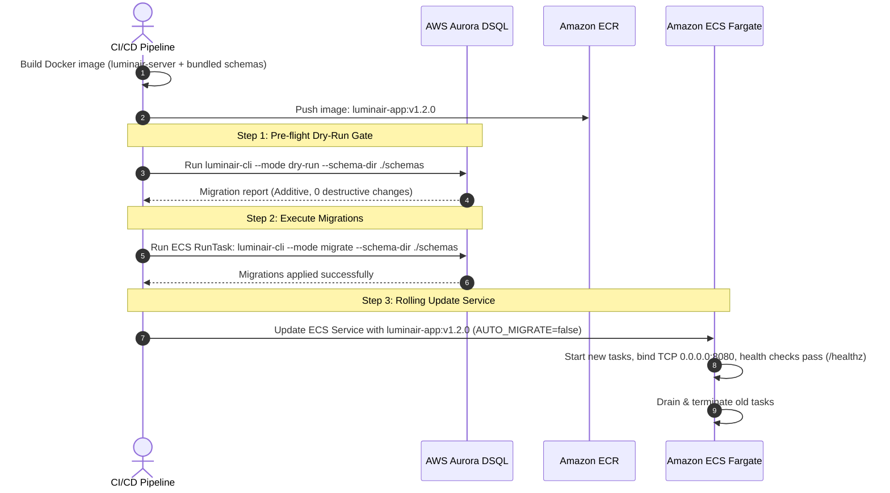
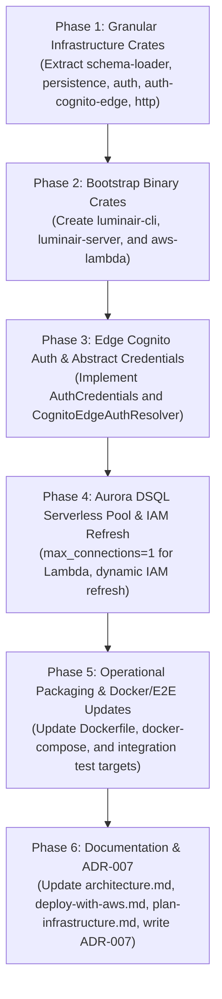

# Refactoring Plan: Dual-Target Deployment (Microservice & AWS Lambda) with Edge Cognito Auth and Granular Infrastructure Crates

- **Target Crates**:
  - `infrastructure/schema-loader` (granular crate)
  - `infrastructure/persistence` (granular crate)
  - `infrastructure/auth` (granular crate — in-process OIDC & service tokens)
  - `infrastructure/auth-cognito-edge` (granular crate — zero-cryptography edge claims)
  - `infrastructure/http` (granular crate — Axum REST driving adapter, extractors & composition root)
  - `bootstrap/aws-lambda` (new entrypoint binary crate)
  - `bootstrap/luminair-server` (new entrypoint binary crate)
  - `bootstrap/luminair-cli` (new entrypoint binary crate)
- **Governing Architecture**: [`docs/architecture.md`](../architecture.md), [`ADR-002`](../adr/ADR-002-hexagonal-architecture.md), [`ADR-003`](../adr/ADR-003-aws-dsql-database.md), [`ADR-006`](../adr/ADR-006-user-profile-and-directory-architecture.md)
- **Status**: Completed
- **Date**: 2026-11-12

---

## 1. Executive Summary & Objectives

The purpose of this refactoring is to enable the Luminair backend to be deployed in two first-class target environments from a single unified codebase:
1. **Standard Long-Running Microservice**: Runs as a persistent Linux daemon listening on a TCP socket (`luminair-server` using `axum::serve`) inside Docker, AWS ECS Fargate, Kubernetes, or EC2.
2. **Serverless AWS Lambda**: Runs as an event-driven function (`bootstrap` using `lambda_http`) on AWS Lambda (`provided.al2023`, `arm64` Graviton) fronted by Amazon API Gateway HTTP API (v2) and backed by Amazon Aurora DSQL.
3. **Lean Administrative & Migration CLI**: Runs as a standalone command-line executable (`luminair-cli`) for deterministic pre-deployment schema validation, offline dry-run inspection, and dynamic database migrations.

### Core Architectural Directives
- **Zero Business Logic Modification**: Pure business domain ([`domain`](../../domain)) and application orchestration ([`application`](../../application)) crates remain 100% agnostic and untouched.
- **Granular `infrastructure/` Layered Adapter Crates (Approach 1.A)**: Split monolithic `infrastructure` into five focused, single-responsibility adapter crates (`schema-loader`, `persistence`, `auth`, `auth-cognito-edge`, `http`). `luminair-cli` depends only on `persistence` and `schema-loader`, pulling in zero web-server or Lambda dependencies. `aws-lambda` pulls in zero CLI or in-process RSA/JWKS dependencies.
- **AWS Cognito Edge Authentication with Decoupled Credentials (Approach 2.A)**: Offload JWT validation to Amazon API Gateway HTTP API (v2) at the AWS network edge. Unauthenticated requests are rejected at the edge with zero Lambda invocations ($0 compute cost). Valid requests pass claims via parameter-mapped headers into an abstracted `AuthCredentials` model, eliminating in-process RSA cryptography in Lambda.
- **Monomorphized Composition Root with RPITIT (Approach 3.A)**: Retain modern Rust Return-Position Impl Trait in Trait (`impl Future<Output = ...> + Send`) without dynamic heap allocation (`dyn Trait`), making `AppContainer<Auth>` and `HttpState` generic over `Auth: AuthContextResolver`.
- **Strict ADR-006 Conformance for User Profiles (Approach 4.A)**: `CognitoEdgeAuthResolver` is 100% read-only. Profile synchronization is decoupled from the hot-path request pipeline, protecting Amazon Aurora DSQL from Optimistic Concurrency Control (`40001` OCC) write conflicts.
- **Dynamic Aurora DSQL IAM Refresh & Serverless Sizing (Approach 5.A)**: Implement dynamic AWS SDK IAM token refresh within `max_lifetime <= 10m` pools, and enforce serverless pool sizing (`max_connections = 1`) on AWS Lambda.
- **Pattern 1: Bundled Schemas per Project Artifact**: Luminair functions as a reusable, project-agnostic engine. Any project with custom JSON schemas bundles its own schemas inside its deployment artifact (`lambda.zip` or Docker image) with zero Rust code changes.
- **Strict Migration & Dry-Run Lifecycle Separation**: Hard-disable dynamic migrations on Lambda cold starts. Provide deterministic, explicit `dry-run` and `migrate` CLI flows for both long-running and serverless deployments.

---

## 2. Architectural Decisions & Key Concepts

### Decision 1: Crate Layout — Granular `infrastructure/` & Isolated `bootstrap/`

Monolithic `infrastructure` is decomposed into cohesive adapter crates under `infrastructure/` and platform entrypoints under `bootstrap/`:

```text
luminair-system/
├── Cargo.toml                              # Workspace root manifest
├── domain/                                 # Pure domain entities, value objects, ports (unchanged)
├── application/                            # Pure use-cases, services (unchanged)
│
├── infrastructure/                         # Adapter layer (focused library crates)
│   ├── schema-loader/                      # Schema disk walker, validation & SystemContext assembly
│   │   ├── Cargo.toml                      # Deps: domain, serde, serde_json, indexmap
│   │   └── src/
│   ├── persistence/                        # Database adapters, SeaQuery, SQLx, DSQL connection factory
│   │   ├── Cargo.toml                      # Deps: domain, application, schema-loader, sqlx, sea-query
│   │   ├── migrations/                     # Embedded static migrations (-- no-transaction)
│   │   └── src/
│   ├── auth/                               # In-process OIDC validator, JWKS client & Service Tokens
│   │   ├── Cargo.toml                      # Deps: domain, application, persistence, jsonwebtoken, reqwest
│   │   └── src/
│   ├── auth-cognito-edge/                  # Edge-authenticated claims resolver (zero cryptography)
│   │   ├── Cargo.toml                      # Deps: domain, application, persistence (no jsonwebtoken/reqwest!)
│   │   └── src/
│   └── http/                               # Axum router, REST routes, handlers, DTO codecs, ProblemDetails
│       ├── Cargo.toml                      # Deps: domain, application, schema-loader, persistence, axum
│       └── src/
│
└── bootstrap/                              # Platform execution entrypoints
    ├── aws-lambda/                         # AWS Lambda custom runtime
    │   ├── Cargo.toml                      # Deps: http, persistence, auth-cognito-edge, schema-loader, lambda_http
    │   └── src/main.rs                     # Produces 'bootstrap' binary for provided.al2023 (arm64)
    ├── luminair-server/                    # Long-running HTTP service daemon
    │   ├── Cargo.toml                      # Deps: http, persistence, auth, schema-loader, tokio
    │   └── src/main.rs                     # Produces 'luminair-server' binary (axum::serve + graceful shutdown)
    └── luminair-cli/                       # Administrative & migration CLI
        ├── Cargo.toml                      # Deps: persistence, schema-loader, tokio (ZERO Axum/Lambda deps!)
        └── src/main.rs                     # Produces 'luminair-cli' binary (validate, dry-run, migrate)
```

#### Workspace Members in Root `Cargo.toml`:
```toml
[workspace]
resolver = "2"
members = [
    "domain",
    "application",
    "infrastructure/schema-loader",
    "infrastructure/persistence",
    "infrastructure/auth",
    "infrastructure/auth-cognito-edge",
    "infrastructure/http",
    "bootstrap/aws-lambda",
    "bootstrap/luminair-cli",
    "bootstrap/luminair-server",
]

[workspace.dependencies]
# Workspace crates
domain = { path = "domain" }
application = { path = "application" }
luminair-schema-loader = { path = "infrastructure/schema-loader" }
luminair-persistence = { path = "infrastructure/persistence" }
luminair-auth = { path = "infrastructure/auth" }
luminair-auth-cognito-edge = { path = "infrastructure/auth-cognito-edge" }
luminair-http = { path = "infrastructure/http" }
```

#### Architectural Advantages:
1. **True Dependency Isolation**:
   - `bootstrap/luminair-cli` does not pull in `axum`, `reqwest`, `jsonwebtoken`, or `lambda_http`. It compiles in a fraction of the time and has zero attack surface from web dependencies.
   - `bootstrap/aws-lambda` does not compile CLI argument parsers, TCP daemon machinery, or in-process RSA/JWKS validation code.
   - `bootstrap/luminair-server` compiles standard microservice components with in-process OIDC and graceful TCP shutdown.
2. **Minimal Lambda Cold Starts & Artifact Size**:
   - The compiled `bootstrap` binary contains only the Axum HTTP routing layer, lightweight Edge claim extraction, database repositories, and `lambda_http` runner.

---

### Decision 2: AWS Cognito Edge Authentication with Decoupled Credentials

#### The Cost & Cold-Start Penalty of In-Process JWT Validation in Lambda:
1. Every invocation spends CPU cycles computing `RS256` RSA signature checks, adding ~5–15ms of billable execution duration per request.
2. Unauthenticated or spam requests invoke Lambda sandboxes, racking up execution costs just to return `401 Unauthorized`.
3. Fetching and caching JWKS keys from Cognito over the network complicates cold-start latency and sandbox recycling.

#### The Edge Solution: API Gateway HTTP API (v2) JWT Authorizer + Parameter Mapping:
1. API Gateway HTTP API (v2) is configured with a native JWT Authorizer pointing to the AWS Cognito User Pool.
2. API Gateway verifies `iss`, `aud`, `exp`, and RSA cryptographic signatures at the AWS edge network:
   - **Invalid/missing tokens**: Rejected immediately at the edge with `401 Unauthorized`. **Lambda is NOT invoked (Cost = $0)**.
   - **Valid tokens**: Parameter mappings securely overwrite trusted HTTP headers:
     ```yaml
     ParameterMappings:
       - Header:
           Name: x-cognito-sub
           Value: $context.authorizer.jwt.claims.sub
       - Header:
           Name: x-cognito-email
           Value: $context.authorizer.jwt.claims.email
       - Header:
           Name: x-cognito-name
           Value: $context.authorizer.jwt.claims.name
     ```
   - **Spoofing Prevention**: Parameter mappings explicitly overwrite any client-supplied headers. An attacker sending a spoofed `x-cognito-sub` header will have it replaced by API Gateway with the verified token claim or rejected.

#### Transport-Agnostic Credential Model (`AuthCredentials`):
To prevent HTTP transport details from leaking into domain/application ports, define an `AuthCredentials` enum in `infrastructure/http`:

```rust
pub enum AuthCredentials<'a> {
    /// In-process token validation (Bearer JWT or Service Token)
    BearerToken(&'a str),
    /// Verified edge claims injected by API Gateway
    EdgeCognito {
        user_id: &'a str,
        email: Option<&'a str>,
        name: Option<&'a str>,
    },
}

pub trait AuthContextResolver: Send + Sync + 'static {
    fn resolve_user_identity(
        &self,
        credentials: AuthCredentials<'_>,
    ) -> impl Future<Output = Result<AuthenticatedUser, AuthResolutionError>> + Send;

    fn resolve_caller(
        &self,
        credentials: AuthCredentials<'_>,
    ) -> impl Future<Output = Result<CallerContext, AuthResolutionError>> + Send;
}
```

Axum extractors (`Caller`, `OnboardingUser`) inspect incoming request parts:
- If `x-cognito-sub` is present $\rightarrow$ constructs `AuthCredentials::EdgeCognito`.
- Else if `Authorization: Bearer <token>` is present $\rightarrow$ constructs `AuthCredentials::BearerToken`.
- Otherwise $\rightarrow$ yields `AuthError::MissingToken`.

---

### Decision 3: Monomorphized Composition Root (`AppContainer<Auth>`) with RPITIT

Per `.ai/skills/backend/rust-patterns.md`, async trait methods in repository and auth ports use Return-Position Impl Trait in Trait (RPITIT):
```rust
fn resolve_caller(&self, ...) -> impl Future<Output = Result<CallerContext, AuthResolutionError>> + Send;
```
RPITIT traits are **non-dyn-compatible** (not object-safe in modern Rust). Rather than boxing futures (`Pin<Box<dyn Future...>>`) on every request, `AppContainer` and `HttpState` use **monomorphized static dispatch**:

```rust
pub struct AppContainer<Auth> {
    pub context: &'static SystemContext,
    pub auth_resolver: Arc<Auth>,
    pub documents_service: Arc<DocumentsServiceImpl<SqlxDocumentInstanceRepository, SqlxDocumentSnapshotRepository>>,
    pub access_requests_service: Arc<AccessRequestsServiceImpl<SqlxAccessRequestRepository, SqlxUserRoleAssignmentRepository, SqlxRoleRepository>>,
    pub user_directory_service: Arc<UserDirectoryServiceImpl<SqlxUserProfileRepository>>,
    pub schema_service: Arc<SchemaServiceImpl>,
    pub system_config_service: Arc<SystemConfigServiceImpl>,
    pub health_checker: Arc<SqlxHealthChecker>,
}

impl<Auth: AuthContextResolver> AppContainer<Auth> {
    pub fn new(
        pool: PgPool,
        context: &'static SystemContext,
        auth_resolver: Arc<Auth>,
    ) -> Self { ... }

    pub fn http_state(&self) -> HttpState<..., Auth, ...> { ... }
}
```

- In `bootstrap/luminair-server`: instantiates `AppContainer::new(pool, context, Arc::new(SqlxAuthResolver::new(...)))`.
- In `bootstrap/aws-lambda`: instantiates `AppContainer::new(pool, context, Arc::new(CognitoEdgeAuthResolver::new(pool.clone())))`.
- **Result**: Zero dynamic vtable dispatch, zero premature heap allocations, 100% type-safe compilation.

---

### Decision 4: ADR-006 Conformance for User Profile Synchronization

Per [`ADR-006`](../adr/ADR-006-user-profile-and-directory-architecture.md), Amazon Aurora DSQL is protected against Optimistic Concurrency Control (`40001` OCC) write amplification:
- **`CognitoEdgeAuthResolver` is Strictly Read-Only**:
  1. Resolves `UserId::try_new(sub)`.
  2. Queries `user_role_assignments` by user ID.
  3. If no assignments exist, queries `access_requests` to determine onboarding status (`access_not_requested`, `access_pending`, `access_rejected`).
  4. Resolves assigned `Role` records.
  5. **Zero writes to `user_profiles` are performed during request authentication.**
- **Profile Synchronization Lifecycle**:
  - Profiles are synchronized when an authenticated user logs into the Admin Studio via `POST /api/v1/auth/profile/sync` (`UserDirectoryService::sync_profile`).
  - Profiles are atomically created/updated when submitting an initial access request (`POST /api/v1/auth/access-requests`).

---

### Decision 5: Aurora DSQL Connection Factory & Serverless Sizing

#### Dynamic IAM Token Refresh (Within 15-Minute Expiry):
1. Aurora DSQL IAM DB authentication tokens expire after 15 minutes.
2. `infrastructure/persistence/src/connection.rs` configures `PgPoolOptions` with:
   - `max_lifetime = Some(Duration::from_secs(10 * 60))` (10 minutes).
   - `idle_timeout = Some(Duration::from_secs(5 * 60))` (5 minutes).
3. A dynamic `DsqlTokenProvider` generates refreshed tokens using AWS SDK SigV4 credentials. When connections are recycled, new connections acquire fresh IAM credentials.

#### Serverless Pool Sizing:
- In container / microservice mode (`luminair-server`), `max_connections` defaults to `20..50`.
- In Lambda mode (`aws-lambda`), `max_connections` defaults to `1` (maximum `2`). Since AWS Lambda scales horizontally by adding concurrent execution sandboxes, keeping each sandbox at 1 connection prevents connection pool exhaustion at the database layer.

---

### Decision 6: Pattern 1 — Bundled Schemas per Project Artifact

Luminair acts as a generic, headless content engine. Projects define custom schemas in JSON without modifying Rust source code.

#### Bundling Strategy:
- The compiled `bootstrap` binary is completely generic and published as a reusable artifact (GitHub Releases, Amazon S3, or OCI registry).
- Each project repository maintains:
  ```text
  my-project-repo/
  ├── schemas/
  │   ├── system-config.json
  │   └── document-types/
  │       ├── article.json
  │       └── category.json
  ├── deploy/                  # Terraform / CDK / SAM descriptors
  └── Makefile / CI script
  ```
- **Packaging Phase**:
  The project build pipeline packages the generic `bootstrap` binary together with the project's local `schemas/` directory:
  ```text
  lambda.zip
  ├── bootstrap                # Generic executable (zero code changes)
  └── schemas/                 # Specific project schema definitions
      ├── system-config.json
      └── document-types/*.json
  ```
- **Runtime Discovery**:
  - `LUMINAIR_SCHEMA_DIR=/var/task/schemas` (for Lambda)
  - `LUMINAIR_SCHEMA_DIR=/app/config/schemas` (for Docker / ECS)
  - During the **INIT phase**, `load_system_context_from_dir` reads and validates the project's schemas in < 3ms, constructs `SystemContext`, and initializes the Axum router.

---

### Decision 7: Strict Migration & Dry-Run Lifecycle Separation

#### The Golden Rule: Never Run Dynamic Migrations on Lambda Cold Start
If 50 Lambda containers cold-start simultaneously during a traffic surge, running dynamic DDL migrations concurrently in 50 instances would cause severe database contention, lock failures, and invocation timeouts.

#### Environment Matrix:

| Mode | Microservice (Local Dev / Staging) | Microservice (Production ECS / K8s) | AWS Lambda (Serverless Production) |
|---|---|---|---|
| **Auto-Migrate on Boot** | Allowed (`LUMINAIR_AUTO_MIGRATE=true`) | **Disabled** (`LUMINAIR_AUTO_MIGRATE=false`) | **Forbidden** (`LUMINAIR_AUTO_MIGRATE=false`) |
| **Dry-Run Validation** | CLI command before push | CI/CD pipeline deployment gate | CI/CD pipeline deployment gate |
| **Migration Execution** | Automatic or manual CLI | Pre-deployment one-off ECS Task / K8s Job | Pre-deployment CI/CD runner or Migration Lambda |

---

## 3. End-to-End Execution & Deployment Flows

### Flow 1: Long-Running Microservice (Containers / ECS Fargate)



---

### Flow 2: AWS Lambda Serverless Flow (API Gateway + Cognito Edge)


---

## 4. Step-by-Step Refactoring Implementation Plan



---

### Phase 1: Granular Infrastructure Crates (`infrastructure/*`)

- [x] **Step 1.1: Extract `infrastructure/schema-loader` Crate**
  - Create `infrastructure/schema-loader/Cargo.toml` with dependencies: `domain`, `serde`, `serde_json`, `indexmap`, `thiserror`.
  - Move `dto.rs`, `error.rs`, and `loader.rs` from `infrastructure/src/schema_loader/` into `infrastructure/schema-loader/src/`.
  - Expose `pub use loader::{load_schemas_from_dir, load_system_context_from_dir};`.
- [x] **Step 1.2: Extract `infrastructure/persistence` Crate**
  - Create `infrastructure/persistence/Cargo.toml` with dependencies: `domain`, `application`, `luminair-schema-loader`, `sqlx`, `sea-query`, `sea-query-sqlx`, `tokio`, `uuid`, `chrono`, `rust_decimal`, `tracing`.
  - Move `naming/`, `migration/`, `query/`, `repositories/`, `connection.rs`, and `error.rs` from `infrastructure/src/persistence/` into `infrastructure/persistence/src/`.
  - Expose public repositories (`SqlxDocumentInstanceRepository`, `SqlxRoleRepository`, etc.), connection factory (`create_connection_pool`), and migrations (`run_static_migrations`, `sync_dynamic_schemas`).
- [x] **Step 1.3: Extract `infrastructure/auth` Crate (In-Process OIDC)**
  - Create `infrastructure/auth/Cargo.toml` with dependencies: `domain`, `application`, `luminair-persistence`, `jsonwebtoken`, `reqwest`, `serde`, `serde_json`, `thiserror`, `tracing`.
  - Move in-process JWT validation (`oidc.rs`), JWKS fetching, `ServiceTokenRegistry`, and `SqlxAuthResolver` into `infrastructure/auth/src/`.
- [x] **Step 1.4: Extract `infrastructure/auth-cognito-edge` Crate**
  - Create `infrastructure/auth-cognito-edge/Cargo.toml` with dependencies: `domain`, `application`, `luminair-persistence`, `thiserror`, `tracing`. (Zero RSA, zero JWKS, zero `jsonwebtoken` dependencies).
  - Implement `CognitoEdgeAuthResolver` querying `user_role_assignments` and `access_requests` without in-process cryptography.
- [x] **Step 1.5: Extract `infrastructure/http` Crate**
  - Create `infrastructure/http/Cargo.toml` with dependencies: `domain`, `application`, `luminair-schema-loader`, `luminair-persistence`, `axum`, `serde`, `serde_json`, `thiserror`, `tracing`.
  - Move `routes.rs`, `handlers/`, `middleware.rs`, `error.rs`, `envelope.rs`, `extractors/`, `codec/`, and generic `HttpState` into `infrastructure/http/src/`.
  - Define `AuthCredentials<'a>` enum and update `Caller` / `OnboardingUser` extractors.
  - Implement generic composition root: `AppContainer<Auth: AuthContextResolver>`.

---

### Phase 2: Create `bootstrap/` Binary Crates

- [x] **Step 2.1: Register Member Crates in Workspace Root `Cargo.toml`**
  - Register all five `infrastructure/*` crates and three `bootstrap/*` crates.
  - Add workspace dependency aliases (`luminair-schema-loader`, `luminair-persistence`, `luminair-auth`, `luminair-auth-cognito-edge`, `luminair-http`).
- [x] **Step 2.2: Implement `bootstrap/luminair-cli` Crate**
  - Create `bootstrap/luminair-cli/Cargo.toml` (depends only on `domain`, `application`, `luminair-schema-loader`, `luminair-persistence`, `tokio`, `tracing`, `tracing-subscriber`).
  - Move CLI configuration, runner, and reports (`validate`, `dry-run`, `migrate`) into `bootstrap/luminair-cli/src/`.
  - Confirm binary contains **zero** HTTP or Lambda dependencies.
- [x] **Step 2.3: Implement `bootstrap/luminair-server` Crate**
  - Create `bootstrap/luminair-server/Cargo.toml` (depends on `domain`, `application`, `luminair-schema-loader`, `luminair-persistence`, `luminair-auth`, `luminair-http`, `tokio`, `tracing`, `tracing-subscriber`).
  - Implement server startup in `main.rs`:
    - Reads `LUMINAIR_*` environment variables.
    - Loads schemas via `load_system_context_from_dir`.
    - Builds `SqlxAuthResolver` with OIDC validator / service tokens.
    - Creates database pool (`max_connections = 20..50`).
    - Assembles `AppContainer::new(pool, context, auth_resolver)` and builds Axum router.
    - Binds `tokio::net::TcpListener` and starts `axum::serve` with graceful `SIGINT`/`SIGTERM` shutdown.
- [x] **Step 2.4: Implement `bootstrap/aws-lambda` Crate**
  - Create `bootstrap/aws-lambda/Cargo.toml`:
    ```toml
    [package]
    name = "aws-lambda"
    version.workspace = true
    edition.workspace = true

    [[bin]]
    name = "bootstrap"
    path = "src/main.rs"

    [dependencies]
    domain = { workspace = true }
    application = { workspace = true }
    luminair-schema-loader = { workspace = true }
    luminair-persistence = { workspace = true }
    luminair-auth-cognito-edge = { workspace = true }
    luminair-http = { workspace = true }
    tokio = { workspace = true }
    tracing = { workspace = true }
    tracing-subscriber = { workspace = true }
    lambda_http = { version = "0.14", default-features = false, features = ["apigw_http"] }
    ```
  - Implement Lambda entrypoint in `bootstrap/aws-lambda/src/main.rs`:
    ```rust
    use std::sync::Arc;
    use lambda_http::{Error, run};
    use luminair_auth_cognito_edge::CognitoEdgeAuthResolver;
    use luminair_http::container::AppContainer;
    use luminair_http::routes::build_router;
    use luminair_persistence::create_connection_pool;
    use luminair_schema_loader::load_system_context_from_dir;

    #[tokio::main]
    async fn main() -> Result<(), Error> {
        init_tracing();

        // 1. INIT Phase (executed once per Lambda sandbox)
        let schema_dir = std::env::var("LUMINAIR_SCHEMA_DIR")
            .unwrap_or_else(|_| "/var/task/schemas".into());
        let context = load_system_context_from_dir(std::path::Path::new(&schema_dir))
            .expect("schema directory must be valid at cold start");

        let db_url = std::env::var("LUMINAIR_DATABASE_URL")
            .expect("LUMINAIR_DATABASE_URL is required");

        // Serverless connection pool: max_connections = 1
        let pool = create_connection_pool(&db_url, 1).await
            .expect("failed to connect to Aurora DSQL");

        let auth_resolver = Arc::new(CognitoEdgeAuthResolver::new(pool.clone()));
        let container = AppContainer::new(pool, context, auth_resolver);
        let router = build_router(container.http_state());

        // 2. Invocation Loop
        run(router).await
    }
    ```

---

### Phase 3: Edge Cognito Auth & Abstract Credentials

- [x] **Step 3.1: Implement `AuthCredentials` & Update Extractor**
  - In `infrastructure/http/src/extractors/auth.rs`, map `x-cognito-sub`, `x-cognito-email`, and `x-cognito-name` into `AuthCredentials::EdgeCognito`.
  - Fall back to `Authorization: Bearer <token>` into `AuthCredentials::BearerToken`.
- [x] **Step 3.2: Implement `CognitoEdgeAuthResolver`**
  - In `infrastructure/auth-cognito-edge/src/lib.rs`, implement `AuthContextResolver` for `CognitoEdgeAuthResolver`.
  - Read-only lookup for `UserId` role assignments and onboarding status.
  - Return `AuthResolutionError::Auth(AuthError::MissingToken)` if `EdgeCognito` credentials are not present or `user_id` is blank.

---

### Phase 4: Aurora DSQL Serverless Pool & IAM Refresh

- [x] **Step 4.1: Background Dynamic IAM Token Refresh**
  - Extend `infrastructure/persistence/src/connection.rs` with an AWS SDK-backed token provider (`AwsSdkDsqlTokenProvider`).
  - Automatically regenerates Aurora DSQL IAM tokens prior to the 15-minute expiration window using `max_lifetime = Duration::from_secs(600)`.
- [x] **Step 4.2: Serverless Pool Sizing Safeguards**
  - In `create_connection_pool`, enforce that when running in a Lambda environment (detected via `AWS_LAMBDA_FUNCTION_NAME`), `max_connections` defaults to `1` (maximum `2`).

---

### Phase 5: Operational Packaging, Docker & Tests

- [x] **Step 5.1: Update `Dockerfile` for Dual Binaries**
  - Update multi-stage Docker build to compile `luminair-cli` and `luminair-server`:
    ```dockerfile
    RUN cargo build --release -p luminair-cli -p luminair-server
    ```
  - Copy both binaries to `/usr/local/bin/`.
- [x] **Step 5.2: Update `docker-compose.yml`**
  - Update `luminair-server` service to invoke `luminair-server`.
  - Update `cli-validate`, `cli-dry-run`, and `cli-migrate` to invoke `luminair-cli`.
- [x] **Step 5.3: Update Integration & E2E Tests**
  - Update `infrastructure/tests/cli_test.rs` to target `luminair-cli`.
  - Update `infrastructure/tests/e2e_service_test.rs` to target `luminair-server`.

---

### Phase 6: Documentation & ADR-007

- [x] **Step 6.1: Update [`docs/architecture.md`](../architecture.md)**
  - Reflect granular `infrastructure/*` adapter crates and `bootstrap/*` entrypoints.
  - Document dual deployment targets (container microservice vs. AWS Lambda serverless).
- [x] **Step 6.2: Update [`docs/deploy-with-aws.md`](../deploy-with-aws.md)**
  - Document Amazon API Gateway HTTP API (v2) JWT Authorizer setup for AWS Cognito.
  - Document parameter mappings for `x-cognito-*` headers.
  - Document serverless deployment commands (`cargo lambda build -p aws-lambda --release --arm64`).
- [x] **Step 6.3: Update [`docs/plan-infrastructure.md`](../plan-infrastructure.md)**
  - Add Phase 8: Dual-Target Deployment & Granular Crate Refactoring.
- [x] **Step 6.4: Author [`docs/adr/ADR-007-dual-target-deployment-lambda-and-microservice.md`](../adr/ADR-007-dual-target-deployment-lambda-and-microservice.md)**
  - Document context, evaluated alternatives, decision, consequences, and approval record.

---

## 5. Verification & Testing Strategy

1. **Unit & Spec Tests**:
   - `cargo test --workspace` must pass with zero failures.
   - Test `CognitoEdgeAuthResolver` with mocked `AuthCredentials::EdgeCognito`.
2. **Local Lambda Simulation**:
   - Use `cargo lambda watch` or AWS SAM CLI (`sam local start-api`) to execute HTTP requests against `bootstrap` locally, verifying that API Gateway v2 payloads parse seamlessly into Axum routes.
3. **Microservice Regression Tests**:
   - Verify that CLI tests (`luminair-cli`) and E2E service tests (`luminair-server`) pass cleanly with Docker/PostgreSQL.
4. **Linting & Quality Gates**:
   - `cargo clippy --workspace --all-targets -- -D warnings` must produce zero warnings.
